# User guide

Using SprintTicker day to day.

Installation is in the [README](../README.md#-installation). This picks up from
first launch.

  

| | |
| :--- | :--- |
| 🏁 [First run](#-first-run) | the first run -- your account, your desk, your day |
| 🗂️ [The window](#-the-window) | its four places -- Today, Tasks, History, Settings -- the header, the mini timer, the tray and the shortcuts |
| 💡 [The bar itself](#-the-bar-itself) | every screen the bar shows, and its buttons |
| 🎹 [A Stream Deck](#-a-stream-deck) | the session on keys you place yourself |
| 🩺 [Troubleshooting](#-troubleshooting) | when something does not do what it should |
| 🔐 [Your data](#-your-data) | where it lives, and what leaves your machine |

---

## 🏁 First run

The first run opens on its own at the first launch -- three steps, each
optional. **Settings › General › Run setup** opens it again.

  
  

**1️⃣ Where are your tasks?** Jira, OpenProject, or no account at all:

| Choice | What it needs |
| :--- | :--- |
| 🟦 Jira | Your site, your email, and an API token -- **make one ↗** opens Atlassian's page for it |
| 🔷 OpenProject | Your server's address and an API key -- **make one ↗** opens your account's page on that server |
| 📝 No account | Nothing -- your own tasks only, and their time stays on this computer; the app then names your provider *This computer* |

**Test connection** tries what you typed without saving it, and says who you
are -- *Connected as Alex Moreau · 15 projects* -- or exactly what went wrong:
an address that does not exist (*studio.atlasian.net was not found*), a token
Jira refused (with **Make a new one ↗**), or no network. Then one question:
when you start a task, should SprintTicker move it to In Progress and make it
yours once it has run two minutes? With Jira or OpenProject, **Continue**
waits until Test connection has passed, and says so beside it; it saves the
account, and nothing is saved before it. **Set up later** goes straight to Today -- connect an
account any time in **Settings › Account**.

**2️⃣ What's on your desk?** A BUSY Bar and a Stream Deck, both optional.
Only what SprintTicker finds starts ticked: a bar answering on USB, Stream
Deck installed on this computer. A bar on Wi-Fi: tick it, **Mine is on
Wi-Fi**, and type its address. **Install the plugin** opens the Stream Deck
plugin that comes with SprintTicker, so Stream Deck asks to install it; the
line turns green once a deck connects. **I have neither** runs SprintTicker
without a bar (see [Without a BUSY Bar](#-without-a-busy-bar)); add one later
in **Settings › Desk devices**.

Developing without a bar but wanting to see what it would show? Run
`pnpm dev:mock` (or launch with `--mock-hardware`) and the on-screen emulator
shows what the device would display.

**3️⃣ Your day.** Your working days, the stand-up's time and the task it is
timed on, lunch, and the end of your day, all filled in already, and how
SprintTicker works in four sentences. **Start my first task** saves them and
opens the picker on Today.

### 💻 Without a BUSY Bar

<table>
  <tr>
    <th width="50%">🟢 With a bar</th>
    <th width="50%">💻 Without one</th>
  </tr>
  <tr>
    <td></td>
    <td>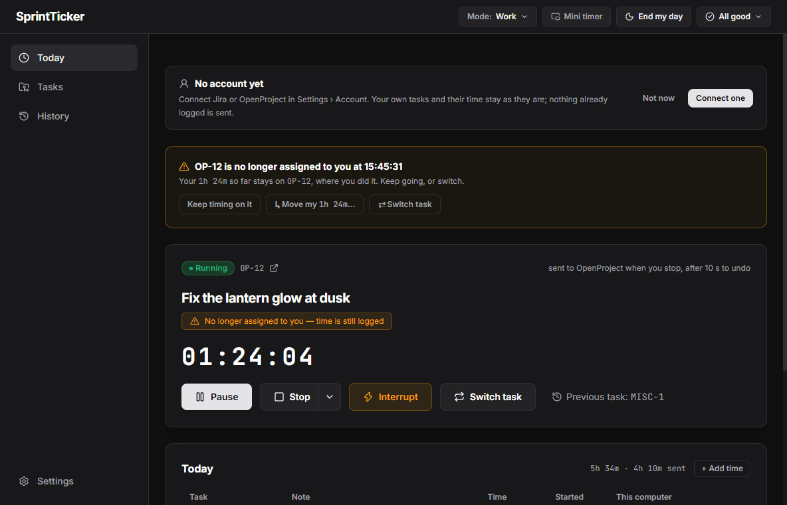</td>
  </tr>
  <tr>
    <td>The four places; the bar's preview in the header.</td>
    <td>The same four places; everything that keeps time is still there.</td>
  </tr>
</table>

Everything that keeps time works without the hardware: the task picker, the
running timer, pausing, stopping, sending your time, History, the stand-up,
lunch and End my day. The window keeps its four places; what steps aside is
what only describes the bar -- the bar's preview in the header, and in
**Settings, Desk devices** the Windows notifications it mirrors and **What the
bar shows first**, which orders its screen and nothing else. Notifications
*from* OpenProject or Jira still arrive, as Windows notifications; their
settings are in **Settings, Account**. The Windows notification listener does
not run in this mode.

The app does not look for a bar in this mode, so it logs nothing about one being
unreachable.

  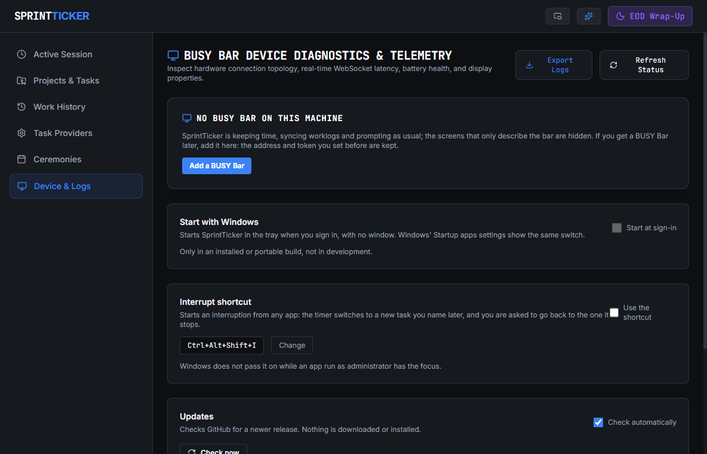

To switch, use **Use without a bar** in **Settings, Desk devices**; the bar is
cleared and handed back to its own clock first. To add a bar later,
press **Add** on its one line in the same place: the address and token you had set
before are kept, and the bar's screens come back at once.

---

## 🗂️ The window

Four places down the left: **Today**, **Tasks** and **History**, and
**Settings** at the bottom. They are the same with or without a bar. A ⚡
beside Today counts the interruptions you have not placed on a task yet.

⌨️ Everything works from the keyboard. Escape closes any dialog or menu and
puts you back on the button that opened it; the arrow keys move in a menu.
Closing the window keeps SprintTicker running in the tray, and four
shortcuts work from any app: see [the tray and the shortcuts](#-the-tray-closing-the-window-and-the-shortcuts).
🔍 **Ctrl+=** and **Ctrl+-** (or Ctrl and the mouse wheel) make the window's
text larger or smaller; **Ctrl+0** puts it back. A screen reader hears a
question -- the stand-up, Back to MG-12? -- when it arrives, without the
window taking the focus.

Across the top, the header:

- 🟩 **The bar's preview**, with a bar: what the bar shows right now.
- 🔀 **Mode: Work ▾** switches between Work, Lunch and Away by hand. It is
  the mode your day's schedule and Windows' lock switch for you.
- ▭ **Mini timer** opens the mini timer, below.
- ☾ **End my day** opens End my day now.
- ✅ **The status entry** says in a word how things stand: **All good**,
  **2 waiting** (entries not yet sent to your provider), **Sending stopped**
  (your provider refused them), **Not set up** (no account yet: Settings ›
  Account › **Set up**), **Update**, or **Bar offline**; the worst wins. Click it for the details, **Try now** to send what waits, and **What
  you missed**: the last notifications the bar showed.

🧭 **When something is not normal, Today says what still works**, in a card
above the session -- so nobody stops timing because something else is down:

| Card | What it means |
| :--- | :--- |
| **First sync** | Your tasks are arriving from Jira -- *6 of 15 projects*. Start a task of your own meanwhile. |
| **Jira is not answering** · since 10:42 | Timing works; the entries waiting go out when it answers. **Try now** asks again. |
| **Jira refused your token** | Timing works; the entries wait until you enter a new token -- **Enter a new one** opens Settings › Account. |
| **No network** | Timing works, the task list is from your last sync, and nothing is lost. |
| **BUSY Bar unplugged** | Shown after ten seconds without the bar. Your timer keeps running here; the bar shows the current screen when it is back. |
| **Updated to 1.5.0** | **What's new** opens the release notes; **Not now** puts it away. |
| **No account yet** | **Connect one** opens Settings › Account; **Not now** puts it away for good. Your own tasks and their time stay as they are. |
| **Jira refused 1 entry** | *PF-44, 30m: time tracking is off on this issue.* Jira turned that entry down, and asking again would not change its answer, so it is not sent again -- not even after a new token. It stays here, unsent, and Check my week lists it. **↳ Move…** puts it on another task, which sends it there; **Keep off Jira** keeps the time in your history only (Undo takes that back). The entry's ⋯ offers both too. |

### ⚙️ Settings

Six groups, each one page, with a search box above them that finds a setting
by its name or by the name it used to have -- *sync queue*, *priority*,
*ceremonies*, *wrap-up*. Each is a page of rows: a name, one sentence and its control
at the right -- a switch that says **On** or **Off**, a menu or a button:

| Group | Holds |
| :--- | :--- |
| **General** | Start with Windows, when you close the window, the shortcuts, updates, **Set up again**, and **Show developer tools** |
| **Account** | your account, with Refresh now and Change account; the tasks to fetch; what a start and a Done do there; its notifications; Advanced -- its state names, the key for tasks of your own, the entries waiting to send |
| **My workday** | working days, the stand-up and its task, lunch, the end of day, when your week closes, how long each reminder waits, a timer left running overnight, the pause that starts a new entry |
| **Desk devices** | the bar's line (where it answers, firmware, battery, brightness; Use without a bar), task key color, when nothing runs, Windows notifications on the bar, what the bar shows first, the connection; the Stream Deck's line. Without a bar, one line with Add |
| **Data** | export the logs; AI agents; erase everything on this computer |
| **Developer** | hidden until **Show developer tools**, in General: the bar remote, the display debugger, test notifications, the notification listener, the bar's health -- each behind **Open**, one at a time |

The developer tools act on the real app -- the bar remote and the display
debugger's Pause, Stop, Lunch and Away on your real timer and mode -- and
the page says so. Without a bar, only the bar remote is there.

🤖 **AI agents**, in **Data**, lets Claude Code or Claude desktop ask
SprintTicker what you worked on -- "what did I do yesterday?", "how much
went on MG-12 last week?", "is anything left to place?" -- and start, stop,
pause or resume a task, or mark one done, when you ask it to. It is off
until you turn it on. Turned on, it shows:

- **Token**, which an agent needs. **Make a new one** stops every agent
  given the old one; give them the new lines below.
- **Claude Code**: one line to run once in a terminal (`claude mcp add
  sprintticker …`). From then on, ask Claude Code in any project.
- **Claude desktop**: an entry for `claude_desktop_config.json` (Claude
  desktop's Settings › Developer › Edit Config). Add it under
  `mcpServers`, beside any others there, and restart Claude desktop.
- **The command**, `sprintticker.cmd`, for an agent that runs commands
  (`sprintticker.cmd day yesterday`).

Each line carries this computer's paths and the token. The command runs
inside SprintTicker's own program, so nothing else needs installing, and
it asks the running app: with SprintTicker closed, the agent is told so.

What the agent reads -- task keys and titles, your entries and their notes
-- goes to the AI with your conversation. A stop it makes shows the Undo
bar here like one you make, for ten seconds before anything is sent, and
it marks a task done only after asking you. The portable build cannot give
an agent the command, since it runs from a folder that is gone once it
closes: install SprintTicker for it.

🧹 **Erase everything on this computer**, in **Data**, deletes your tasks,
projects, history, interruptions and stars here -- nothing at Jira or
OpenProject. It asks twice: once what goes, once that it cannot be undone
and that time not yet sent goes with it. Your provider's tasks come back at
the next refresh; your settings and credentials stay.

### ▶️ Today

The main screen. Start a task, and the bar shows it. With nothing running
the session card offers just **Start a task** and **Interrupt**. While a task
runs it says **Running** or **Paused**, when its time will be sent -- *sent
to Jira when you stop, after 10 s to undo*; *kept on this computer, never
sent* for a task of your own; *kept here until Jira is set up* with no
account yet -- and offers, in one row:
**Pause** or **Resume**, **■ Stop ▾**, **⚡ Interrupt**, **Switch task**, and
**Previous task: PF-31**, which goes back to the task before in one press.
Timing a task of your own? **Place…** puts the whole session, from its
start, on a task of your provider, where its time is then sent.

  

**Stop** is one click: the time is logged, and sent after ten seconds to
undo; the task stays open. The **▾** beside it holds the two other ends:
**✓ Done**, which also moves the task to its done state at your provider
(shown only where the provider can), and **Discard…**. Marking it done
celebrates on the bar -- a green badge drops in, ticks itself, and throws
confetti beside **DONE!** -- then returns to the session; the window throws
confetti too, unless Windows' animation effects are off. It also fires your
configured completion transition — which in Jira usually means "To
Review", not "Closed", because you send work for review rather than closing it
yourself. Each project can send Done somewhere of its own -- workflows
differ -- under **Settings, Account** › *When I mark a task done*. Stopping
without marking it done shows **LOGGED** on the bar
instead: the time is kept and the task stays open.

☀️ **The morning card.** The first time you open Today on a working day,
before anything is timed, it starts with what yesterday left: **Carry on
with MG-12?** -- the last task you timed, still open and yours, with
**▶ Continue MG-12**; the interruptions from earlier days still to place,
with **Place them…**, which takes you to their list; the stand-up's time
while it is still to come; and your tasks in progress, each one press to
start, with **Pick another…** for the picker. It goes as soon as anything
starts -- here, on the bar or on the Stream Deck -- or when you put it
away with **×**, and does not come back that day.

📋 **Today's entries** are under the session card, newest first, one row
each: the task, its note, its time, when it started, and where it stands
with your provider -- **Sent**, **Waiting to send**, **Waiting to send ·
overlaps PF-31**, **Not sent**, or **Logged here** for work never sent. **⋯** on a row holds
**Correct…**, **Split in two…**, **↳ Move…** and **Delete…**, as in History. ⚡ marks time
that started as an interruption and was placed on its task. The heading
counts the day -- *6h 05m · 5h 20m sent · 45m to place*: everything done
today, the session running included, what of it your provider has, and the
interruptions of today still to place. A long day shows its five newest
entries; **show all** shows the rest.

🔀 **A task that leaves your list while you track it** -- reassigned to someone
else, closed or moved on Jira or OpenProject -- keeps running, and your time
is logged as usual. The task you are timing is checked every minute, so a
card on Today says so within a minute -- *MG-12 was given to Rin Okada at
14:32* -- with **Keep timing on it**, **↳ Move my 1h 24m…**, which puts
the time so far on the task you pick and goes on timing there, and
**⇄ Switch task**. SprintTicker asks the provider why, and the panel and the
mini timer say so: **No longer assigned to you**, **Assigned to Rin**,
**Closed in Jira**, or **No longer in Jira** when it was deleted or you can
no longer see it -- with your provider's name. Marking it done asks first, since your completion transition would move a
task that is no longer yours. A task already **closed**
there is the exception: marking it done asks nothing and moves nothing on the
provider. The task stays listed until the session ends, and leaves at the
next sync after that.

⏰ **A session left running** -- not stopped before the weekend, or overnight
-- is caught when you come back. If your last activity on the computer (or a
press on the bar) was on an earlier day, at least two hours ago, the session
is paused at that moment and nothing is logged. The window asks -- *MG-12
ran all night* -- without coming forward; a notification says so while the
window is hidden. Choose when you stopped: at your last activity, at your
end-of-day hour that day, at a time you pick, **I was working all along**
(the whole absence, to now) or **Discard it**, each with what it would log.
Then **Log and stop** or **Log and restart MG-12** (asking first if the task
is no longer assigned to you); with *all along* it is **Keep MG-12 running**
instead. A discard asks first and cannot be undone.

**Decide later** puts the question away: the timer stays paused at your last
activity, nothing is logged, and a card on Today and a row on the mini timer
keep it -- **Answer** brings the question back. It is not asked again every
minute. Stopping the session from the bar or the mini timer logs up to your
last activity; resuming it does not count the gap. Turn the question off in
**Settings, My workday**.

💥 **SprintTicker closed while a task ran** -- a crash, or the PC shut down
-- is asked about the same way when it starts again, the same day, if your
last activity was more than two hours before: *SprintTicker closed while
MG-12 ran*, the timer paused at your last activity, nothing logged. A shorter
gap counts as work, as it would have with the app open.

🌙 **Overtime is never interrupted.** As long as you are at the keyboard or
mouse, working past midnight is just a long session: nothing pauses it and
nothing asks. Only more than two hours without any input across midnight --
a long call -- brings the question, and **I was working all along** keeps it
all.

### 🔎 Finding a task: the picker

**Start a task**, **Switch task**, **Place on a task…**, **Place…** (see
[Interruptions to place](#interruptions-to-place)) and **Move** all open the
same picker. Type, and it searches every task of every
project at once -- key, title, description or project name -- grouped by
project. When it finds many, it shows eight of each project and **N more in
…**, which opens that project with your search kept. Before you type, it
offers:

- **the previous task**, first, when you are switching: one click back;
- **Recent**, the last six tasks you timed;
- **Starred**, your usual places for time: hover a task and click its ☆;
- **Assigned to me · open**, your own tasks from every project, in progress
  first, then to do by priority -- **all N of my open tasks** lists them all;
- **All projects**, the ones you have starred tasks in first, then the ones
  you used most this month. Click one to see only its tasks.

On your first day it opens on your own open tasks -- in progress first, then
to do by priority -- since you have no Recent or Starred yet.

A project's key and a space -- `pf ` -- also narrows the picker to that
project, and what you type next searches inside it: `pf 40` finds PF-40.
Backspace on an empty search, or the ✕ beside the project, takes it off.
Arrow keys and Enter pick from the keyboard; Escape closes.

- **A ticket made a minute ago** is not there until the next sync. Type its
  key -- `MG-77`, or a work package's number in OpenProject -- and the picker
  offers **Fetch MG-77 from Jira**: one request, about a second, and the task
  starts. **A task is missing? Refresh from Jira**, at the bottom, fetches
  everything again.
- **A task of my own…** starts work that stays in SprintTicker and is never
  sent; with something typed, it is named after it.
- **During an interruption, no task can be chosen**: the tray, the mini
  timer, Ctrl+K, the shortcut and the Stream Deck offer no Switch, and Tasks'
  Start is greyed. End it first -- Back, Stop or Discard.
- Placing and moving offer only real tasks: time goes to a task on your
  provider. Placing opens on **Starred**, since an interruption is most often
  about one of your usual places, and **Keep as its own entry** is there
  too.

The picker shows the same tasks in the same order as Tasks, and follows the
same **unassigned** and **teammates'** pills.

**From the tray, the mini timer and the Stream Deck, the picker opens as its
own small window**, in the middle of the screen your pointer is on, over
whatever you were doing -- the dashboard stays where it was. It is the same
picker: Start a task when nothing runs, Switch task while something does.
It closes after you pick, on Escape or ✕, and when you click elsewhere.

### ⌨️ Ctrl+K: everything by name

**Ctrl+K**, anywhere in the window, opens the command palette: type, and it
finds what the window can do now, every setting, and any task by key or
title. Arrow keys and Enter do the one selected; Escape closes.

- **Actions** are the ones your state allows -- Start a task… or Switch
  task…, Previous task, Pause or Resume, Stop, Interrupt, or Back, Stop and
  Another during an interruption -- then Place interruptions, End my day…,
  the mini timer and the places. The old words still find them: *sort* or
  *assign* finds Place, *finish* or *log* finds Stop.
- **Settings** come by name once you type -- *lunch*, *token*, *colour* --
  and open their group.
- **Tasks** start, or are switched to, as a pick in the picker does.

Done and Discard are not there: each asks first, on the session card.

### ⚡ Interrupt: a timer at once

Someone at your desk, a call: press **Interrupt** and a timer starts there
and then, with nothing to fill in. The task you were on **waits, paused**:
nothing is logged or sent for it, and its timer goes on from where it was
when you come back. Interrupt is on Today's session card, in the mini timer,
in the tray menu, on the Stream Deck's Interrupt key, and on the bar: click
the wheel. An interruption is then timed like a task you had not planned:
Pause pauses it, Pause twice stops it, and another click is **Another**. And on Ctrl+Alt+Shift+I,
from any app -- see [the shortcuts](#-the-tray-closing-the-window-and-the-shortcuts).

While it runs, the session card says which task waits, and offers:

- ⏸️ **Pause** and ▶ **Resume**, as on a task: a paused interruption's
  timer stops, and the time it spent paused is not counted.
- ⏹️ **Stop** ends the interruption and goes back to the task, as it was:
  a task already paused when you pressed Interrupt stays paused. A small
  **Place** window opens in front at once, wherever you are: the
  interruptions of that run -- Marc, then Ana -- each on its own row, with
  its name to type and its own **Choose a task ▾**. Place the ones you
  chose; **Later** or Escape leaves them to place on Today, with the names
  you typed. Undo, for 10 s, puts the interruption and the task back as
  they were.
- ⚡ **Another**: someone else arrives before you got back. The interruption
  ends and the next starts, waiting on the same task. Marc, then Ana, then
  Marc again is three interruptions in a row and one **Stop**.
- **No task can be chosen while it runs**: an interruption is already being
  timed. To move on to another task, end it first -- Stop or Discard --
  then start the task.

The mini timer has the same: ⏸️, ↳ Place, ⚡ and ⏹️. The tray menu has
**Pause** and **Stop, back to MG-12**.

When SprintTicker itself ends an interruption -- lunch, the end of your
day, a night away -- the task stays paused and it asks **Back to MG-12?**:
in the window, and on the bar as the task's key over **BACK TO IT?**.
**↩ Back to MG-12** goes back; **↩ Back, add the 6 min** also puts the
minutes since on the task; **Not now** leaves it paused.

- **Lunch time during an interruption** asks first, on Today and the mini
  timer: *Start lunch? It ends "Call with Marc", which waits to be placed.*
  **Start lunch** ends it; the task that waited stays paused, now for lunch,
  and **Back at your desk?** offers it again when lunch ends. **Not now**
  keeps the call going, and lunch does not start again that day -- nor does
  it if you go **Back** to your task during lunch's hour. **Away** -- locking
  Windows -- leaves an interruption running, as it leaves any task: a call
  goes on away from the desk, and lunch asks when you are back.
- **The stand-up during an interruption**: its card says *Join? It ends
  "Call with Marc"*; Join ends it, and it waits to be placed.
- **End my day** ends an interruption and the task it held, without
  asking.
- **While it runs**, Today's session card asks three things, none of which
  stops the timer:
  - **What is it about?** -- type a name and press Enter; your provider
    shows it as the note with its time.
  - **Started now ▾** -- 2, 5 or 10 min ago, when you pressed late. Those
    minutes come off the task that waits, never before it started, so
    nothing counts twice.
  - **Which task is it for?** -- **Choose a task…**, and its time goes there
    when it ends, sent like any entry; **Later** takes the choice back, and
    it waits to be placed.

  The first time, a line says what happens to its time; **Got it** puts it
  away for good.
- **Name it** while it runs: in that field, or click its title in the mini
  timer, type, and press Enter (Escape keeps the name). It is
  called after the time it started, **Interruption 14:32**, until you do.

#### Interruptions to place

An interruption that ended is on no task yet, and **its time is sent
nowhere until you say where it goes**. The ⚡ count beside Today says how
many wait. **Today** and **History** list every one, whatever its day, under
**Interruptions to place · 3 · 45m**: what it interrupted (*during MG-12*),
where you started it (*from the Stream Deck*, *from the shortcut*, *from the
bar*), its place in its run (*2 of 3*), its time, and when it began -- in
History, click that to go to the day. End my day lists them too,
so you can place them while you remember what they were. For each:

- Click its name to give it one, or **⋯** › **Rename…**.
- **↳ Place…** opens it in the Place list on its own: name it, choose its
  task, and **Place 1** makes it an entry, sent like any other,
  with ten seconds to undo.
- Tick some, and **↳ Place 2…** puts them all on one task.
- **Place all 3…** opens them all in one list, each with its own **Choose a
  task ▾**: your starred tasks first, then the recent ones, with the tasks
  you just chose above -- so a talk that came back is one click from its
  first part. Nothing is chosen until you click; **Keep as its own entry**
  is in each menu too. Each row has its name to type, since the name is the
  note the provider shows; a name you type is kept even if you close the
  list. **Place N** places those; the others stay to place.
- **⋯** › **Keep as its own entry** keeps its time in your history as an
  entry of its own, a task of your own, never sent to Jira -- nothing is
  deleted.
  With no provider, it is simply an entry in your history.
- **⋯** › **Discard** throws it away: its time is kept nowhere. Ten seconds
  to undo.
- Leave it there, and it waits for later.

Interruptions timed by an earlier version are listed the same way;
placing one moves its entry to the task.

🗑️ **Discard…**, in Stop's **▾**, is for a session started by mistake:
nothing is kept in your history and nothing is sent to your provider. It
asks once more, naming the time and the task, and **Undo**, on the bar at
the foot of the window, takes it back for ten seconds.

| | |
| :---: | :---: |
|  | 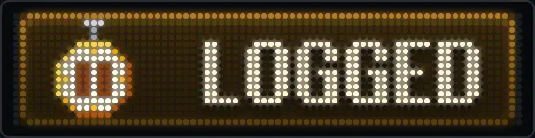 |
| ✅ Finished and marked done | 📝 Stopped: time logged, task still open |

### ⏱️ The mini timer

A small window that stays above every other one and shows what the bar would:
the task key and title, the elapsed time, and a coloured edge -- green while
tracking, amber while paused, in an interruption or asking, grey with nothing
running. **Nothing timing** is written large and amber in your working hours,
with the interruptions still to place under it, and **▶ Start…** beside it.
The first time it opens, one line names its buttons; **Got it** puts it
away. Beside them is the
icon of whatever holds the bar: the stopwatch for your session, an app's icon
during its notification, the sandwich at lunch, a coffee cup while you are away. Hover it for what the bar says. Open it with **Mini
Timer** in the header or **Mini timer** in the tray menu.

  

- ⏯️ **Pause** and **Resume** act on the session as Today does; paused, the
  row says **❚❚ Paused · MG-12**.
- ⏹️ **Stop** offers the three ways to end it, in the order the bar and the
  Stream Deck use: **Done** logs the time and marks the task done, **Stop**
  logs it and keeps the task open, and **Discard…** throws the session away
  after a **Yes**. **×** keeps the session running.
- ⟲ **Previous** goes back to the task you timed before this one, and
  **⚡3** beside the buttons counts the interruptions waiting to be placed.
- ⚡ **Interrupt** starts a timer at once, as Today's button does --
  see [Interrupt](#-interrupt-a-timer-at-once). During an interruption the
  row says which task waits, and offers ↩ **Back** to it, ↳ to choose the
  task its time goes to, ⚡ **Another** and ⏹️ **Stop**, which ends the
  interruption alone. Click its title to name it.
- 🎛️ **An interruption started from the bar, the Stream Deck or the
  shortcut opens the mini timer**, without taking the focus from what you
  are typing in, unless the window is on screen: "⚡ from the deck · started
  now ▾" sets when it began (2, 5 or 10 minutes ago, taken off the task it
  interrupted), and its name can wait.
- ☷ **During the stand-up** the row says which task comes back after it,
  "then back to MG-12, as it was", with **End stand-up**.
- 👤 A task given to someone else reads **MG-12 · Rin's now**, in amber; its
  time is still logged.
- ⇄ **Switch** (▶ **Start…** with nothing running) opens the task picker in
  its own small window, over what you are doing -- the dashboard stays where
  it is.
- ↳ **Place…**, while a task of your own runs, puts the session on a task of
  your provider, as on Today.
- ❓ **A question takes the row** until you answer it, with an amber edge:
  the stand-up (**Skip today**, **Join**), **Back at your desk?** (**Not now**,
  **I worked through it**, **▶ Resume**) and **Back to MG-12? 6 min not timed**
  (**Not now**, **↩ Back, add the 6 min**, **↩ Back**), and, when nothing
  else is asked, a reminder -- see *Reminders ask once*, under
  [Settings: My workday](#-settings-my-workday). Answered anywhere, it goes
  everywhere.
- 🖱️ Drag it by any part that is not a button. It reopens where you left it; if
  that was on a monitor you have since unplugged, it comes back in the
  bottom-right corner of the main one.
- 🔁 It reopens at the next launch if it was open when you quit, and stays closed
  if you closed it.

It counts seconds, which the bar does not: on screen a second costs nothing.

### 📁 Tasks

Your projects in a column on the left, the selected one's tasks in a table
on the right, refreshed from the provider. Make a project of your own here
for work that has no ticket: the next sync leaves it alone, and time on its
tasks stays on this machine, like the time of any task of your own.

> [!NOTE]
> **A task of your own stays on this machine.** Its time is in History like
> any other, but it is never sent to your provider, which has no ticket to
> put it on. Marking it done marks it done here only. The key the window
> shows is **Key for tasks of my own**, in Settings › Account › Advanced
> (`MISC-1` by default); the bar shows the task's name alone, which the
> shared key would only crowd out.

  

**The projects column.** A search box finds a project by name or key. ☆
stars a project: the starred ones are listed first, under *Starred*. Below,
*All* lists the rest, each with its count of open tasks, and
**+ A project of my own** makes one -- a key and a name.

**The table.** The header says where the project comes from (*from Jira*,
*kept on this computer*) and how many tasks are open. Each row is ☆, the
key, the title, the status, **Who** has it -- *me*, a teammate's name, or
*nobody* in grey italics -- and **Start**, or **Switch** while something runs, the
same as picking it in the picker. During an interruption it is greyed: end
the interruption first. The task being timed has **Stop**, one click as on
Today: the time is logged, the task stays open, and Undo takes it back for
ten seconds. Done and Discard are on Today's session card. A task's ☆ is the
picker's and the Stream Deck's star.

Above the table: a search of this project's tasks, by key, title or
description; the pills described below; and the state, **Open** by default
(In progress, To do, Done or All). A line under the table says how many
tasks the search or the state leaves out. Click a column's name to sort by
it, and again to reverse; until then the table keeps the order every list
uses (below).

A project of your own also has **+ Task of my own**, a delete button on each
task, and **⋯**: **Import tasks…**, **Rename…** and **Delete…**. Deleting
asks first. A provider's projects and tasks have none of these: the next
sync would undo them. Import takes lines of `KEY, Title, status` -- or a
title alone -- or a JSON list of `{ "key", "title", "status" }`; a status
it does not know is *to do*, and a list it cannot read imports nothing.

A task from Jira or OpenProject shows the start of its description when you
point at its title. The search above the table and the task picker search
it too, so you can find a task by what it is about.

🔎 **Hide empty** -- the box beside *All*, ticked by default -- hides every
project with no open task. A provider lists every project you can see, while
the tasks it fetches are yours and the team's free or ongoing work, so most
projects held nothing to pick. A project is listed again as soon as it has a
task to do or in progress. The column says how many projects it hides, and
unticking it lists them all. The task picker always lists only the projects
with a task. The project you have selected stays listed even when it is
empty, so one you have just created does not vanish before its first task.
If no project has a task for you -- before the first sync, or on a day
nothing is assigned to you -- every project is listed, and the column says
so: *None has an open task: showing all.* Tasks of your own do not count
for this, since one stays in progress until you mark it done.

👥 **Whose tasks** -- the pills above the table -- decide whose tasks are
shown besides yours, which always are (*✓ mine*). **unassigned**, on by
default, lists the open tasks nobody is assigned: work free to take.
**teammates'**, off by default, lists a teammate's task while it is in
progress. The pills say how many tasks they hide. They are one setting: the
task picker and Tasks both follow it, and **Hide empty** counts what they
show -- a project holding only unassigned work is listed while unassigned
work is. The task you are tracking stays listed whoever's it is. Every list
keeps one order: yours in progress, yours to do, unassigned to do,
unassigned in progress, teammates' in progress, then finished work -- yours,
then unassigned.

↗️ **Open a task on its provider** -- the small arrow beside a task's key in
Today, Tasks and History opens it in
your browser, on Jira or OpenProject, to comment, attach a picture or read
the thread. Tasks and projects of your own have no page there, so no
arrow.

⏱️ **A glance moves nothing.** Starting a task moves it to In Progress, and
takes it if nobody has it, only once you have timed it for two minutes --
paused time does not count. Started to look at it and stopped or switched
within those two minutes, it stays where it was on Jira or OpenProject. The
wait, or none, is in **Settings, Account** › *When I start a task*, and so is
turning it off: then starting a task never moves or takes it.

🙋 **Starting an unassigned task assigns it to you**, without asking, two
minutes in, and then moves it to In Progress as for your own. If someone took it in the meantime,
it stays theirs -- SprintTicker never takes a task away from anyone -- but
your session runs and its time is logged: a Windows toast says *TEAM-2 is
taken*, the bar shows **TAKEN** and their name, and the panel and the mini
timer say **Assigned to** them. Marking it done then asks first, as for any
task that is not yours. If the assignment fails, a toast says the task *was
not assigned to you*; it is not retried, so assign it on the provider if it
should be yours. Starting a teammate's task in progress assigns nothing and
moves nothing.

The task list refreshes by itself every five minutes. If it looks out of
date, **Refresh now** in **Settings › Account** fetches it again.

### 📊 History

One day at a time: ‹ and › step through the days, a click on the date picks
one, and **Today** comes back. At the top, what the day adds up to -- *7h 30m
· 6 tasks · 9 entries* -- and where its sends stand (*all sent but 1
correction*); under it each task's share, the most time first. Then every
entry in the order you worked it: its task, the note your provider shows,
its time, when it started, and where it stands there. ⋯ on a row corrects,
moves or deletes it. The arrow beside a task opens it on Jira or
OpenProject, as on Today and in Tasks. Interruptions still to place, of any
day, are listed above the day.

📅 **The week** (**Week**, beside **Day**): a timesheet of the week the day
falls in. Each project with its total, the largest open and the others a
click away; under it each task's time on each day. Then the **Day** row,
and **In Jira** (or OpenProject) -- *what your manager sees*: only what your
provider holds, so an entry held by an overlap, still sending or refused is
not in it, and a correction not answered yet still counts its old value.
A day that differs is amber and says why: *20m held*, *18m to place*,
*correction waiting*. The line under the sheet names each exception. Click
a day's total, or a task's time, to open that day. Weekends show when they
have time.

**Export CSV** saves the week as a spreadsheet where you choose: one row per
entry with its date, start and end in your local time, its length (also in
decimal hours), project, task, note, and whether it was sent.

✔️ **Check my week…** (beside Export CSV) lists everything in the week worth
a look, each with its fix:

- an interruption still to place -- **Place…** opens Place interruptions;
- a correction your provider has not answered, or an entry it refused --
  **Send now** sends again what was refused;
- a working day with time not timed in its working hours, or nothing logged
  at all -- **Open** that day, where a gap opens Add time;
- two entries that overlap -- **Fix…** opens their day; the later one is
  not sent until the overlap is fixed;
- in a week already closed, any entry added, corrected or deleted since it
  closed: what your manager saw has moved. With none, it says so.

There is no daily target to be "under": time not timed is what it shows
instead.

▨ **The day as a timeline.** Under the day's figures, a strip shows your
working hours -- from the stand-up to End my day, as set in **Settings, My
workday** -- with each entry a block named by its task, ⚡ for time that began
as an interruption, and lunch. What no entry covers is hatched, and the strip
says how much: *6h 50m logged · 40m not timed in working hours*. A click on a
hatched stretch opens Add time at its start and length; a click on a block
corrects that entry. Nothing is guessed or logged from a gap -- it is only
shown. Stretches under five minutes are not, on today the rest of the day is
not missing yet, and a day off has no working hours, only its entries.

➕ **Add time you didn't time** with **+ Add time**, on any day here and on
Today: pick the task, say how long and when it started, and add a note --
it is what your provider shows. The task can be work of your own, found by
its name or made with *A task of my own named "…"*; that time stays in
SprintTicker. It opens on half an hour, ending now on
today and from 09:00 on another day. It is sent like any entry, after the
same ten seconds of Undo. Before you add it, it says when it would overlap
an entry -- *Overlaps PF-31, which starts at 08:45* -- and offers the one
change that clears it; added anyway, the later of the two waits. It says so
too for a week already closed. An entry ends on the day it starts: add the
time after midnight as another.

  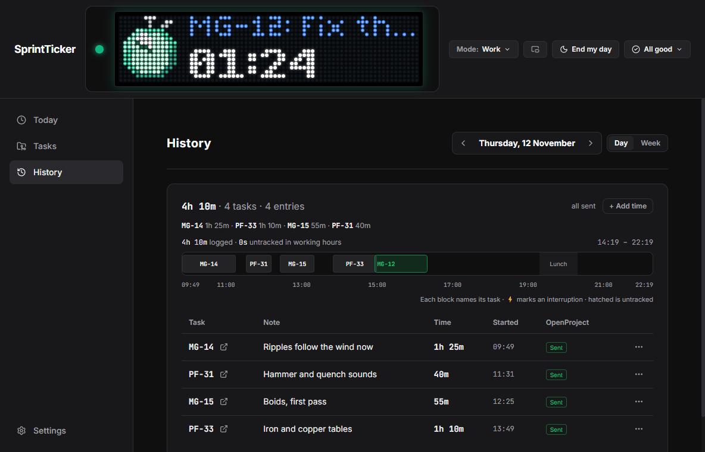

**An entry never spans midnight.** Jira and OpenProject -- where an entry is
a *worklog* or a *time entry* -- file it under the day it began, so a
session from 23:00 to 01:00 is logged as two: an hour on each day, each sent
on its own. A session paused overnight and resumed in
the morning puts the morning on the morning's day. End my day, and the question about a session left running, say how the
time will be filed before it is. The timer still shows the whole session.

**A long pause starts a new entry too**: 15 minutes or more by default, set
by *A long pause starts a new entry* in **Settings, My workday** (*never*
keeps one entry per day). A shorter pause is a gap inside one entry. A piece too short for your
provider -- 30 seconds after midnight, on Jira -- is added to its neighbour
rather than lost.

**An entry is kept here whether or not your provider accepted it.** If Jira
refused a 40-second session, the time is still in your history — it just is
not in Jira. Each entry says where it stands: **Waiting to send**, **Sent**,
**Not sent**, **Refused**, **Logged here** (a task of your own, or too short
for your provider), **Correction pending** or **Correction failed**.

  

↩️ **Undo, for ten seconds.** Nothing you stop, discard, correct, move or
delete goes to Jira or OpenProject at once: for ten seconds a bar at the foot
of the window says what you did -- *Stopped MG-12 · 1h 05m* -- and what it
comes to -- *Sent in 7 s*, *Kept here*, *Waits to place*, or nothing kept
or sent -- with **Undo**, and the mini timer shows it too. Undo puts things back as they were: a
stopped session runs on with its time and pauses, a discarded one comes
back, a corrected, moved or deleted entry is as it was. A task you marked
done is not moved on the provider until the ten seconds are over. Starting
another task, or another action, makes the last one final. Quitting within
the ten seconds sends it at the next start.

⏸️ **Two entries that overlap are not both sent.** The same hour twice is
the error a timesheet reviewer finds first, so the later of two overlapping
entries says **Waiting to send · overlaps PF-31** and is not sent until you correct
one of them; then it goes. A correction that would make two entries overlap
says so before you save it. Entries already sent stay as they are.

✏️ **Correct or delete an entry** with **Correct…** and **Delete…** in ⋯ on
its row. A correction changes the duration, the start or the note. It
applies here at once and reaches Jira or OpenProject behind the entry's own
send, so it survives a lost connection or a restart; an entry not sent yet
is simply sent with the new values. A deletion asks first, and deletes the
entry at the provider too. Entries are found at the provider by the
`[#xxxxxxxx]` tag at the end of their note, so keep that tag if you edit the
note in Jira.

✂️ **Split an entry in two** with **Split in two…** in its ⋯ (or in Correct), for the time
you forgot to switch: slide to the moment you switched, by the minute, and
pick the task the rest goes to -- nothing is chosen for you. It can be work
of your own: search for it by its name, or type a new name and choose
*A task of my own named "…"*; that part stays in SprintTicker, never sent.
The first part stays on its task and the rest becomes a new entry with the
same note. Jira
or OpenProject gets the first entry shortened, then the second as a new one,
in that order, so it never holds the same minutes twice; a shortening it
refuses keeps the second from being sent. Undo is there for ten seconds, and
time in a closed week is warned about first. An entry under two minutes has
nothing to split.

⇄ **Move an entry to another task** with **↳ Move…** in ⋯ on its row: pick the
task, and the time is on it at once here. At Jira or OpenProject the entry is
deleted where it was, then created on the new task -- in that order, so the
time is never on both, and for a moment may be on neither while the move goes
through. An entry not sent yet simply goes to the new task. Neither task's
status changes. The task can be work of your own -- search for it by its
name, or type a new name and choose *A task of my own named "…"*: the time
then stays in SprintTicker, and is deleted at your provider if it was sent. An interruption waiting in **Interruptions to place** is
placed rather than moved: see [Interrupt](#-interrupt-a-timer-at-once).

Each entry is named by its task's key and title. **Deleting a task or a project
does not delete the time logged against it**: the task leaves your lists and
stays in your history. The same happens when your provider stops listing a task
you worked on — reassigned, closed or moved — and if it lists it again, it
comes back.

An entry whose note starts **"Recovered:"** is a session an earlier version
left running behind another one. Its end is where the next session began, the
latest it can have run, so check it before copying it to a timesheet; it is not
sent to your provider.

### 🔌 Settings: Account

A page of rows, as General. The first names your account -- *Jira ·
studio.atlassian.net*, with your email, how many projects and tasks it
fetched and when it last refreshed -- with **Refresh now** and **Change
account**, which opens the provider, the site and the token under it. Then
**Tasks to fetch** -- *Mine, free and in progress*, *Everything open*, or your own query
(JQL for Jira, a v3 filter array for OpenProject), typed under the row.
**When I start a task** says how long a task is timed before it moves to In
Progress and becomes yours -- right away, after one, two (the default) or
five minutes -- or never; it is hidden for a provider that can do
neither. **When I mark a task done** is the completion
transition for all projects, and under it a list of your projects where any
one can go elsewhere: a Jira state or transition name, typed, or an
OpenProject status, chosen. A project left empty follows the choice for all.
A state its workflow lacks moves nothing, and the time is sent all the same.

  

🔑 **When the provider refuses your token**, the page opens on a red banner
that says how many entries wait, with one field for the new token: **Save
and send** puts it in place and sends them at once.

⚙️ **Advanced**, folded at the foot, holds the provider's state names -- the
Jira transition or state each of *When I start a task*, *To test* and *To
review* runs, or the OpenProject statuses, read from it with **Read the
states from OpenProject** -- the key for tasks of your own, and every entry
waiting to send.

**OpenProject notifications**, behind **Choose…**, turns what happens on your work packages
into Windows notifications: assigned to you, a mention, a comment, a status
change, a date alert. Tick the ones you want. Clicking a notification opens the
work package in your browser. With a bar, they can go there too, as a banner
that competes for the display like any *Default notifications*. The app
checks every minute by default (30 seconds to an hour); more than three at
once arrive as one summary. Only unread notifications that arrive after you
turn this on are shown -- what was already waiting in OpenProject is not
replayed -- and one you have read in OpenProject before the next check is not
shown either. **Send a test notification** shows what one looks like, and
says where it went.

**Jira notifications** does the same for Jira issues: assigned to you, a
status change, a comment, a mention in a comment. Clicking one opens the issue,
or the comment. Jira Cloud has no notification feed for apps to read, so
SprintTicker looks at the issues you are assigned, reported or watch at each
check, and works out what changed. That has edges worth knowing:

- 🙈 **Your own changes never notify you**, including the status changes
  SprintTicker makes for you when you start or finish a task.
- 👀 **A mention on an issue you do not follow is not seen**, and neither is a
  mention in a description rather than a comment.
- 📅 **Jira has no date alerts**, so that box is not offered.

🧩 **A SprintTicker server** is a server your team runs on SprintTicker's
own contract ([`PROVIDER-API.md`](PROVIDER-API.md)), when your tasks live in
neither Jira nor OpenProject. Choose **A SprintTicker server** under
**Change account**, then:

- **Server address**: the one your team gives you. It starts with
  `https://` and ends with `/v1`, such as
  `https://tracker.example.com/sprintticker/v1`.
- **Personal token**: made in your server, under your account.
- **Test connection** says the server's name and yours: *Connected to Team
  Tracker as Ada Lovelace*. From then on the app calls the server by its own
  name.

There is no task scope and no state to choose: the server decides which
tasks you see and where a finished one goes. What it offers -- assigning a
task nobody has, notifications, its days off, fetching a task by its key --
appears in the app once it says so, and stays hidden otherwise.

In **Advanced**, under **Entries waiting to send**, is every entry that has
not reached the provider, with the server's own message, the attempt count against the
ceiling, and when the next attempt is due. When the provider refuses your saved
credentials, a Windows notification says **Sending time to Jira stopped** (or
OpenProject) -- once, even with provider notifications switched off. Your time
waits in the queue; saving the credentials again sends it.

The project and task lists refresh by themselves after every sync, every five
minutes, so a task added on the provider appears without changing views.

| Button | Does |
| :--- | :--- |
| 🔄 **Sync now** | Fetches projects and tasks immediately, as Refresh now does |
| ♻️ **Retry failed** | Sends again the entries that stopped -- use after fixing what stopped them |

Above the entries, one line counts them: waiting, sending, not sent, sent.

> [!NOTE]
> **Why an entry stops being sent**
>
> An entry is marked **Not sent** when the failure is permanent: a deleted
> issue, a revoked key, a session too short for the provider to record.
> Retrying those on a timer would send the same request forever, so the app
> stops and tells you why. **Retry failed** is for after you have fixed the
> cause.

### 📅 Settings: My workday

A page of rows: your working days, the three scheduled events, when your
week closes, how long each reminder waits before it asks, and two rules for
your time -- a timer left running overnight is asked about, and a long pause
starts a new entry. **Show me**, on the stand-up and the end of day, puts up
the prompt now; nothing is timed or sent unless you answer it.

  

| | Default | Does |
| :--- | :--- | :--- |
| 🗣️ **Stand-up prompt** | 09:30 | A card on Today; **Join** switches your timer to the stand-up's task (Daily Standup unless you chose one) |
| 🥪 **Lunch** | 12:30–13:30 | Switches to Lunch mode |
| 🌙 **End my day** | 17:30 | Asks you to end the day: see below |

Both prompts can be confirmed or dismissed **from the bar itself** — see the
hardware controls below.

🔕 **No prompt takes the window.** SprintTicker never comes up over what you
are typing. A question waits as a card at the top of **Today** and in the
mini timer's row until you answer it -- one at a time, the most urgent
first, with *1 more question after this one* when others wait -- and, while the window is hidden in the
tray or minimised, a Windows notification says so; clicking it opens the
window. The stand-up's card offers **Join**, **Skip today** and **Remind me in
10 min**, and stays until you choose. End my day opens in the window
without bringing it forward.

🌙 **End my day** (at your end of day, or ☾ in the header, or the tray)
shows the day before anything is sent:

- the interruptions still to place, each with its own menu -- each is sent
  once you choose its task, and those you leave wait for the morning card and
  the week;
- **every** entry of the day, nothing folded, with where it stands with Jira
  (or OpenProject), and the task still running: *stops, stays open, and is
  sent*;
- the gaps not timed in your working hours, as a hint only -- **Check
  them…** opens History, **Skip** hides them; a gap never stops you ending
  the day.

Its button says exactly what it does: *End my day · send 1h 45m · 45m left
to place*. One click stops the running task (it stays open in Jira) and
sends everything on a task after the usual ten seconds to undo; **Undo**
brings the task back as it was. Anything Jira refuses stays here, and the
next day says so. **Remind me in 15 min** asks again then. On the bar it is
two presses of Pause, and the wheel's click closes it.

**Then shut down the PC** is a separate choice, unticked unless you turn on
**Shut down the PC when I end my day** in **Settings, My workday**; even
then you can untick it for that day. The
shutdown waits until the ten seconds of Undo have passed and Jira has
answered -- up to 30 seconds, after which it goes ahead with what is not
sent kept for tomorrow -- and Windows then gives you its own 30 seconds to
cancel. Undo cancels it. Open files in VS Code or Cursor are saved first.

🔔 **Reminders ask once.** Between your stand-up time and your end of day, on
a working day and in Work mode, SprintTicker asks -- once each time, on Today,
in the mini timer, and by notification while the window is hidden:

| When | It asks | Answers |
| :--- | :--- | :--- |
| Nothing timing for 10 min | *Did you mean to stop?* | **Not now** · **▶ Start a task…** |
| A pause of 30 min | *Still paused?* | **Still paused** · **▶ Resume** |
| An interruption of 20 min, not paused | *Still on it?* | **Still on it** · **↩ Back to MG-12** (or **■ Stop**) |
| The stand-up at 25 min | *Still in it?* | **Still in it** · **End stand-up** |
| Back after 15 min away, the task still timing | *Was it on MG-12?* | **Keep it on MG-12** · **⚡ Something else…** |

Click the interruption's name in *Still on it?* to name it there -- on Today
or in the mini timer -- with Enter; Escape keeps the name. Naming it answers
nothing: the question stays.

On the bar, *Nothing timing* shows **NO TASK** beside an empty office chair,
on amber, until you answer it there or in the app. The quiet answer is final for that time: the same
pause is not asked about again, the next one is. Resuming, going back or starting a task answers it
too. **Back to MG-12?** left unanswered for 10 minutes gets one more
notification. Each delay is a row of **My workday**, from 5 minutes to
two hours.

During Lunch the bar shows a sandwich building itself beside **LUNCH**, on
teal. In Away mode it shows a steaming coffee beside **AWAY**, on purple. At the
stand-up prompt it shows three people round a table taking turns to speak,
beside **MEETING**, on blue. When nothing is timing in your working hours, an
empty office chair swivels and settles beside **NO TASK**, on amber. Each loops
for as long as the mode lasts, and the bar plays it itself, so it keeps moving
when the computer is busy.

| | |
| :---: | :---: |
| 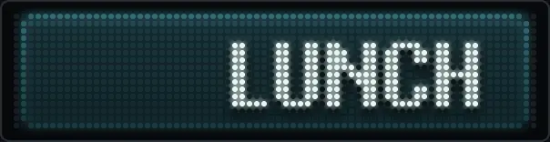 | 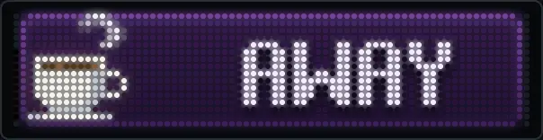 |
| 🥪 Lunch | ☕ Away |
|  | 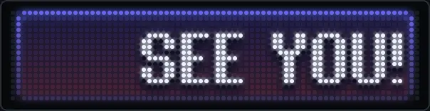 |
| 🗣️ Stand-up | 🌙 End of day |
| 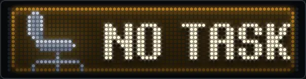 | |
| 🪑 Nothing timing | |

🗣️ **Joining the stand-up switches your timer to it.** Press **Join** on
Today's card or in the mini timer, or Pause on the bar's prompt: the task
you are tracking stops, its time logged, and a **Daily Standup** task starts
-- one task of your own, reused every day, kept on this computer and never
sent. Joined late? Pick **joined 2, 5,
10 or 15 min ago** beside Join: the stand-up starts then, and those minutes
come off the task before it. To have the stand-up sent to your provider,
choose its task on the **Stand-up** row of **Settings, My workday** --
**on Daily Standup ▾**; **Keep it here** goes back to Daily Standup. A chosen task that is
no longer in your lists falls back to Daily Standup. The bar then shows its timer, with three people at a table in place of
the stopwatch, taking turns to speak, so you can see the prompt has gone and
the meeting is being timed. Stop the stand-up (DONE, STOP or DISCARD) and the
task you were on starts again: once, that day, only if you have not started
something else meanwhile, and never when End my day is what stopped it. A
task that left your list during the meeting is asked about first: **Resume
MG-12?** in the window, with **▶ Resume MG-12 anyway** and **Not now**, and
**NOT YOURS / RESUME IT?** on the bar, where Pause resumes it and a wheel
click does not. **Not now**, or leaving the question alone, leaves the task
stopped.

☕ **Locking your computer keeps your task timing.** A coffee or a trip
down the corridor is work: locking Windows, putting it to sleep or choosing
**Away** shows Away on the bar and changes nothing else. Back after 15
minutes or more (*Back after time away*, in **My workday**) with the same
task still timing, Today and the mini timer ask once **Away 23 min -- Was it
on MG-12?**:

- **Keep it on MG-12** leaves the time where it is.
- **⚡ Something else…** makes the time away an interruption that has
  ended, and opens the place picker: put it on another task, or keep it off
  your tasks. MG-12 keeps timing from now.

Nothing moves unless you answer. Away across midnight is asked about by
*A timer left running overnight* instead.

🥪 **Lunch pauses the task you are tracking.** Lunch is not timed,
and nothing is sent at the start of the break: when you stop the task, its
time goes in as two entries either side of a break of 15 minutes or more
(*A long pause starts a new entry*, in **My workday**), to the second. When
lunch's hour is over, Today and
the mini timer ask **Back at your desk?**, naming the task, and the bar shows
its key over **RESUME?** -- Pause resumes, a wheel click is Not now:

- **Resume KEY from 13:30** starts timing again -- from the time the break
  ended, not from your answer, so the minutes the question waited count as
  work. That time is lunch's end, or your return when the computer stayed
  locked or the app closed past it: time away after lunch is not counted.
- **I worked through it** takes the break back as though you had never
  paused: the time counts as work, in one entry.
- **Not now** leaves the task paused.

During lunch, Today has a **Lunch until 13:30** card saying the task is
paused and nothing is sent, with **Resume KEY** -- resuming during lunch is
working through it. Away has an **Away** card saying your task keeps timing,
with **I'm back**; a task you had paused before stays paused, and **Resume
KEY** also leaves Away.

The paused session is kept in the database: closing the app over lunch, or
leaving Windows locked until after it ends, does not lose it -- the question
comes when you are back, that day. Lunch never undoes what you do:

- **Working through lunch.** Start a task, resume a paused one or switch tasks
  during lunch -- in the window, the mini timer or on the bar -- and Lunch ends
  there and then; no *Back at your desk?* is asked when it would have ended,
  and Lunch does not start again that day.
- **A task that left your list over the break** -- reassigned, closed or
  moved -- is asked about as usual: **Back at your desk?** adds that it is
  no longer assigned to you, and on the bar Pause resumes it and a wheel
  click leaves it paused. Starting another task answers no. Resuming it tracks your time
  and nothing else: the task stays out of your lists, is not moved to In
  Progress on the provider, and marking it done still asks first.
- **Locked when lunch begins.** The bar stays on Away; your task, timing
  while you were away, is paused when lunch begins. Unlock during lunch and the bar
  goes straight to Lunch; unlock after it and **Back at your desk?** asks
  about your task.

Lunch must start and end on the same day, start first: **My workday**
says so and saves nothing until it does. A window across midnight never began.

📆 **The stand-up, lunch and End my day happen on working days only.** **Working days**, at the
top of **My workday**, picks them -- Monday to Friday until you change
it, and at least one. On any other day nothing is prompted and Lunch does not
start; your timer works as on any day, and what you track is logged as usual.
With OpenProject connected, the holidays your instance lists (its
*Non-working days*, under Administration) are days off too. They are read
once a day; if the instance cannot be reached, the weekdays you picked decide
alone, and a holiday already read stays one.

🗓️ **End my day on the week's last working day closes the week.** Usually
that is Friday's; with Friday a holiday, or a four-day week, it is Thursday's.
**My week closes**, in My workday, names that day.
A notice in the corner of the window then shows the week and the time logged
in it, a reminder to check it is all in before your timesheet is due. **Check
my week** opens that week in History with its check (above); either button
dismisses the notice, which
otherwise stays -- across a restart too -- until you do. Missed End my day
(a day off you had not entered, the laptop shut)? The next working day closes
the week at its first check instead, and a week closes once, whatever happens.
A week you did not work at all closes without a notice.

**Time in a closed week asks first.** Closing a week locks nothing, but its
timesheet may be in by then, or approved. So moving an entry of a closed week
asks before the task picker opens, and correcting or deleting one says so in
the dialog before you save -- a correction that moves the start into a closed
week too. A locked timesheet may refuse the change at Jira or OpenProject;
**Entries waiting to send** then shows why.

### 🔔 Settings: Desk devices, Windows notifications

Which applications may reach the bar: the **Windows notifications on the
bar** row of **Desk devices**, with a bar. Its switch turns the mirroring on
or off. Windows must let SprintTicker read its notifications: until it does,
the row says *Windows access needed* and **Grant access** opens the page in
Windows' settings; the row notices once you come back. **Choose apps…** opens
the list of apps known. **Nothing is mirrored until you allow it.**

  
  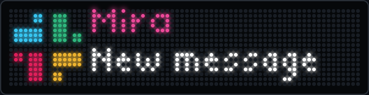

Per app, choose one of three:

| Setting | Effect |
| :--- | :--- |
| 🚫 **Don't show** | Ignored entirely |
| 💬 **Default** | Takes the bar at the level of *Default notifications* |
| 🔔 **High priority** | Takes it at the level of *High-priority notifications* |

Note what that means: an app is put in one of two rows of **What the bar
shows first**, which decides what that row is worth and how it behaves
during Lunch and Away. Nothing here hardcodes which app wins. In the shipped
defaults those two rows are at levels 65 and 70, and a few common apps arrive pre-classified — Slack and the
battery warning as High priority, Discord, Gmail and Windows as Default — but
all of it is yours to change.

Every app shows its own icon, converted for the bar. It is resolved from its
MSIX manifest or Start Menu shortcut
and downscaled to 15×15. Windows itself says which shortcut belongs to which
app, so a shortcut named differently from its app — `PowerToys (Preview)`,
`Visual Studio Code` — still finds the right icon. An app with no shortcut is
matched by name, which is not perfect: if it shows the wrong icon, set an icon
of your own on that app (*Icon of my own*, a 16×16 PNG). An icon found is
kept between starts, and the apps you have already met are looked up when the
app starts. The very first notification from an app SprintTicker has never
seen waits up to 1.5 seconds for its icon to be found. If it is not found by
then, Slack, Discord, Gmail, Jira and OpenProject show an icon drawn for the
bar, and any other app the bell. The ✈ beside an
app sends it a test notification, and the bin forgets it until it notifies
again. An app the list has not seen yet is added by its id under **Settings,
Developer** (turn on **Show developer tools** in General first). The first notification from an app after SprintTicker
starts shows the built-in icon while the real one is looked up; later ones
show the app's own.

**Hide the message text** shows that a message arrived, and from whom,
without what it said -- on by default for Slack and Discord. How long a
notification stays on the bar, and how often Windows is read, are under
**Connection**.

Notification text is redacted from logs and the diagnostics export. Launch with
`--debug-notifications` to see it while troubleshooting.

### ⚡ Settings: Desk devices, What the bar shows first

What the display shows when several things want it: **Open…** on its row
of **Desk devices**, with a bar. Every row has a level; the highest holds
the bar. The arrows beside a row move its level by 10 and the list sorts
itself again; type a level from 1 to 100 to place it exactly.

  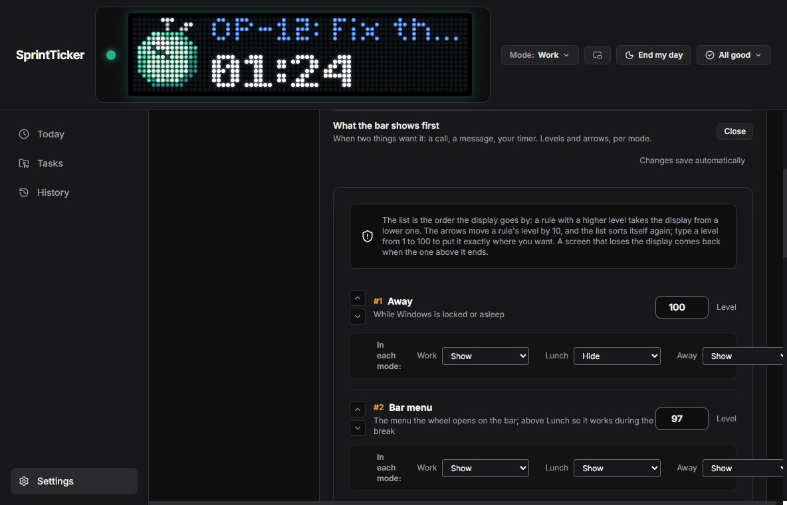

| Row | Level |
| :--- | ---: |
| 🧳 Away | 100 |
| 🎛️ Bar menu | 97 |
| 🥪 Lunch | 95 |
| 🌙 End my day question | 80 |
| 🥪 Resume question | 76 |
| 🗣️ Stand-up question | 75 |
| ⏸️ Nothing timing | 74 |
| 🔔 High-priority notifications | 70 |
| 💬 Default notifications | 65 |
| ⏱️ Your timer | 45 |

Every row is editable, including what each does in each mode — **Show**,
**Show when free** or **Hide** in Work, Lunch and Away.

With the shipped ordering, notifications do not interrupt Lunch or Away. That is
the table working as configured, not a bug. Move the rows if you disagree.

### 🩺 Settings: Desk devices

**Desk devices** opens on the bar's line -- *Connected on USB*, or the
address it answers at, with its firmware, battery and brightness as the bar
reports them, or *Not answering at …* -- and **Use without a bar**. **When
nothing runs**, on, leaves the bar its own clock when no task is timed; a
question or NOTHING TIMING still stays on it until answered. Off,
SprintTicker keeps its own idle screen.

**Bar health** shows what the bar sends, as you press: a chart of the last
minute with a lane each for Pause, the wheel's click, turning and Back. A
filled mark did something, a hollow one arrived and did nothing -- a Back,
or an answer held off because the screen had just changed -- and a turn is
a triangle pointing its way. Point at a mark, or Tab to it, to read what it
did and when, to the millisecond; **As a list** has the same, newest first.
Under it, how quickly the bar answers. The display debugger -- every scene
and screen, drawn through the real renderer -- is under **Developer**, once
**Show developer tools** is on in General.

  

**Connection**, behind **Change…**, sets the address the app dials and, if
your device needs one, an API token:

- 🌐 **Device address.** Defaults to `10.0.4.20`, which is where the bar answers
  over USB. Change it for a bar on Wi-Fi, or when you are reaching the device
  through a proxy on another address. An IPv4 address or a hostname — no
  `http://`, no port, no path.
- 🔑 **API token.** Leave empty for USB, where the bar accepts unauthenticated
  requests. Fill it in once the device has access protection enabled, which is
  the normal state over Wi-Fi; without it every request comes back 401 or 403.

**Save and reconnect** applies both immediately — the app re-dials without a
restart. The bar's line above says whether the new address answered; saving
means the setting was stored, not that the bar replied. **Back to USB
default** puts the address back to `10.0.4.20`. Below them: how long a
notification stays on the bar, and how often Windows' notifications are
read.

🎛️ **The Stream Deck** has its own line under the bar's: *Connected · 1
deck*, with **Install the plugin again**; *Plugin not connected*, when
Stream Deck is installed but the plugin is not talking to SprintTicker, with
**Install the plugin**; or, with no Stream Deck at all, one line with
**Add**. The line notices a plugin installed meanwhile within a few
seconds.

🎨 **Task key color** sets the color of the task key on the bar's front
display -- blue, pink, amber or pale cyan -- and is kept across restarts.

### 🧭 The tray, closing the window, and the shortcuts

🗙 **Closing the window keeps SprintTicker running**, in the tray by the
clock: your timer, the bar and the Stream Deck go on. The first time, a
Windows notification says where it went. **Quit** is in the tray's menu.
*Settings › General › When I close the window* can make the window's ✕
quit instead.

🧭 **The tray icon says where you stand**, by its mark as well as its
colour: ▶ green, a task is timed; ⚡ amber, an interruption runs; ❚❚ amber,
paused, at Lunch or Away; **!** amber, nothing is timed in your working
hours; ○ grey, nothing is timed outside them. A number in its corner is the
entries waiting to send (9+ past nine), and hovering it says so.

🔔 **SprintTicker's notifications open where they are about.** A question
-- the stand-up, Lunch's end, a session left running -- opens Today on its
card; "Sending time to Jira stopped" opens *Settings › Account*, where the
credentials go. Stop a task from the tray, the Stream Deck or the bar while
the window is hidden, and a notification says so, "Stopped MG-12 · 1h 24m":
click it within ten seconds and the window opens with **Undo** ready
(Enter). A notification about a Jira or OpenProject task opens the task
there.

🧭 **The tray**: a click opens the window. Its menu, on a right-click, holds
what you reach for without the window: **Switch task…** (**Start a task…**
when nothing runs), **Previous task:
PF-31**, **Pause** or **Resume**, **Stop** (as Today's, with Undo),
**Interrupt** -- **Another interruption** during one, when Stop reads **Stop, back to MG-12** -- **Lunch**
and **Away** (ticked while on; click again to go back to work), **End my
day…**, **Mini timer**, **Start with Windows** and **Quit**. Quit clears the
bar and lets go of the Stream Deck.

🚀 **Start with Windows** starts SprintTicker when you sign in, in the tray,
with no window over whatever you open first. The tray icon, the bar and the
mini timer work as usual; open the window from the tray, or by starting
SprintTicker again. The same switch is in the tray menu, and Windows lists
the entry under *Settings → Apps → Startup*: turned off there, it reads off
here too. The portable build registers the file you ran, so move it and
switch it on again from the new place. A build run from source
(`pnpm dev`) shows the switch greyed out.

⌨️ **Shortcuts** work from any app, with the window closed. Each is on
until you switch it off:

| Shortcut | Chord | Does |
| :--- | :--- | :--- |
| **Interrupt** | Ctrl+Alt+Shift+I | starts an [interruption](#-interrupt-a-timer-at-once); during one, **Another** |
| **Switch task** | Ctrl+Alt+Shift+S | opens the task picker over the app you are in (not during an interruption) |
| **Previous task** | Ctrl+Alt+Shift+P | goes back to the task you timed before this one (not during an interruption) |
| **Back** | Ctrl+Alt+Shift+B | ends the interruption and goes back to the task it interrupted, as it was; nothing otherwise |

**Change keys** records another chord -- press it, then the keys, or Escape to
keep the old one. A chord needs Ctrl, Alt or Win: Shift alone only types
capitals, and two shortcuts cannot share one. Avoid Ctrl+Alt without Shift
on AZERTY and other layouts where it is AltGr, or the shortcut takes a
character you type -- its row says so. If you had turned the Interrupt
shortcut on or off before, your choice stays.
- **"Not active: another app holds it"** means Windows gave that chord to
  another app first. Choose another; SprintTicker tries yours again at its
  next start.
- **Nothing happens in an app run as administrator.** Windows does not pass
  a shortcut to SprintTicker while such a window has the focus.
- **With the window hidden, no bar and no mini timer**, a Windows
  notification says what the shortcut did -- the interruption started and
  which task waits paused, or which task you are back on -- otherwise
  nothing would show that the timer changed.

---

## 💡 The bar itself

### 🖼️ What it shows

A 72×16 RGB matrix: a 16px icon on the left, then two rows of text, both in
proportional fonts drawn for SprintTicker. Row 0 holds roughly twelve characters
of mixed case in its 55px field. Row 1 uses a narrower face and holds about
fourteen.
Text that does not fit ends in `…`. Accented letters are shown without their
accents, since the display draws plain ASCII only.

The small screen on the back belongs to the bar itself: it shows a copy of the
front at twice the size, and its own clock and date when the front is empty.
SprintTicker draws nothing there.

Every screen, as the bar shows it:

| Screen | What it means |
| :---: | :--- |
|  | ⏱️ **Tracking.** The task on row 0, its time in large digits on row 1. The stopwatch's hand ticks round. |
| 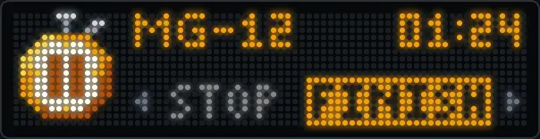 | ⏸️ **Paused.** ❚❚ and the key, the time below -- **AGAIN=STOP** for 4 s after the bar's Pause, when a second press stops. Then Pause resumes; a wheel click interrupts. |
|  | 🗣️ **Stand-up.** Joined from its prompt: **STAND-UP** over the stand-up's own timer, with three people at a table taking turns to speak in place of the stopwatch. A task of your own shows its name alone, never its shared key. |
|  | 📝 **LOGGED.** Stopped: the time is kept, the task stays open. |
|  | ✅ **DONE!** Finished and marked done. |
|  | 🔔 **Notification**, from an app you allowed, with its own icon. |

The session screen's icon is a stopwatch whose colour says where you are: green
while a task runs, its hand ticking round once a second; amber with blinking
pause bars while it is paused; dim grey when nothing runs, with *When
nothing runs* off (the screen then reads **Ready / No task running**; on,
the bar shows its own clock). While a task runs, row 0 shows the task and
row 1 its time, in large digits. While paused, row 0 shows **❚❚** and the
task key, and row 1 the time, in amber. Paused from the bar, row 1
says **AGAIN=STOP** for four seconds: Pause again then stops the task --
the time is logged, the task stays open, and the bar shows **LOGGED** for
three seconds, the stopwatch's hand sweeping back to twelve. Marking a task done
or discarding a session is in the wheel's menu, the app or the Stream Deck;
DONE from anywhere shows **DONE!**.

Three more things the session screen can say:

- **3 TO PLACE**, in amber on row 1, while interruptions wait for you to
  place them in the app -- on a task's screen, running or paused. The time
  moves up beside the key, and the key is the one shortened. Not during an
  interruption or the stand-up, and **AGAIN=STOP** still takes row 1 for its
  four seconds.
- **MG-12 > RIN**: the task was given to someone else on Jira or
  OpenProject while you were on it -- the key and their first name.
- **NO TASK**, beside an empty chair on amber, when the app's
  *Nothing timing* reminder asks (see *Reminders ask once* under [Settings: My workday](#-settings-my-workday)).
  Pause opens the task picker on the computer; a wheel click is *not now*.
  Either puts it away, and the bar's own clock comes back.

> [!NOTE]
> **Why the timer shows HH:MM**
>
> Every frame is an asset upload plus a draw — two HTTP requests. A per-second
> redraw would mean an upload a second for a digit nobody reads, so the tracker
> deliberately shows minutes. The stopwatch's ticking hand is the bar's own
> animation: it shows that the clock is running, and is not the seconds of your
> session.

### 🎞️ Animated icons

The icons move. A notification without an app logo rings its bell, the
end-of-day prompt's alarm clock rings, and the lunch prompt's sandwich hops. An
OpenProject notification passes a shine across the OpenProject logo; other
apps' logos stay still. The bar animates them itself. If one ever shows still,
the log's `[IconAnimator]` lines say why, and the screen is otherwise
unaffected.

| | |
| :---: | :---: |
|  |  |
| notification | end of day |

### 🎛️ Controls

The bar is mostly a display: it shows what runs and what needs you, and
each control does one thing you can predict. Anything that needs a choice
-- which task, where an interruption's time goes -- opens SprintTicker on
the computer, in front of what you are doing.

| Control | Does |
| :--- | :--- |
| ⏯️ **Pause** | **Yes.** Pauses, resumes, joins the stand-up, answers yes, dismisses a notification. With nothing running, opens the task picker on the computer |
| ⏯️⏯️ **Pause again** | **Stop.** Within 4 s of pausing -- the bar says **AGAIN=STOP** meanwhile -- stops the task: its time logged, the task left open, **LOGGED** on the bar and Undo in the app. An interruption stops the same way, and you are back on your task. After the 4 s, Pause resumes |
| 🖱️ **Wheel** click | **Interrupt**; during an interruption, **Another**. On a question or a notification, **no** |
| 🔄 **Wheel** turn | **The menu**: one entry per screen, Pause picks it, a click closes it |
| ↩️ **Back** | Nothing in SprintTicker. Best left alone: with nothing running, the bar's own software uses it to leave its clock, and a notification showing over the clock goes with it |

The same list is in the app: **Settings, Desk devices, Bar controls**.

- **During an interruption** the bar shows a bolt (⚡) where the stopwatch
  was, a light running down it. It is paused and stopped as a task is:
  Pause, then Pause again within 4 s, ends it and takes your task up again,
  and the Place window opens on the computer.
- **A press right as a question or a notification appears only settles.**
  Within 0.7 s of it coming up, the press was meant for what was there
  before, so it neither answers nor dismisses.
- **The menu** opens on the first notch -- turned right on its first entry,
  left on its last -- and shows one entry at a time, with its place in the
  list (**2/5**):
  - while a task runs or is paused: **DONE**, **DISCARD**, your previous
    task, up to three recent ones;
  - during an interruption: **DISCARD** -- a task is never chosen during
    one;
  - with nothing running: your previous task and the recent ones. With
    none, turning does nothing.

  Pause picks the entry: a task starts, stopping the one running. **DONE**
  and **DISCARD** ask first -- **DONE?** or **DISCARD?** in red, **AGAIN=YES**
  -- and a second Pause does it, with Undo in the app; a click or a turn
  says no. A task no longer yours asks **NOT YOURS / DONE ANYWAY?**. A click
  closes the menu, and so do 6 s untouched. The recent tasks are the Stream
  Deck's.
- **Nothing is held.** The bar sends no long press, so no control depends on
  one.
- **Back is left alone.** On the bar's own screen -- its clock when nothing
  runs -- the bar uses Back itself and leaves its own clock app.

🗣️ **During a question** -- the stand-up, back to your task?, NOTHING
TIMING, End my day -- Pause says yes and a wheel click no. End my day asks
twice — the first press is "yes", the second confirms
(**AGAIN=YES**) — because it can shut your machine down. Once it is done,
the bar says **SEE YOU!** for five seconds, a moon rising and the stars
coming out, and then goes idle.

The bar's buttons answer End my day only while the bar shows its prompt.
The **End my day** button in the header puts the prompt on the bar too. If
something ranked above it holds the bar -- Lunch, in the shipped ordering --
the buttons keep doing what that screen says, and End my day is confirmed
in the window.

---

## 🎹 A Stream Deck

SprintTicker has a plugin for Elgato's Stream Deck app (7.1 or later). It
works beside the bar or without one, and leaves the rest of your deck alone.
The installer carries it: **Install the plugin**, in the first run or in
Settings › Desk devices, opens it in the Stream Deck app. Releases also
carry it beside the installer, as
`SprintTicker-StreamDeck-<version>.streamDeckPlugin`: double-click it. Its
version is its own, not the app's. From the source, `pnpm deck:pack` builds
it into `packages/streamdeck-plugin/dist/`.

Its actions are listed under **SprintTicker** in the Stream Deck app.
Session, Interrupt and Answer A, B and C fill five of a Stream Deck Mini's
six keys -- the ready-made profile puts Previous task in the sixth -- and
Recent 1-3 are there if you want them. Drag each
onto any key, as many times as you like:

| Action | The key shows | A press |
| :--- | :--- | :--- |
| **Session** | the task, its time and the bar's icon, moving as it does on the bar -- a notification's own icon while its banner holds the bar -- under a band: green while tracking, amber while paused, during an interruption (its time) and for a task that is no longer yours (**NOT YOURS**). With nothing running, START -- amber **NOT TIMING** in your working hours | pauses or resumes -- an interruption too; with nothing running, opens the task picker. **Held** half a second, it opens the task picker; not during an interruption: end it first |
| **Interrupt** | INTERRUPT -- ANOTHER during an interruption -- and "3 to place" while interruptions wait for you in the app | starts a timer at once, whatever runs -- see [Interrupt](#-interrupt-a-timer-at-once) |
| **Previous task** | PREV and the task's key | goes back to the task you timed before this one. Blank during an interruption: A goes back |
| **Answer A** | says yes, in green: DONE, BACK to the task during an interruption, JOIN the stand-up, END STAND-UP, RESUME, START LUNCH, DONE ANYWAY, and END MY DAY | does that. DONE takes two presses |
| **Answer B** | stops or waits, keeping the time, in blue-grey: STOP, SKIP, NOT NOW | does that; STOP logs the time and leaves the task open |
| **Answer C** | throws away, in red: DISCARD, or DISCARD ⚡ during an interruption -- the interruption, not your task | two presses; nothing logged. Blank while a question waits or nothing runs |
| **Recent 1, 2, 3** | one of your recent tasks and START -- never the one running; blank during an interruption | starts it |

- **On a Stream Deck Mini or Stream Deck Mobile, the layout is
  ready-made.** Installing the plugin adds a **SprintTicker** profile for
  each -- Session, Interrupt and Previous task on the top row, A, B and C
  below. It does not replace the profile you use: choose it in the Stream
  Deck app's profile list.
- **Each position keeps one meaning.** A always says yes, B always stops or
  waits, C always throws away; a key with nothing of its kind to do is
  blank. When a question comes -- the stand-up, End my day, back to your
  task? -- A and B turn into its answers. A press in the moment a key
  changes only flashes it, so a question arriving as you press DONE is not
  answered by mistake. After an interruption, A, B and C are DONE, STOP and
  DISCARD again at once; what is left to place is counted on Interrupt and
  placed in the app.
- **DONE always takes two presses**, because it moves the ticket in Jira or
  OpenProject: a habit learned on BACK, the same key, never marks a ticket
  done.
- **Laid out your deck before 0.5.0?** The keys you placed -- Not done,
  Done, Discard, Yes, No -- keep working; they are only gone from the list.
  Not done now reads STOP, and Done takes two presses.

- **A key's colour says what it does.** A coloured glyph can be pressed; a
  grey key has nothing to do; a key filled with colour is waiting on you --
  a question, or a second press.
- **Done and Discard ask on the same key.** Done fills green, **DONE?**,
  Discard red, **DISCARD?**; press it again within four seconds to go
  ahead. Waiting, or another task starting, takes the question back.
- **Keys move a little when something happens.** Done's check draws itself,
  Discard's bin lifts its lid, Stop's square presses in and Interrupt's
  bolt strikes when you press them; the yes and the no draw their mark when
  a question arrives. Half a second, then they rest.
- **Yes and no are two keys**, and neither changes meaning with how long you
  hold it. Session is the one key with a long press: held, it opens the task
  picker in its own small window, in front of the app you are in -- to
  switch tasks without ending the one running. End my day asks twice, as
  on the bar: END MY DAY, then **CONFIRM**.
- **offline under every key** means the plugin cannot reach SprintTicker:
  start it, and the keys come back by themselves within ten seconds. **update
  app** means SprintTicker and the plugin are of different versions -- update
  whichever is older. A newer SprintTicker keeps an older plugin working, so
  updating the app first is safe.

---

## 🩺 Troubleshooting

Click a problem to unfold its answer.

📭 <b>The task list is empty</b>

 Check **Settings, Account**: your Jira site or OpenProject address, and its
API token or key.
Press **Refresh now**; if it stays empty, the credentials are probably wrong — the
app deliberately does not invent tasks. A provider error is shown rather than
swallowed.

🔑 <b>Jira says <code>Checking the Jira credentials failed: HTTP 401</code></b>

 Jira no longer
accepts the API token. Atlassian tokens carry an expiry date chosen when they
are created, so a token that worked last month can simply have run out. Create
a new one at id.atlassian.com › Security › API tokens and enter it in
**Settings › Account** -- the red banner's field and **Save and send**, or
**Change account** › API token. Your projects and tasks stay as they were in the meantime, and the
next sync brings them up to date.

🔀 <b>The task I am tracking says "No longer assigned to you", "Assigned to …" or "Closed in Jira"</b>

 Since you started it, the task
left what your provider lists for you: reassigned to someone else, closed, or
moved to a project you are not in. Nothing is lost: the session keeps running
and its time is logged when you stop. The task stays in your lists until then.
Marking it done asks first, because your completion transition would move a
task that is no longer yours. If the provider refuses the time -- some Jira
setups forbid logging on someone else's issue -- the entry appears under
**Entries waiting to send** with Jira's own message.

📤 <b>An entry never reached Jira or OpenProject</b>

 Open **Entries waiting to send** in **Settings, Account** › Advanced. Each
entry carries the server's own message. Common causes:

- *`404` — the issue no longer exists.* Nothing to do; the entry here stands.
- *`400` — under a minute.* Jira records time to the minute; anything shorter
  rounds to zero and is refused. The time is in your local history.
- *`401`/`403` — the key was revoked.* Enter a new one; saving it sends again
  the entries the old key stopped.

✏️ <b>A correction never reached Jira or OpenProject</b>

 The entry says **Correction failed**,
and **Entries waiting to send** lists the correction with the reason.

- *Not found in Jira (or OpenProject).* The entry was deleted there, or its
  note lost the `[#xxxxxxxx]` tag that identifies it. Correct it there by
  hand; the entry here already has the new values.
- *Under a minute.* Jira records time to the minute, so a correction to a
  shorter duration is refused before it is sent.
- *`401`/`403`.* As for any entry: enter a new key, and it is sent again.

A **Correction pending** that stays put is waiting for the entry's own send
to arrive first: a correction never overtakes it.

🔕 <b>Notifications never appear on the bar</b>

 Three things to check, in order: the
app is set to something other than *Don't show*, and the row's switch is
on; the notification listener is
running (**Settings, Developer**, once **Show developer tools** is on in
General, reports its status — **its failures are otherwise silent**); and nothing higher-priority holds the display, Lunch and Away being
the usual culprits.

🔌 <b>The bar never connects</b>

 The header says **Bar offline**, and the bar's line in **Settings, Desk
devices** reads *Not answering at 10.0.4.20*, with no firmware or battery. The bar reaches the app as a **USB
network device on `10.0.4.20`**, so the question is whether that device exists
at all:

1. Open <http://10.0.4.20> in a browser. If the bar's own web UI loads, the link
   is fine and the problem is in the app — export the logs from **Settings,
   Data** › **Export logs** and read the `[BusyBarDriver]` lines.
2. If the browser times out, run `ipconfig` (Windows) and look for an adapter
   holding a `10.0.4.x` address. **No such adapter means the bar is not
   enumerating**, and nothing in software can reach it.
3. Reseat the cable, and make sure it is a **data** cable rather than
   charge-only — a charge-only cable powers the bar, so its lights come on and
   it looks healthy while presenting no network device at all. Try a port
   directly on the machine rather than through a hub, and confirm the bar is
   awake.
4. On Windows, open Device Manager and look under **Network adapters** for
   *Flipper FZCO Network Interface*. A yellow warning triangle with **Code 10 —
   "This device cannot start"** means the bar is enumerating correctly and
   Windows' own USB network driver is refusing to bring the interface up. See
   the note below; this is not something the app can fix.

> [!WARNING]
> **Code 10 on the Flipper network interface is a Windows driver fault, not a
> bar fault or an app fault.**
> It has been reproduced on Windows 11 25H2 with an Intel 700-series USB
> controller, where the composite device enumerates cleanly, every descriptor
> reads back, and the network child still fails to start. The same bar works on
> another computer. Reinstalling the driver, switching to the alternate inbox
> NCM driver, `DISM`/`sfc`, clearing the USB descriptor cache and disabling
> selective suspend all change nothing.
>
> An **in-place repair upgrade** of Windows is the obvious next move, and on
> this machine it did not help: the upgrade completed, the driver store was
> rebuilt, Windows selected the same `usbncm.inf`, and the interface still came
> up with Code 10. Try it if you like, but do not count on it.
>
> **What does work is not using the Windows driver at all** — pass the USB
> device through to another network stack. WSL2 with `usbipd-win` brings the
> adapter up without complaint under its own `cdc_ncm` driver; proxy the bar
> back to a local address from there.
>
> Then **put that address in Settings › Desk devices › Connection ›
> Change…**. That is what the
> setting is for: the bar is reachable at, say, `10.0.4.21`, and the app needs
> to be told.
>
> One thing to watch if you go this route: a `usbipd` binding, and any watcher
> script that re-attaches the device on plug-in, will claim the bar before
> Windows can try. If you ever want to re-test the native driver, disable the
> watcher and `usbipd unbind` the device first, or you are only testing the
> passthrough.

> [!NOTE]
> **Export the logs; they now say what went wrong.** The driver records the
> reason it could not reach the device — `timed out after 2000ms`,
> `ECONNREFUSED`, and so on — and logs the moment a connection is lost or comes
> back. Earlier builds failed silently, so a diagnostics export sent in to ask
> "why won't it connect" contained no evidence of the failure anywhere.

🎞️ <b>An animation plays in the app but not on the bar</b>

 Fixed in 1.2.0, and
worth knowing why, because the symptom is confusing: the preview
and the bar are fed by two different paths. The on-screen emulator draws every
frame locally, while the bar is handed the whole animation file and plays it
itself, so the preview kept animating while the bar showed nothing. Two causes,
both addressed — a refused upload that went unreported, and the app drawing its
own blank frame on top of the animation it had just started. If you still see
it, export the logs from **Settings, Data** and look for `[AnimationPlayer]`
lines naming the file and its size.

⬆️ <b>Updating the bar's firmware</b>

 Firmware 1.3 changed how the bar
stores animations, and reads only its own files: a bar on 1.3 shown a file made
for 1.2 draws a small error icon where the animation should be, without
reporting anything wrong. SprintTicker 1.4.0 and later carry every animation
in both forms and read the bar's version to pick one, so update the app first,
then the bar.

After the update the bar restarts. SprintTicker notices the new version when
the bar answers again and sends its animations once more in the new form. If
the bar ever reports a version the app cannot read, the app sends no animation
files at all: scenes play from the app frame by frame, and icons stay still.
**Settings, Desk devices** shows the version the bar reported.

SprintTicker 1.3.0 or older, on a bar updated to 1.3, shows that error icon in place
of every animated icon and scene. Updating the app fixes it.

🧊 <b>The bar freezes and stops answering</b>

 The panel stops changing, the app
reports the bar disconnected, and sometimes the bar restarts on its own about
45 seconds later. On firmware 1.2.4 this is what happens when the display is
cleared a few times while a picture and an animation are both on it. Earlier
builds did exactly that each time Lunch, Away or a meeting began from a screen
with an animated icon. 1.2.0 switched scenes without clearing; it still hung
the bar during long Unity sessions, because the end of a compile cleared the
display two or three times at once. 1.2.1 fixed that. (Unity support itself
was removed later.)

Firmware 1.2.4 also freezes, now and then, when an animation is removed from
the panel while it plays -- an animated icon as its screen ends, for
instance. The panel then stays on that icon, still moving, and the bar stops
answering. Nothing warns of this one. 1.2.1 never removes a playing
animation: it replaces it with an empty one, and returns to the clock by
taking the picture down first, which is the half second of black you may see
before the clock.

If the bar does freeze, unplug and replug it, then
export the logs from **Settings, Data**: the lines just before the freeze say
what the app was drawing. For the first kind of freeze, uploads taking several
hundred milliseconds, rather than about fifty, are the warning sign, and
**Settings, Desk devices** shows them under **Bar health**: the median upload
time, turning red with a warning when it reaches that level, and how many
times the screen closed in the last hour. If you see the warning, export the
logs before restarting the bar; the bundle then holds the run-up to the
freeze. Once the bar is back, the app redraws the current screen by itself.

🕰️ <b>The bar shows something stale</b>

 Something ranked higher in **What the bar
shows first** holds the bar. Check that list and the mode in the header. After the bar
restarts or its connection drops, the app redraws the current screen within a
few seconds of the bar answering again; before 1.2.1 it could put back the
screen from before the outage.

🛡️ <b>Windows warns on first launch</b>

 The build is unsigned. *More info → Run
anyway*. There is no way around it short of a code-signing certificate.

🔤 <b>Accented characters</b>

 These are transliterated to ASCII (`é` → `e`), because
the device accepts printable ASCII only. Emoji do not render.

### 📭 No notification from OpenProject or Jira

- **Is it switched on, for that kind?** **Settings, Account** › OpenProject (or
  Jira) notifications › **Choose…**. **Send a test notification**: if it says it was sent and nothing
  appeared, the cause is on the Windows side.
- **Windows may be holding it.** Do Not Disturb, Focus, or SprintTicker turned
  off in Windows Settings › System › Notifications all hide toasts without
  telling the app. They still land in the notification centre.
- **It may have been read already.** Only unread OpenProject notifications are
  shown; one read in OpenProject between two checks is not news.
- **On Jira, is it an issue you follow?** Only issues you are assigned,
  reported or watch are read, and nothing you changed yourself is reported.
- **The log says why a check failed** -- `[ProviderEvents] OpenProject events
  unavailable: ...`, or `Jira events` -- and a refused toast as
  `[Toasts] Windows did not show a notification`.

---

## 🔐 Your data

One SQLite file: `%APPDATA%\SprintTicker\sprintticker.db`. Installing over a
previous version does not touch it.

Provider credentials are encrypted at rest with Windows' own keystore. If it is
unavailable, the app says so rather than failing silently; if the file is read
by a different Windows account, the key reads back as "not configured" and you
are asked to re-enter rather than shown a crash.

> [!NOTE]
> **No telemetry, no account, no server**
>
> The one outbound request is a daily update check against GitHub, which sends
> nothing about you and can be turned off in **Settings, General** — turning it off
> stops the request being made, rather than hiding its result.
