# User guide

Using SprintTicker day to day.

Installation is in the [README](../README.md#-installation). This picks up from
first launch.

  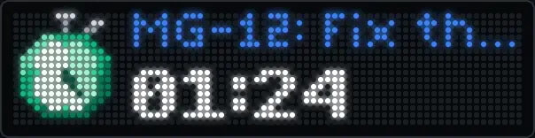

| | |
| :--- | :--- |
| 🏁 [First run](#-first-run) | the setup wizard, with or without a bar, and the mini timer |
| 🗂️ [The panels](#-the-panels) | the nine tabs of the window, one by one |
| 💡 [The bar itself](#-the-bar-itself) | every screen the bar shows, and its buttons |
| 🎹 [A Stream Deck](#-a-stream-deck) | the session on keys you place yourself |
| 🩺 [Troubleshooting](#-troubleshooting) | when something does not do what it should |
| 🔐 [Your data](#-your-data) | where it lives, and what leaves your machine |

---

## 🏁 First run

The onboarding wizard opens automatically. Three steps:

  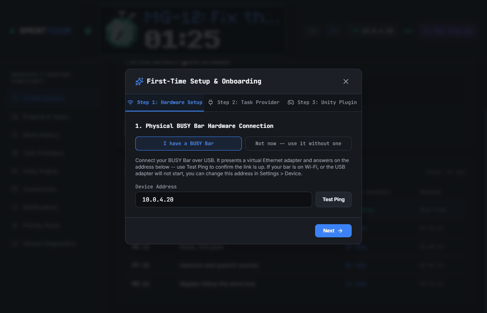
  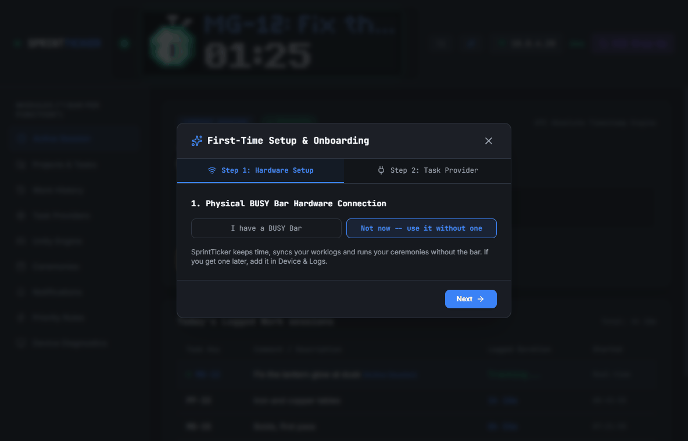

**1️⃣ Hardware.** First, whether you have a BUSY Bar. If you do, plug it in over
USB. It presents a virtual Ethernet adapter and answers on `10.0.4.20`, so there
is usually nothing to configure — press **Test Ping** to confirm the link. A
failure here is reported as a failure; it never congratulates you on a
connection it did not make.

If you do not, choose **Not now**: SprintTicker runs without one (see
[Without a BUSY Bar](#-without-a-busy-bar)), and you can add a bar later.

Developing without a bar but wanting to see what it would show? Run
`pnpm dev:mock` (or launch with `--mock-hardware`) and the on-screen emulator
shows what the device would display.

**2️⃣ Task provider.** Choose OpenProject, Jira Cloud or ad-hoc, and enter the
credentials for the one you picked:

| Provider | What it needs |
| :--- | :--- |
| 🔷 OpenProject | Domain URL, and an API key from *My Account → Access tokens* |
| 🟦 Jira Cloud | Site URL, your account email, and a token from `id.atlassian.com` |
| 📝 Ad-hoc | Nothing — local tasks only |

You can leave credentials blank and add them later in **Task Providers**. Until
a remote provider is configured the app runs on local ad-hoc tasks. Completing
the wizard saves the choice and immediately fetches your projects.

The **ad-hoc task key** (default `MISC-1`) is the key your own ad-hoc tasks
show in the window — meetings, admin, anything without a ticket. The bar
shows their name alone, which the shared key would only crowd out. Ad-hoc time stays in your
Work History and is **never sent** to Jira or OpenProject.

**3️⃣ Unity plugin.** Optional. Skip it if you do not use Unity.

### 💻 Without a BUSY Bar

<table>
  <tr>
    <th width="50%">🟢 With a bar</th>
    <th width="50%">💻 Without one</th>
  </tr>
  <tr>
    <td>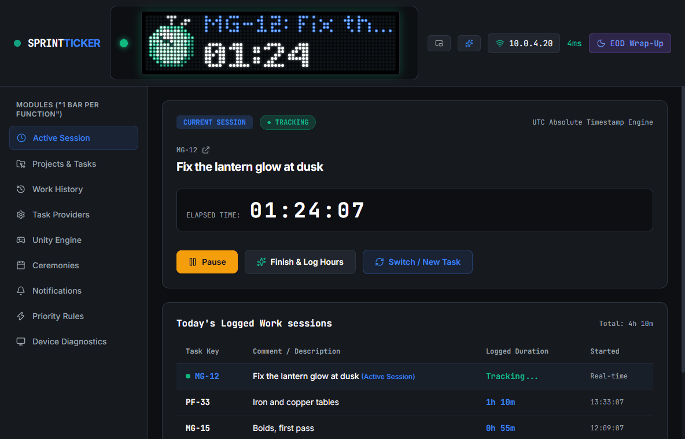</td>
    <td>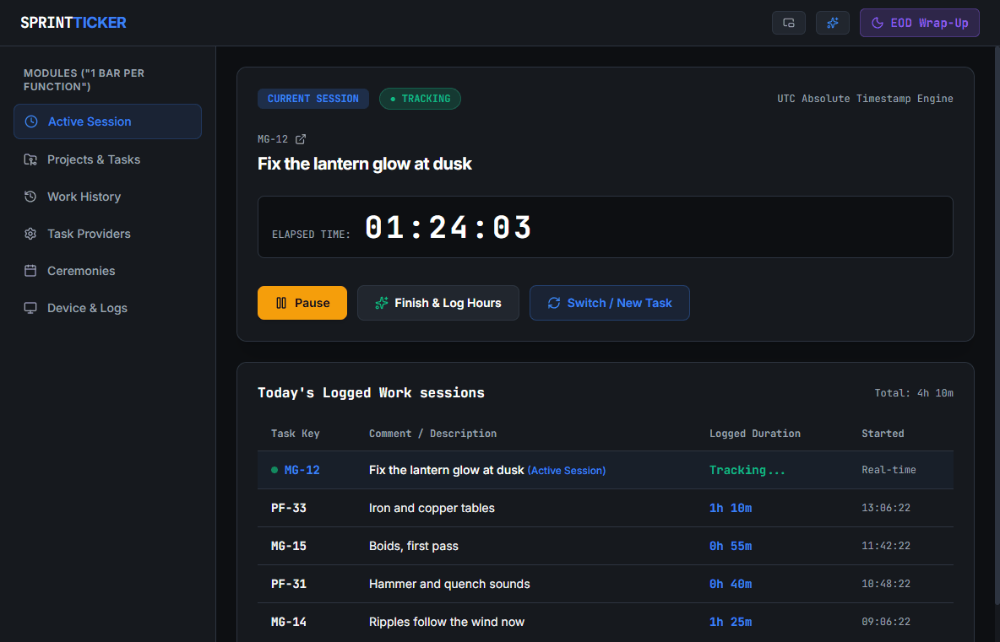</td>
  </tr>
  <tr>
    <td>Nine tabs; the emulator and the connection readout in the top bar.</td>
    <td>Six tabs; everything that keeps time is still there.</td>
  </tr>
</table>

Everything that keeps time works without the hardware: the task picker, the
running timer, pausing, finishing, worklog sync, history, the ceremonies and
the end-of-day wrap-up. What steps aside is what only describes the bar — the
on-screen emulator and connection readout in the top bar, **Priority Rules**,
which orders the bar's screen and nothing else, **Unity Engine**, whose
compile, Play Mode and error states exist to be shown on the bar, and
**Notifications**, which mirrors Windows notifications onto it. Notifications
*from* OpenProject still arrive, as Windows notifications; their settings are
in Task Providers. Events from the
Unity plugin are ignored in this mode, the Windows notification listener does
not run, and the setup wizard skips its Unity step. The end-of-day wrap-up still saves open Unity scenes. **Device Diagnostics**
becomes **Device & Logs**, keeping log export, the update setting and the
factory reset.

The app does not look for a bar in this mode, so it logs nothing about one being
unreachable.

  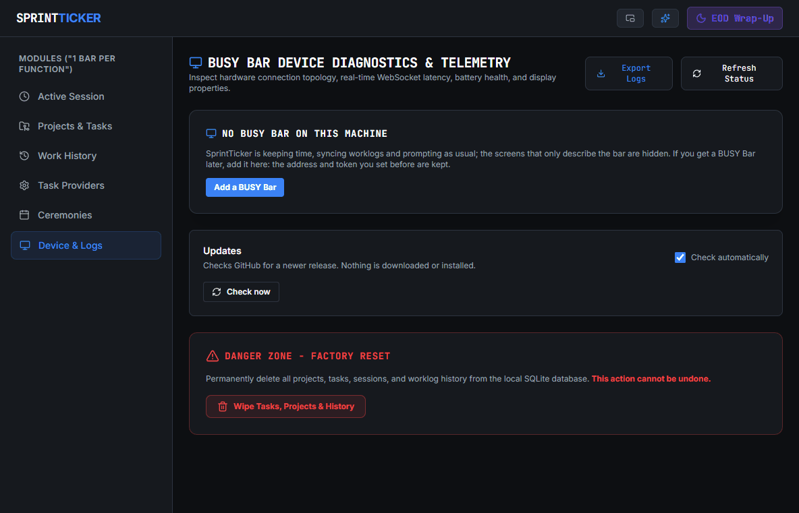

To switch, use **Use without a bar** in Device Diagnostics; the bar is cleared
and handed back to its own clock first. To add a bar later,
press **Add a BUSY Bar** in Device & Logs: the address and token you had set
before are kept, and the bar's screens come back at once.

### ⏱️ The mini timer

A small window that stays above every other one and shows what the bar would:
the task key and title, the elapsed time, and a coloured edge -- green while
tracking, amber while paused, grey with nothing running. Beside them is the
icon of whatever holds the bar: the stopwatch for your session, the gear while
Unity compiles, an app's icon during its notification, the burger at lunch, a
coffee cup while you are away. Hover it for what the bar says. Open it with **Mini
Timer** in the top bar or **Show Mini Timer** in the tray menu.

  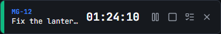

- ⏯️ **Pause** and **Resume** act on the session as the dashboard does.
- ⏹️ **Stop** offers the three ways to end it, in place of the buttons:
  **Not done** logs the time and keeps the task open, **Done** also marks it
  done, and **Discard** throws the session away after a **Yes**. **×** keeps
  the session running.
- 📋 The **list** button brings the dashboard forward with the task picker open:
  that is how you start or switch a task from it.
- 🖱️ Drag it by any part that is not a button. It reopens where you left it; if
  that was on a monitor you have since unplugged, it comes back in the
  bottom-right corner of the main one.
- 🔁 It reopens at the next launch if it was open when you quit, and stays closed
  if you closed it.

It counts seconds, which the bar does not: on screen a second costs nothing.

---

## 🗂️ The panels

Nine tabs down the left.

### ▶️ Active Session

The main screen. Start a task, and the bar shows it. Pause, resume, and finish
from here.

  

Finishing asks for a comment and whether to mark the task done. Marking it done
celebrates on the bar -- a green badge drops in, ticks itself, and throws
confetti beside **DONE!** -- then returns to the session. It also fires your
configured completion transition — which in Jira usually means "To
Review", not "Closed", because you send work for review rather than closing it
yourself. Stopping without marking it done shows **LOGGED** on the bar
instead: the time is kept and the task stays open.

🔀 **A task that leaves your list while you track it** -- reassigned to someone
else, closed or moved on Jira or OpenProject -- keeps running, and your time
is logged as usual. SprintTicker asks the provider why, and the panel and the
mini timer say so: **No longer assigned to you**, **Closed on the provider**,
or **No longer on the provider** when it was deleted or you can no longer see
it. Marking it done asks first, since your completion transition would move a
task that is no longer yours; on the bar, FINISH (or a long BACK) shows
**NOT YOURS / DONE? OK=YES**, and BACK refuses. A task already **closed**
there is the exception: marking it done asks nothing and moves nothing on the
provider. The task stays listed until the session ends, and leaves at the
next sync after that.

⏰ **A session left running** -- not stopped before the weekend, or overnight
-- is caught when you come back. If your last activity on the computer (or a
press on the bar) was on an earlier day, at least two hours ago, the session
is paused at that moment and nothing is logged. The window asks when you
stopped working on it: at your last activity, at your end-of-day hour that
day, or at a time you pick, each with the time it would log. Then **Log and
stop**, **Log and restart it now** (asking first if the task is no longer
assigned to you), **Discard**, or **I was working all along**, which counts
the whole absence. Stopping it from the bar or the mini timer logs up to your
last activity; resuming it does not count the gap. Turn the question off in
**Ceremonies**.

🌙 **Overtime is never interrupted.** As long as you are at the keyboard or
mouse, working past midnight is just a long session: nothing pauses it and
nothing asks. Only more than two hours without any input across midnight --
a long call -- brings the question, and **I was working all along** keeps it
all.

🗑️ **Discard this session**, the third choice, is for a session started by
mistake: nothing is kept in your history and nothing is sent to your
provider. It asks you to confirm, naming the task and the time it would throw
away, because that time does not come back.

| | |
| :---: | :---: |
| 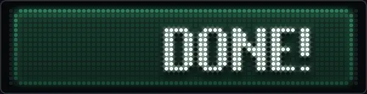 | 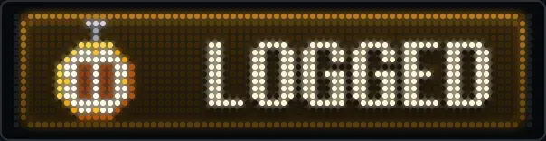 |
| ✅ Finished and marked done | 📝 Stopped: time logged, task still open |

### 📁 Projects & Tasks

Your cached projects and their tasks, refreshed from the provider. Create local
ad-hoc tasks here for work that has no ticket, or a project of your own: the
next sync leaves it alone, and time on its tasks stays on this machine like
ad-hoc time.

> [!NOTE]
> **Ad-hoc time stays on this machine.** It is in Work History like any other
> time, but it is never sent to your provider, which has no ticket to put it
> on. Finishing an ad-hoc task as done marks it done here only. The key the window shows is the one set in **Task Providers**
> (`MISC-1` by default); the bar shows the task's name alone.

  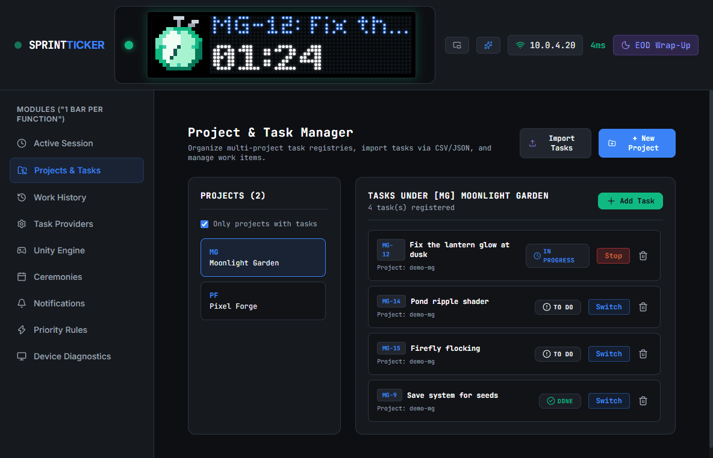

A task from Jira or OpenProject shows the start of its description under its
title, on one line. The task picker searches it too, so you can find a task by
what it is about.

🔎 **Only projects with tasks** -- the switch above the project list, on by
default -- hides every project with no open task. A provider lists every
project you can see, while the tasks it fetches are yours and the team's free
or ongoing work, so most projects held nothing to pick. A project is listed again as soon as it
has a task to do or in progress. The switch says how many projects it hides,
and turning it off lists them all. It is one setting: the task picker shows
the same switch, and the bar's own picker follows it. The project you have
selected stays listed even when it is empty, so one you have just created does
not vanish before its first task. If no project has a task for you -- before
the first sync, or on a day nothing is assigned to you -- every project is
listed, and the switch says so: *none has a task: showing all*. Ad-hoc work
does not count for this, since an ad-hoc task stays in progress until you
finish it as done.

👥 **Unassigned and Teammates'** -- two switches above each task list --
decide whose tasks it shows besides yours, which are always there.
**Unassigned**, on by default, lists the open tasks nobody is assigned: work
free to take. **Teammates'**, off by default, lists a teammate's task while it
is in progress. A task that is not yours carries *Unassigned* or the
assignee's name beside its key, and the switches say how many tasks they hide.
They are one setting: the task picker, the Projects & Tasks panel and the
bar's picker all follow it, and **Only projects with tasks** counts what they
show -- a project holding only unassigned work is listed while unassigned work
is. The task you are tracking stays listed whoever's it is. Every list keeps
one order: yours in progress, yours to do, unassigned to do, unassigned in
progress, teammates' in progress, then finished work -- yours, then
unassigned.

↗️ **Open a task on its provider** -- the small arrow beside a task's key in
the session panel, the Projects & Tasks panel and Work History opens it in
your browser, on Jira or OpenProject, to comment, attach a picture or read
the thread. Ad-hoc work and projects made in SprintTicker have no page there,
so no arrow.

🙋 **Starting an unassigned task assigns it to you**, without asking, and then
moves it to In Progress as for your own. If someone took it in the meantime,
it stays theirs -- SprintTicker never takes a task away from anyone -- but
your session runs and its time is logged: a Windows toast says *TEAM-2 is
taken*, the bar shows **TAKEN** and their name, and the panel and the mini
timer say **Assigned to** them. Marking it done then asks first, as for any
task that is not yours. If the assignment fails, a toast says the task *was
not assigned to you*; it is not retried, so assign it on the provider if it
should be yours. Starting a teammate's task in progress assigns nothing and
moves nothing.

The cache is what the app and the bar read. If it looks stale, **Sync Now** in
Task Providers refetches it.

### 📊 Work History

Worklogs by date, with a daily summary and an end-of-day export. The arrow
beside a task opens it on Jira or OpenProject, as in the session panel and
the Projects & Tasks panel.

  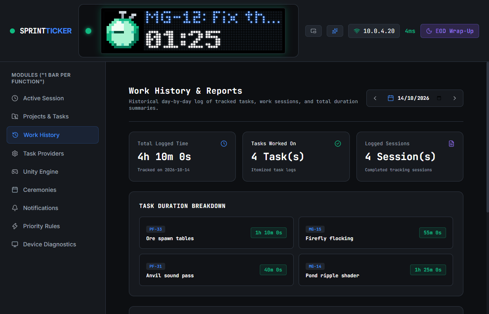

**A worklog never spans midnight.** Jira and OpenProject file a worklog under
the day it began, so a session from 23:00 to 01:00 is logged as two: an hour
on each day, each sent on its own. A session paused overnight and resumed in
the morning puts the morning on the morning's day. The finish dialog, and the
question about a session left running, say how the time will be filed before
it is. The timer still shows the whole session.

**A long pause starts a new worklog too**: 15 minutes or more by default,
set under **Working Days** in Ceremonies (0 keeps one worklog per day). A
shorter pause is a gap inside one worklog. A piece too short for your
provider -- 30 seconds after midnight, on Jira -- is added to its neighbour
rather than lost.

**A worklog is written locally whether or not the remote accepted it.** If Jira
refused a 40-second session, the time is still in your history — it just is not
in Jira. Each entry says where it stands: **Sent**, **Sending**, **Not sent**,
**Local only** (ad-hoc work, or too short for your provider), or a correction
on its way.

  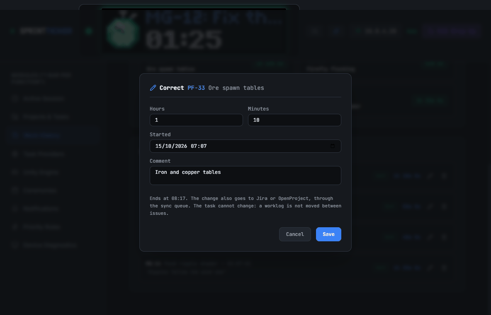

✏️ **Correct or delete a worklog** with the pencil and the bin on its row. A
correction changes the duration, the start or the comment — not the task: Jira
does not move a worklog from one issue to another. It applies here at once and
reaches Jira or OpenProject through the sync queue, so it survives a lost
connection or a restart; a worklog not sent yet is simply sent with the new
values. A deletion asks first, and deletes the entry at the provider too.
Worklogs sent by an earlier version are found at the provider by the
`[#xxxxxxxx]` tag at the end of their comment, so keep that tag if you edit the
comment in Jira.

Each entry is named by its task's key and title. **Deleting a task or a project
does not delete the time logged against it**: the task leaves your lists and
stays in your history. The same happens when your provider stops listing a task
you worked on — reassigned, closed or moved — and if it lists it again, it
comes back.

An entry whose comment starts **"Recovered:"** is a session an earlier version
left running behind another one. Its end is where the next session began, the
latest it can have run, so check it before copying it to a timesheet; it is not
sent to your provider.

### 🔌 Task Providers

Credentials, the completion transitions, and which tasks to fetch — assigned to
me, everything open, or your own query (JQL for Jira, a v3 filter array for
OpenProject).

  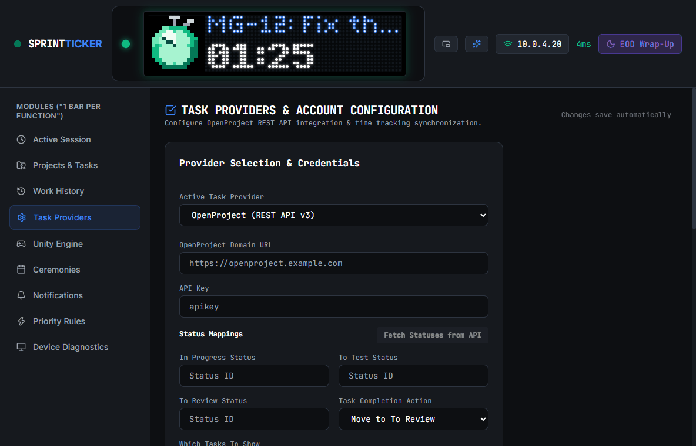

**Notifications from OpenProject** turns what happens on your work packages
into Windows notifications: assigned to you, a mention, a comment, a status
change, a date alert. Tick the ones you want. Clicking a notification opens the
work package in your browser. With a bar, they can go there too, as a banner
that competes for the display like any *Notification — Default*. The app
checks every minute by default (30 seconds to an hour); more than three at
once arrive as one summary. Only unread notifications that arrive after you
turn this on are shown -- what was already waiting in OpenProject is not
replayed -- and one you have read in OpenProject before the next check is not
shown either. **Send a test notification** shows what one looks like, and
says where it went.

**Notifications from Jira** does the same for Jira issues: assigned to you, a
status change, a comment, a mention in a comment. Clicking one opens the issue,
or the comment. Jira Cloud has no notification feed for apps to read, so
SprintTicker looks at the issues you are assigned, reported or watch at each
check, and works out what changed. That has edges worth knowing:

- 🙈 **Your own changes never notify you**, including the status changes
  SprintTicker makes for you when you start or finish a task.
- 👀 **A mention on an issue you do not follow is not seen**, and neither is a
  mention in a description rather than a comment.
- 📅 **Jira has no date alerts**, so that box is not offered.

Below the credentials is the **sync queue**: every worklog that has not reached
the provider, with the server's own message, the attempt count against the
ceiling, and when the next attempt is due. When the provider refuses your saved
credentials, a Windows notification says **Sending time to Jira stopped** (or
OpenProject) -- once, even with provider notifications switched off. Your time
waits in the queue; saving the credentials again sends it.

The project and task lists refresh by themselves after every sync, every five
minutes, so a task added on the provider appears without changing views.

| Button | Does |
| :--- | :--- |
| 🔄 **Sync Now** | Fetches projects and tasks immediately |
| ♻️ **Retry Failed** | Un-parks rows that gave up — use after fixing what broke them |

> [!NOTE]
> **Why a row parks**
>
> A row goes `FAILED` when the failure is permanent: a deleted issue, a revoked
> key, a session too short for the provider to record. Retrying those on a timer
> would send byte-identical requests forever, so the app stops and tells you
> why. **Retry Failed** is for after you have fixed the cause.

### 🎮 Unity Engine

Discovered Unity projects and plugin injection. Once installed, the bar shows
compile progress, an "ON AIR" screen during Play Mode, and console exceptions.

> [!NOTE]
> **Nothing on the bar from Unity?** Open the editor's Console and search
> for `sprintticker`. A line saying a script *will not be compiled because
> it does not belong to any assembly definition file* is a plugin from before
> this release; one compile with the current plugin linked fixes it. An
> error from `SprintTicker.Unity.Editor` stops the project's Play Mode too,
> so report it.

  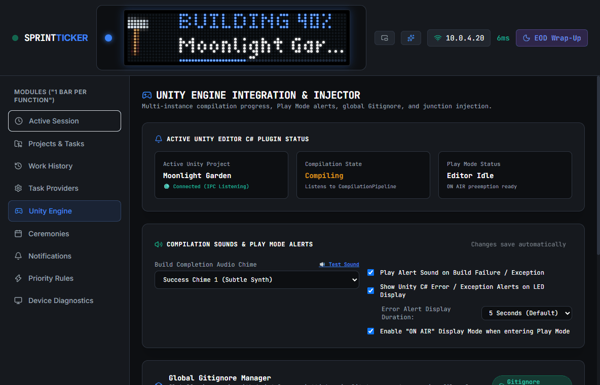

The icons move. While scripts compile the gear turns; during Play Mode the
pad is played, its buttons going down and its stick pushed; a build shows a hammer striking and a lightmap
bake a glowing bulb; an exception shakes its warning triangle. Outside Unity,
a notification without an app logo rings its bell, the end-of-day prompt's
alarm clock rings, and the lunch prompt's burger hops. An OpenProject notification passes a shine across the OpenProject logo;
other apps' logos stay still. The bar animates them itself. If one ever shows still, the log's
`[IconAnimator]` lines say why, and the screen is otherwise unaffected.

| | | | | | | |
| :---: | :---: | :---: | :---: | :---: | :---: | :---: |
| 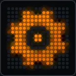 | 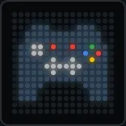 | 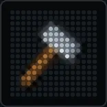 | 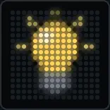 | 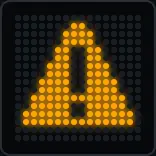 | 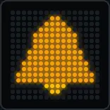 | 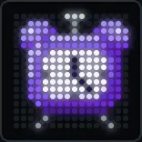 |
| compiling | Play Mode | build | lightmap bake | exception | notification | end of day |

### 📅 Ceremonies

Working hours, and the three scheduled events:

  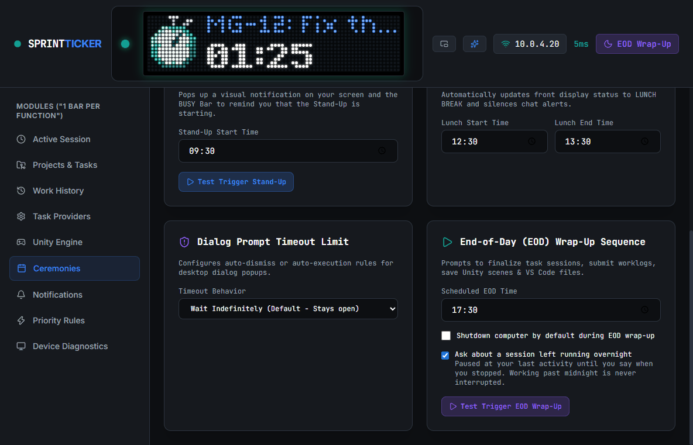

| | Default | Does |
| :--- | :--- | :--- |
| 🗣️ **Stand-up prompt** | 09:30 | Prompts you; **Join** switches your timer to Daily Standup |
| 🥪 **Lunch** | 12:30–13:30 | Switches to Lunch mode |
| 🌙 **End-of-day wrap-up** | 17:30 | Prompts to wrap up; can save open editors and schedule a shutdown |

Both prompts can be confirmed or dismissed **from the bar itself** — see the
hardware controls below.

During Lunch the bar shows a sandwich building itself beside **LUNCH**, on
teal. In Away mode it shows a steaming coffee beside **AWAY**, on purple. At the
stand-up prompt it shows three people round a table taking turns to speak,
beside **MEETING**, on blue. Each loops
for as long as the mode lasts, and the bar plays it itself, so it keeps moving
when the computer is busy.

| | |
| :---: | :---: |
| 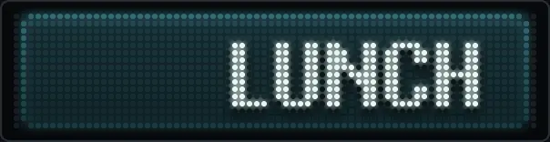 | 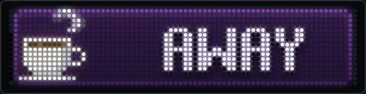 |
| 🥪 Lunch | ☕ Away |
| 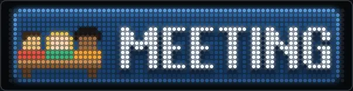 | 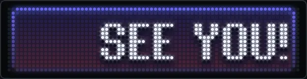 |
| 🗣️ Stand-up | 🌙 End of day |

🗣️ **Joining the stand-up switches your timer to it.** Press **Join** in the
window, or OK on the bar's prompt: the task you are tracking stops, its time
logged, and a **Daily Standup** task starts -- one ad-hoc task, reused every
day. The bar then shows its timer, with three people at a table in place of
the stopwatch, taking turns to speak, so you can see the prompt has gone and
the meeting is being timed. Stop the stand-up (STOP, FINISH or DROP) and the task you were on starts
again, by the same rules as after lunch: once, that day, and only if you have
not started something else meanwhile. A task that left your list during the
meeting is asked about first: **Resume after the stand-up?** in the window,
**NOT YOURS / RESUME IT?** on the bar. **Dismiss**, BACK, or leaving the prompt
alone keeps your task running.

🥪 **Lunch stops the task you are tracking and starts it again when lunch
ends**, so the time goes in as two worklogs either side of the break. The task
to restart is kept in the database: closing the app over lunch, or leaving
Windows locked until after it ends, does not lose it -- it starts again when
you are back. Lunch never undoes what you do:

- **Working through lunch.** Start a task, resume a paused one or switch tasks
  during lunch -- in the window, the mini timer or on the bar -- and Lunch ends
  there and then. Nothing restarts when it would have ended, even if you stop
  your task before that, and Lunch does not start again that day.
- **The bar's picker works during lunch.** START or a click with nothing
  running opens it over the sandwich; BACK brings the sandwich back. Opened
  while Windows is locked, it waits under Away and shows as soon as you
  unlock, ahead of Unity and any notification that came in meanwhile.
- **A task that left your list over the break** -- reassigned, closed or
  moved -- is not restarted without asking. The window asks **Resume after
  lunch?**, and the bar shows **NOT YOURS / RESUME IT?**: OK resumes it, BACK
  leaves it. Starting another task answers no. Resuming it tracks your time
  and nothing else: the task stays out of your lists, is not moved to In
  Progress on the provider, and marking it done still asks first.
- **Locked when lunch begins.** The bar stays on Away, but your task still
  stops at the start of lunch -- it does not count the break as work because
  Windows was locked. Unlock during lunch and the bar goes straight to Lunch;
  unlock after it and your task starts again.

Lunch must start and end on the same day, start first: the Ceremonies panel
says so and saves nothing until it does. A window across midnight never began.

📆 **The ceremonies happen on working days only.** **Working Days**, at the
top of the Ceremonies panel, picks them -- Monday to Friday until you change
it, and at least one. On any other day nothing is prompted and Lunch does not
start; your timer works as on any day, and what you track is logged as usual.
With OpenProject connected, the holidays your instance lists (its
*Non-working days*, under Administration) are days off too. They are read
once a day; if the instance cannot be reached, the weekdays you picked decide
alone, and a holiday already read stays one.

🗓️ **The wrap-up of the week's last working day closes the week.** Usually
that is Friday's; with Friday a holiday, or a four-day week, it is Thursday's.
A notice in the corner of the window then shows the week and the time logged
in it, a reminder to check it is all in before your timesheet is due. **Open
Work History** takes you to it; either button dismisses the notice, which
otherwise stays -- across a restart too -- until you do. Missed the wrap-up
(a day off you had not entered, the laptop shut)? The next working day closes
the week at its first check instead, and a week closes once, whatever happens.
A week you did not work at all closes without a notice.

### 🔔 Notifications

Which applications may reach the bar. **Nothing is mirrored until you allow it.**

  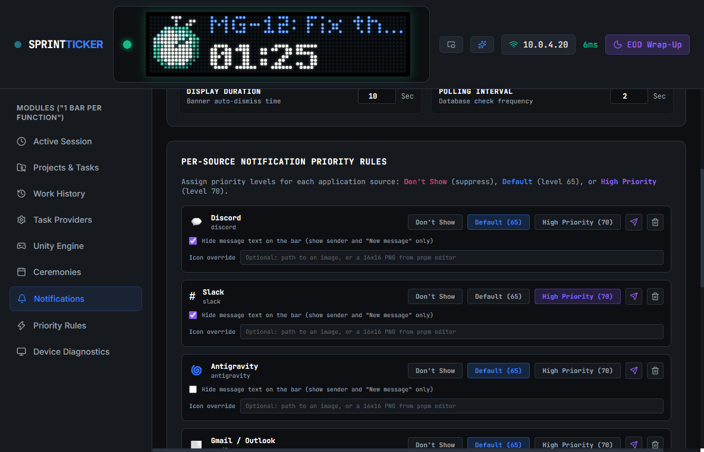
  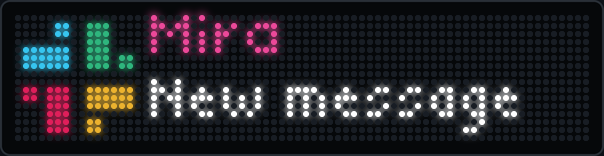

Per app, choose one of three:

| Setting | Effect |
| :--- | :--- |
| 🚫 **Don't Show** | Ignored entirely |
| 💬 **Default** | Claims the display at whatever *Notification — Default* scores |
| 🔔 **High Priority** | Claims it at whatever *Notification — High Priority* scores |

Note what that means: an app is assigned to a **class**, and the Priority Rules
panel decides what that class is worth and how it behaves during Lunch and Away.
Nothing here hardcodes which app wins. In the shipped defaults those two classes
score 65 and 70, and a few common apps arrive pre-classified — Slack and the
battery warning as High Priority, Discord, Gmail and Windows as Default — but
all of it is yours to change.

Each app's real icon is resolved from its MSIX manifest or Start Menu shortcut
and downscaled to 15×15. If it picks the wrong executable — name matching is not
perfect — set an icon override on that app.

**Sender only** mode shows that a message arrived without showing what it said.

Notification text is redacted from logs and the diagnostics export. Launch with
`--debug-notifications` to see it while troubleshooting.

### ⚡ Priority Rules

What the display shows when several things want it. Every claim has a score;
the highest holds the bar.

  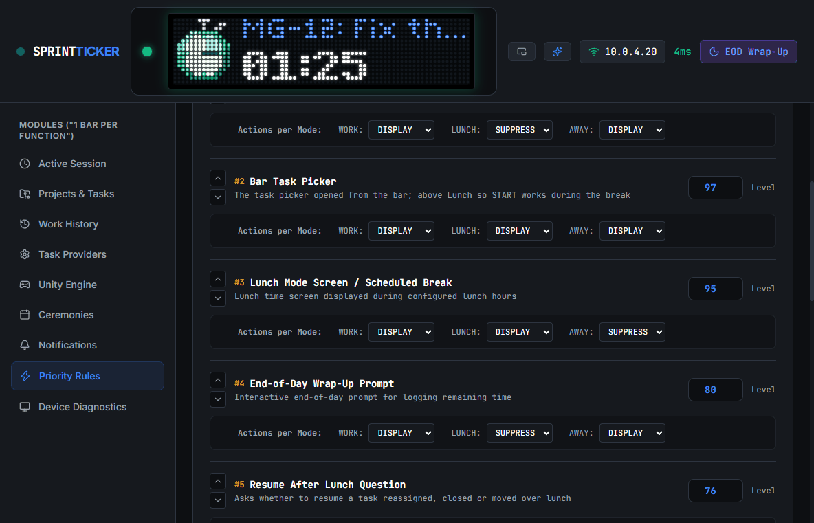

| Claim | Default |
| :--- | ---: |
| 🧳 Away mode | 100 |
| 🎛️ Bar task picker | 97 |
| 🥪 Lunch mode | 95 |
| 🌙 End-of-day wrap-up | 80 |
| 🥪 Resume after lunch question | 76 |
| 🗣️ Stand-up prompt | 75 |
| 🔔 Notification — High Priority | 70 |
| 💬 Notification — Default | 65 |
| ⚠️ Unity build failure | 60 |
| ⚙️ Unity compiling | 55 |
| 🎮 Unity Play Mode | 50 |
| ⏱️ Active task tracker | 45 |

Every row is editable, including what each does in each mode — **Display**,
**Suppress** or **Queue** for Work, Lunch and Away.

With the shipped ordering, notifications do not interrupt Lunch or Away. That is
the table working as configured, not a bug. Move the rows if you disagree.

### 🩺 Device Diagnostics

Connection status, battery, firmware, starting with Windows, the update
setting, and the animation debugger — marquee speeds, particle effects, LED colours and icon rasterisation,
live, drawn through the real renderer.

  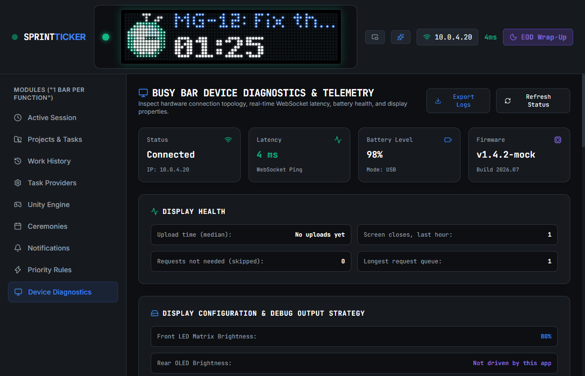

It also holds **Connection**, where you set the address the app dials and, if
your device needs one, an API token:

- 🌐 **Device address.** Defaults to `10.0.4.20`, which is where the bar answers
  over USB. Change it for a bar on Wi-Fi, or when you are reaching the device
  through a proxy on another address. An IPv4 address or a hostname — no
  `http://`, no port, no path.
- 🔑 **API token.** Leave empty for USB, where the bar accepts unauthenticated
  requests. Fill it in once the device has access protection enabled, which is
  the normal state over Wi-Fi; without it every request comes back 401 or 403.

**Save & Reconnect** applies both immediately — the app re-dials without a
restart. Watch the connection status at the top of the window to see whether the
new address answered; saving means the setting was stored, not that the bar
replied. **Reset to USB default** puts the address back to `10.0.4.20`.

🚀 **Start with Windows** starts SprintTicker when you sign in, in the tray,
with no window over whatever you open first. The tray icon, the bar and the
mini timer work as usual; open the window from the tray, or by starting
SprintTicker again. The same switch is in the tray menu, and Windows lists
the entry under *Settings → Apps → Startup*: turned off there, it reads off
here too. The portable build registers the file you ran, so move it and
switch it on again from the new place. A build run from source
(`pnpm dev`) shows the switch greyed out.

---

## 💡 The bar itself

### 🖼️ What it shows

A 72×16 RGB matrix: a 16px icon on the left, then two rows of text, both in
proportional fonts drawn for SprintTicker. Row 0 holds roughly twelve characters
of mixed case in its 55px field. Row 1 uses a narrower face and holds about
fourteen.
Text that does not fit ends in `…`. Accented letters are shown without their
accents, since the display draws plain ASCII only.

The small screen on the back belongs to the bar itself: it shows a copy of the
front at twice the size, and its own clock and date when the front is empty.
SprintTicker draws nothing there.

Every screen, as the bar shows it:

| Screen | What it means |
| :---: | :--- |
| 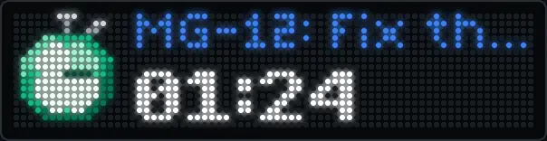 | ⏱️ **Tracking.** The task on row 0, its time in large digits on row 1. The stopwatch's hand ticks round. |
| 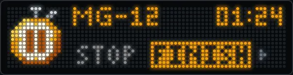 | ⏸️ **Paused.** The key and its time; turn the wheel to **STOP**, **FINISH** or **DROP**, click to confirm. DROP asks first. |
| 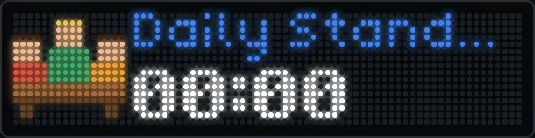 | 🗣️ **Stand-up.** Joined from its prompt: the stand-up's own timer, with three people at a table taking turns to speak in place of the stopwatch. An ad-hoc task shows its name alone, never its shared key. |
| 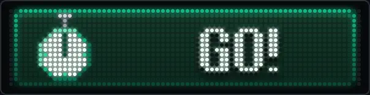 | 🏃 **GO!** A task picked on the bar itself, for two seconds. |
|  | 📝 **LOGGED.** Stopped: the time is kept, the task stays open. |
|  | ✅ **DONE!** Finished and marked done. |
| 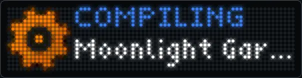 | ⚙️ **Compiling** in Unity, with the project on row 1. |
| 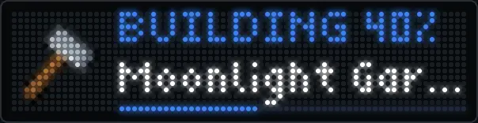 | 🔨 **Building**, with its percentage and a progress line along the bottom. |
| 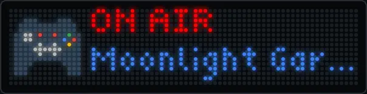 | 🎮 **Play Mode.** ON AIR until you stop playing. |
| 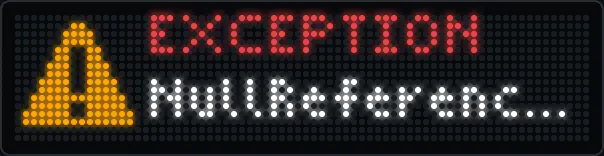 | ⚠️ **Exception.** Its message on row 1, for a few seconds. |
|  | 🔔 **Notification**, from an app you allowed, with its own icon. |

The session screen's icon is a stopwatch whose colour says where you are: green
while a task runs, its hand ticking round once a second; amber with blinking
pause bars while it is paused; dim grey when nothing runs (the screen then
reads **Ready / No task running**). While a task runs, row 0 shows the task and
row 1 its time, in large digits. While paused, row 0 shows the task key and its time, and row
1 offers **STOP**, **FINISH** and **DROP**; the wheel moves one choice per
notch and stops at either end, and a click confirms. Row 1 has room for two of
them, so it shows STOP and FINISH with a small arrow towards DROP, and FINISH
and DROP once you turn to it. DROP discards the session, so it asks first:
**DISCARD?** in red, **OK=YES BACK=NO**. A click throws the session away --
no worklog, nothing sent, no scene -- and BACK, short or long, brings the menu
back; the other buttons wait for the answer. Picking
a task from the bar's own picker shows **GO!** for two seconds, the stopwatch
setting off, before the tracking screen. STOP logs the time and leaves the task open, and the bar shows
**LOGGED** for three seconds, the stopwatch's hand sweeping back to twelve;
FINISH also marks it done, and shows **DONE!**.

Unity screens all read the same way: what is happening on row 0 (with the
percentage for a build or a lightmap bake), the project on row 1, and for a
build or bake a thin progress line along the bottom. An exception shows its
message on row 1 instead of the project.

> [!NOTE]
> **Why the timer shows HH:MM**
>
> Every frame is an asset upload plus a draw — two HTTP requests. A per-second
> redraw would mean an upload a second for a digit nobody reads, so the tracker
> deliberately shows minutes. The stopwatch's ticking hand is the bar's own
> animation: it shows that the clock is running, and is not the seconds of your
> session.

### 🎛️ Controls

| Control | Does |
| :--- | :--- |
| ▶️ **START** press | Start or pause. With nothing running, opens the task picker |
| 🔄 **Wheel** turn | Scroll |
| 🖱️ **Wheel** click | Open the task picker |
| ↩️ **BACK** short press | Dismiss the current notification |
| ⏹️ **BACK** long press | Complete the active task and log the time |

All of these are rebindable.

🗂️ **The task picker** is two stages: turn to choose a project, click to descend
into it, turn to choose a task, click to start. **BACK** leaves at any point.
A blue folder means you are choosing a project, a checklist a task. The
checklist also gives the task's status: grey for to do, amber for in progress,
green for done, and a done task's name is dimmed. Tasks come in the window's
order -- yours in progress, yours to do, unassigned work, teammates' work in
progress, finished work last -- and within each the most urgent first, by the
priority set in Jira or OpenProject. Projects and tasks follow the **Only
projects with tasks**, **Unassigned** and **Teammates'** switches of the
Projects & Tasks panel. The second row shows the task key, then whose the task
is when it is not yours -- `free` for nobody's, `@Alice` for a teammate's --
followed by as much of its description as fits, and on
its right where you are in the list -- `3/12` --
with a thin line along the bottom whose bright segment slides from left to
right as you scroll: at the far left there is nothing before, at the far right
nothing after.

🗣️ **During a ceremony prompt**, START confirms and BACK dismisses. The end-of-day
wrap-up asks twice — the first START is "yes", the second confirms — because it
can shut your machine down. Once it is done, the bar says **SEE YOU!** for five
seconds, a moon rising and the stars coming out, and then goes idle.

The bar's buttons answer the wrap-up only while the bar shows its prompt. The
**EOD Wrap-Up** button in the top bar puts the prompt on the bar too. If
something ranked above the wrap-up holds the bar -- Lunch, in the shipped
ordering -- the buttons keep doing what that screen says, and the wrap-up is
confirmed in the window.

---

## 🎹 A Stream Deck

SprintTicker has a plugin for Elgato's Stream Deck app (7.1 or later). It
works beside the bar or without one, and leaves the rest of your deck alone.
Releases carry it beside the installer, from the first one after 1.2.1, as
`SprintTicker-StreamDeck-<version>.streamDeckPlugin`: double-click it. Its
version is its own, not the app's. Before that release, build it from the
source with `pnpm deck:pack` and double-click the `.streamDeckPlugin` file
that lands in `packages/streamdeck-plugin/dist/`. It has been tried on Stream
Deck Mobile, not yet on a physical deck.

Its six actions are listed under **SprintTicker** in the Stream Deck app --
as many as a Stream Deck Mini has keys. Drag each onto any key, as many times
as you like:

| Action | The key shows | A press |
| :--- | :--- | :--- |
| **Session** | the task, its time and the bar's icon, moving as it does on the bar -- a notification's own icon while its banner holds the bar -- under a band: green while tracking, amber while paused | pauses or resumes; with nothing running, opens the task picker. **Held** half a second, it opens the task picker whatever runs |
| **Not done** | NOT DONE | ends the session and logs its time; the task stays open |
| **Done** | DONE | ends it and marks the task done |
| **Discard** | DISCARD | throws the session away, nothing logged |
| **Yes** / **No** | the answer to the question waiting | joins or skips the stand-up, wraps up the day or not, resumes a task or leaves it |

- **A key's colour says what it does.** A coloured glyph can be pressed; a
  grey key has nothing to do; a key filled with colour is waiting on you --
  a question, or a second press.
- **Discard asks first, on the same key.** It fills red, **DISCARD?**; press
  it again within four seconds to go ahead. Done does the same, filled amber,
  **NOT YOURS**, when the task is no longer yours. Waiting, or another task
  starting, takes the question back.
- **Keys move a little when something happens.** Done's check draws itself,
  Discard's bin lifts its lid and Not done's square presses in when you press
  them; Yes and No draw their mark when a question arrives. Half a second,
  then they rest.
- **Yes and No are two keys**, and neither changes meaning with how long you
  hold it. Session is the one key with a long press: held, it opens the task
  picker -- to switch tasks without ending the one running. Yes and No are
  grey while nothing is asked. The wrap-up asks twice, as on the bar: Yes,
  then **CONFIRM**.
- **offline under every key** means the plugin cannot reach SprintTicker:
  start it, and the keys come back by themselves within ten seconds. **update
  app** means SprintTicker and the plugin are of different versions -- update
  whichever is older.

---

## 🩺 Troubleshooting

Click a problem to unfold its answer.

📭 <b>The task list is empty</b>

 Check Task Providers for a saved domain and key.
Press **Sync Now**; if it stays empty, the credentials are probably wrong — the
app deliberately does not invent tasks. A provider error is shown rather than
swallowed.

🔑 <b>Jira says <code>Checking the Jira credentials failed: HTTP 401</code></b>

 Jira no longer
accepts the API token. Atlassian tokens carry an expiry date chosen when they
are created, so a token that worked last month can simply have run out. Create
a new one at id.atlassian.com › Security › API tokens and paste it into Task
Providers. Your projects and tasks stay as they were in the meantime, and the
next sync brings them up to date.

🔀 <b>The task I am tracking says "No longer assigned to you", "Assigned to …" or "Closed on the provider"</b>

 Since you started it, the task
left what your provider lists for you: reassigned to someone else, closed, or
moved to a project you are not in. Nothing is lost: the session keeps running
and its time is logged when you stop. The task stays in your lists until then.
Marking it done asks first, because your completion transition would move a
task that is no longer yours. If the provider refuses the time -- some Jira
setups forbid logging on someone else's issue -- the row appears in the sync
queue panel with Jira's own message.

📤 <b>A worklog never reached Jira or OpenProject</b>

 Open the sync queue panel. The
row carries the server's own message. Common causes:

- *`404` — the issue no longer exists.* Nothing to do; the local worklog stands.
- *`400` — under a minute.* Jira records time to the minute; anything shorter
  rounds to zero and is refused. The time is in your local history.
- *`401`/`403` — the key was revoked.* Enter a new one; saving credentials
  automatically un-parks rows the old key stranded.

✏️ <b>A correction never reached Jira or OpenProject</b>

 The worklog says **Correction failed**,
and the sync queue panel lists a *Correction* row with the reason.

- *Not found in Jira (or OpenProject).* The entry was deleted there, or its
  comment lost the `[#xxxxxxxx]` tag that identifies it. Correct it there by
  hand; the worklog here already has the new values.
- *Under a minute.* Jira records time to the minute, so a correction to a
  shorter duration is refused before it is sent.
- *`401`/`403`.* As for any worklog: enter a new key, and the row is retried.

A **Correction pending** that stays put is waiting for the worklog's own send
to arrive first: a correction never overtakes it.

🔕 <b>Notifications never appear on the bar</b>

 Three things to check, in order: the
app is set to something other than *Don't Show*; the notification listener is
running (Device Diagnostics reports its status — **its failures are otherwise
silent**); and nothing higher-priority holds the display, Lunch and Away being
the usual culprits.

🔌 <b>The bar never connects</b>

 The header shows *Disconnected* and Device
Diagnostics reports no firmware or battery. The bar reaches the app as a **USB
network device on `10.0.4.20`**, so the question is whether that device exists
at all:

1. Open <http://10.0.4.20> in a browser. If the bar's own web UI loads, the link
   is fine and the problem is in the app — export the logs from Device
   Diagnostics and read the `[BusyBarDriver]` lines.
2. If the browser times out, run `ipconfig` (Windows) and look for an adapter
   holding a `10.0.4.x` address. **No such adapter means the bar is not
   enumerating**, and nothing in software can reach it.
3. Reseat the cable, and make sure it is a **data** cable rather than
   charge-only — a charge-only cable powers the bar, so its lights come on and
   it looks healthy while presenting no network device at all. Try a port
   directly on the machine rather than through a hub, and confirm the bar is
   awake.
4. On Windows, open Device Manager and look under **Network adapters** for
   *Flipper FZCO Network Interface*. A yellow warning triangle with **Code 10 —
   "This device cannot start"** means the bar is enumerating correctly and
   Windows' own USB network driver is refusing to bring the interface up. See
   the note below; this is not something the app can fix.

> [!WARNING]
> **Code 10 on the Flipper network interface is a Windows driver fault, not a
> bar fault or an app fault.**
> It has been reproduced on Windows 11 25H2 with an Intel 700-series USB
> controller, where the composite device enumerates cleanly, every descriptor
> reads back, and the network child still fails to start. The same bar works on
> another computer. Reinstalling the driver, switching to the alternate inbox
> NCM driver, `DISM`/`sfc`, clearing the USB descriptor cache and disabling
> selective suspend all change nothing.
>
> An **in-place repair upgrade** of Windows is the obvious next move, and on
> this machine it did not help: the upgrade completed, the driver store was
> rebuilt, Windows selected the same `usbncm.inf`, and the interface still came
> up with Code 10. Try it if you like, but do not count on it.
>
> **What does work is not using the Windows driver at all** — pass the USB
> device through to another network stack. WSL2 with `usbipd-win` brings the
> adapter up without complaint under its own `cdc_ncm` driver; proxy the bar
> back to a local address from there.
>
> Then **put that address in Settings › Device → Connection**. That is what the
> setting is for: the bar is reachable at, say, `10.0.4.21`, and the app needs
> to be told.
>
> One thing to watch if you go this route: a `usbipd` binding, and any watcher
> script that re-attaches the device on plug-in, will claim the bar before
> Windows can try. If you ever want to re-test the native driver, disable the
> watcher and `usbipd unbind` the device first, or you are only testing the
> passthrough.

> [!NOTE]
> **Export the logs; they now say what went wrong.** The driver records the
> reason it could not reach the device — `timed out after 2000ms`,
> `ECONNREFUSED`, and so on — and logs the moment a connection is lost or comes
> back. Earlier builds failed silently, so a diagnostics export sent in to ask
> "why won't it connect" contained no evidence of the failure anywhere.

🎞️ <b>An animation plays in the app but not on the bar</b>

 Fixed as of this
release, and worth knowing why, because the symptom is confusing: the preview
and the bar are fed by two different paths. The on-screen emulator draws every
frame locally, while the bar is handed the whole animation file and plays it
itself, so the preview kept animating while the bar showed nothing. Two causes,
both addressed — a refused upload that went unreported, and the app drawing its
own blank frame on top of the animation it had just started. If you still see
it, export the logs from Device Diagnostics and look for `[AnimationPlayer]`
lines naming the file and its size.

🧊 <b>The bar freezes and stops answering</b>

 The panel stops changing, the app
reports the bar disconnected, and sometimes the bar restarts on its own about
45 seconds later. On firmware 1.2.4 this is what happens when the display is
cleared a few times while a picture and an animation are both on it. Earlier
builds did exactly that each time Lunch, Away or a meeting began from a screen
with an animated icon. 1.2.0 switched scenes without clearing; it still hung
the bar during long Unity sessions, because the end of a compile cleared the
display two or three times at once. 1.2.1 fixes that, and a burst of compiles
now keeps the compiling screen up instead of clearing between each one.

Firmware 1.2.4 also freezes, now and then, when an animation is removed from
the panel while it plays -- the animated icon at the end of a compile, for
instance. The panel then stays on that icon, still moving, and the bar stops
answering. Nothing warns of this one. 1.2.1 never removes a playing
animation: it replaces it with an empty one, and returns to the clock by
taking the picture down first, which is the half second of black you may see
before the clock.

If the bar does freeze, unplug and replug it, then
export the logs from Device Diagnostics: the lines just before the freeze say
what the app was drawing. For the first kind of freeze, uploads taking several
hundred milliseconds, rather than about fifty, are the warning sign, and
Device Diagnostics shows them under **Display Health**: the median upload
time, turning red with a warning when it reaches that level, and how many
times the screen closed in the last hour. If you see the warning, export the
logs before restarting the bar; the bundle then holds the run-up to the
freeze. Once the bar is back, the app redraws the current screen by itself.

🕰️ <b>The bar shows something stale</b>

 Something is holding the display lock at a
higher priority. Check Priority Rules and your current mode. After the bar
restarts or its connection drops, the app redraws the current screen within a
few seconds of the bar answering again; before 1.2.1 it could put back the
screen from before the outage.

🛡️ <b>Windows warns on first launch</b>

 The build is unsigned. *More info → Run
anyway*. There is no way around it short of a code-signing certificate.

🔤 <b>Accented characters</b>

 These are transliterated to ASCII (`é` → `e`), because
the device accepts printable ASCII only. Emoji do not render.

### 📭 No notification from OpenProject or Jira

- **Is it switched on, for that kind?** Task Providers › Notifications from
  OpenProject (or Jira). **Send a test notification**: if it says it was sent and nothing
  appeared, the cause is on the Windows side.
- **Windows may be holding it.** Do Not Disturb, Focus, or SprintTicker turned
  off in Windows Settings › System › Notifications all hide toasts without
  telling the app. They still land in the notification centre.
- **It may have been read already.** Only unread OpenProject notifications are
  shown; one read in OpenProject between two checks is not news.
- **On Jira, is it an issue you follow?** Only issues you are assigned,
  reported or watch are read, and nothing you changed yourself is reported.
- **The log says why a check failed** -- `[ProviderEvents] OpenProject events
  unavailable: ...`, or `Jira Cloud events` -- and a refused toast as
  `[Toasts] Windows did not show a notification`.

---

## 🔐 Your data

One SQLite file: `%APPDATA%\SprintTicker\sprintticker.db`. Installing over a
previous version does not touch it.

Provider credentials are encrypted at rest with Windows' own keystore. If it is
unavailable, the app says so rather than failing silently; if the file is read
by a different Windows account, the key reads back as "not configured" and you
are asked to re-enter rather than shown a crash.

> [!NOTE]
> **No telemetry, no account, no server**
>
> The one outbound request is a daily update check against GitHub, which sends
> nothing about you and can be turned off in Device Diagnostics — turning it off
> stops the request being made, rather than hiding its result.
