# User guide

Using SprintTicker day to day.

Installation is in the [README](../README.md#-installation). This picks up from
first launch.

  

| | |
| :--- | :--- |
| 🏁 [First run](#-first-run) | the setup wizard, with or without a bar, and the mini timer |
| 🗂️ [The window](#-the-window) | its four places -- Today, Tasks, History, Settings -- and the header |
| 💡 [The bar itself](#-the-bar-itself) | every screen the bar shows, and its buttons |
| 🎹 [A Stream Deck](#-a-stream-deck) | the session on keys you place yourself |
| 🩺 [Troubleshooting](#-troubleshooting) | when something does not do what it should |
| 🔐 [Your data](#-your-data) | where it lives, and what leaves your machine |

---

## 🏁 First run

The onboarding wizard opens automatically. Two steps:

  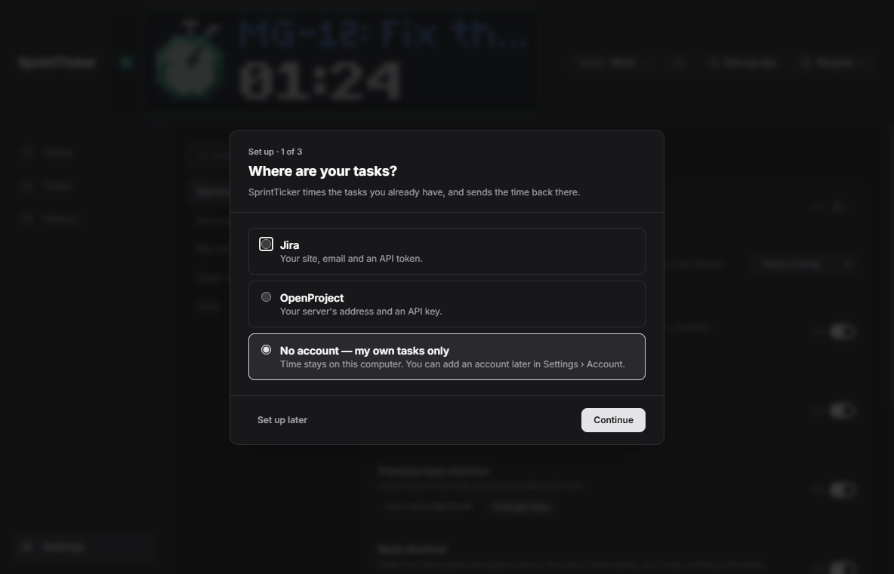
  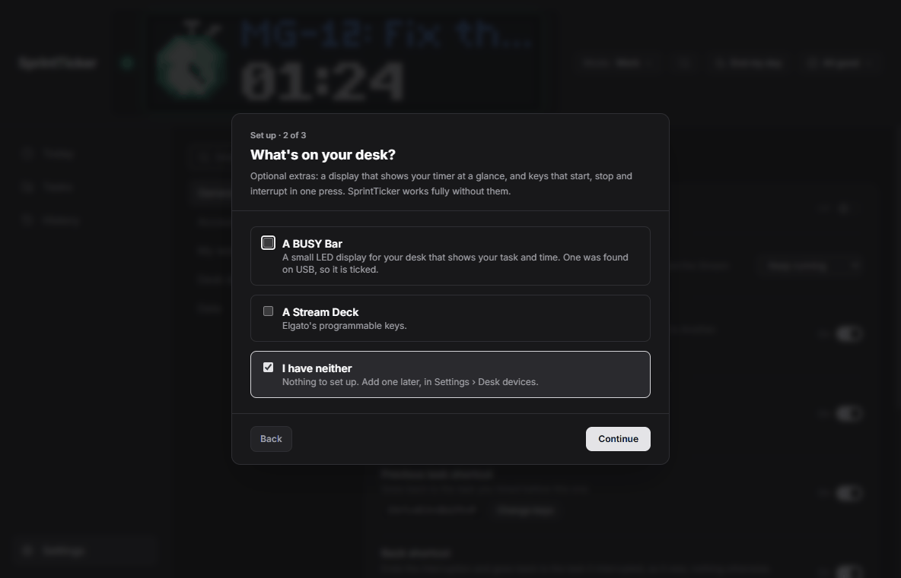

**1️⃣ Hardware.** First, whether you have a BUSY Bar. If you do, plug it in over
USB. It presents a virtual Ethernet adapter and answers on `10.0.4.20`, so there
is usually nothing to configure — press **Test Ping** to confirm the link. A
failure here is reported as a failure; it never congratulates you on a
connection it did not make.

If you do not, choose **Not now**: SprintTicker runs without one (see
[Without a BUSY Bar](#-without-a-busy-bar)), and you can add a bar later.

Developing without a bar but wanting to see what it would show? Run
`pnpm dev:mock` (or launch with `--mock-hardware`) and the on-screen emulator
shows what the device would display.

**2️⃣ Task provider.** Choose OpenProject, Jira or *This computer*, and enter
the credentials for the one you picked:

| Provider | What it needs |
| :--- | :--- |
| 🔷 OpenProject | Domain URL, and an API key from *My Account → Access tokens* |
| 🟦 Jira Cloud | Site URL, your account email, and a token from `id.atlassian.com` |
| 📝 This computer | Nothing — local tasks only, and their time stays here |

You can leave credentials blank and add them later in **Settings, Account**. Until
a remote provider is configured the app runs on local ad-hoc tasks. Completing
the wizard saves the choice and immediately fetches your projects.

The **ad-hoc task key** (default `MISC-1`) is the key your own ad-hoc tasks
show in the window — meetings, admin, anything without a ticket. The bar
shows their name alone, which the shared key would only crowd out. Ad-hoc time stays in your
History and is **never sent** to Jira or OpenProject.

### 💻 Without a BUSY Bar

<table>
  <tr>
    <th width="50%">🟢 With a bar</th>
    <th width="50%">💻 Without one</th>
  </tr>
  <tr>
    <td>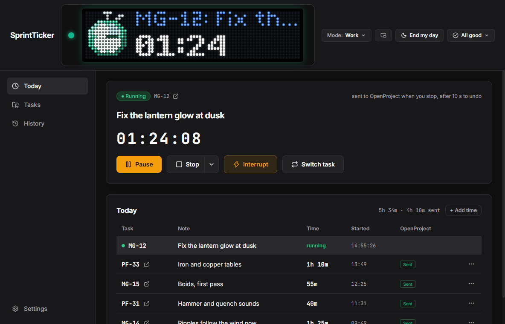</td>
    <td></td>
  </tr>
  <tr>
    <td>The four places; the bar's preview in the header.</td>
    <td>The same four places; everything that keeps time is still there.</td>
  </tr>
</table>

Everything that keeps time works without the hardware: the task picker, the
running timer, pausing, finishing, worklog sync, history, the ceremonies and
the end-of-day wrap-up. The window keeps its four places; what steps aside is
what only describes the bar -- the bar's preview in the header, and in
**Settings, Desk devices** the Windows notifications it mirrors and **What the
bar shows first**, which orders its screen and nothing else. Notifications
*from* OpenProject or Jira still arrive, as Windows notifications; their
settings are in **Settings, Account**. The Windows notification listener does
not run in this mode.

The app does not look for a bar in this mode, so it logs nothing about one being
unreachable.

  

To switch, use **Use without a bar** in **Settings, Desk devices**; the bar is
cleared and handed back to its own clock first. To add a bar later,
press **Add a BUSY Bar** in the same place: the address and token you had set
before are kept, and the bar's screens come back at once.

### ⏱️ The mini timer

A small window that stays above every other one and shows what the bar would:
the task key and title, the elapsed time, and a coloured edge -- green while
tracking, amber while paused, grey with nothing running. Beside them is the
icon of whatever holds the bar: the stopwatch for your session, an app's icon
during its notification, the burger at lunch, a coffee cup while you are away. Hover it for what the bar says. Open it with **Mini
Timer** in the header or **Show Mini Timer** in the tray menu.

  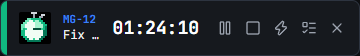

- ⏯️ **Pause** and **Resume** act on the session as Today does.
- ⏹️ **Stop** offers the three ways to end it, in place of the buttons:
  **Not done** logs the time and keeps the task open, **Done** also marks it
  done, and **Discard** throws the session away after a **Yes**. **×** keeps
  the session running.
- ⚡ **Interrupt** starts a timer at once, as Today's button does --
  see [Interrupt](#-interrupt-a-timer-at-once). During an interruption the
  row says which task waits, and offers ↩ **Back** to it, ⏹️ **Stop**, which
  ends the interruption alone, and ⚡ **Another**. Click an interruption's
  title to name it, and the link button to put it on a task.
- 📋 The **list** button brings the window forward with the task picker open:
  that is how you start or switch a task from it.
- ❓ **A question takes the row** until you answer it, with an amber edge:
  the stand-up (**Skip**, **Join**), **Back at your desk?** (**Not now**,
  **Worked through**, **▶ Resume**) and **Back to MG-12?** (**Not now**,
  **Back +time**, **↩ Back**), and, when nothing else is asked, a reminder
  -- see *Reminders ask once*, with the ceremonies. Answered anywhere, it
  goes everywhere.
- 🖱️ Drag it by any part that is not a button. It reopens where you left it; if
  that was on a monitor you have since unplugged, it comes back in the
  bottom-right corner of the main one.
- 🔁 It reopens at the next launch if it was open when you quit, and stays closed
  if you closed it.

It counts seconds, which the bar does not: on screen a second costs nothing.

---

## 🗂️ The window

Four places down the left: **Today**, **Tasks** and **History**, and
**Settings** at the bottom. They are the same with or without a bar. A ⚡
beside Today counts the interruptions you have not placed on a task yet.

Across the top, the header:

- 🟩 **The bar's preview**, with a bar: what the bar shows right now.
- 🔀 **Mode: Work ▾** switches between Work, Lunch and Away by hand. It is
  the mode the ceremonies and Windows' lock switch for you.
- ▭ **Mini timer** opens the mini timer, below.
- ☾ **End my day** opens the end-of-day wrap-up now.
- ✅ **The status entry** says in a word how things stand: **All good**,
  **2 waiting** (entries not yet sent to your provider), **Sending stopped**
  (your provider refused them), **Update**, or **Bar offline**; the worst
  wins. Click it for the details, **Try now** to send what waits, and **What
  you missed**: the last notifications the bar showed.

### ⚙️ Settings

Six groups, each one page, with a search box above them that finds a setting
by its name or by the name it used to have -- *sync queue*, *priority*,
*ceremonies*:

| Group | Holds |
| :--- | :--- |
| **General** | Start with Windows, the Interrupt shortcut, updates, **Set up again**, and **Show developer tools** |
| **Account** | your task provider, its credentials, the tasks to fetch, the transitions, provider notifications, and the entries waiting to send |
| **My workday** | working days, the stand-up, lunch, the end of day |
| **Desk devices** | the bar's status, task key color, connection, idle clock and use without a bar; with a bar, the Windows notifications it shows and what it shows first; the Stream Deck |
| **Data** | export the logs; erase everything on this computer |
| **Developer** | hidden until **Show developer tools**: the bar remote, the display debugger, test notifications, the listener's console, the bar's health |

The developer tools act on the real app -- Pause and Resume on your real
timer, Lunch and Away on your real mode -- and the page says so.

### ▶️ Today

The main screen. Start a task, and the bar shows it. With nothing running
the session card offers just **Start a task** and **Interrupt**. While a task
runs it says **Running** or **Paused**, when its time will be sent -- *sent
to Jira when you stop, after 10 s to undo* -- and offers, in one row:
**Pause** or **Resume**, **■ Stop ▾**, **⚡ Interrupt**, **Switch task**, and
**Previous task: PF-31**, which goes back to the task before in one press.

  

**Stop** is one click: the time is logged, and sent after ten seconds to
undo; the task stays open. The **▾** beside it holds the two other ends:
**✓ Done**, which also moves the task to its done state at your provider
(shown only where the provider can), and **Discard…**. Marking it done
celebrates on the bar -- a green badge drops in, ticks itself, and throws
confetti beside **DONE!** -- then returns to the session. It also fires your
configured completion transition — which in Jira usually means "To
Review", not "Closed", because you send work for review rather than closing it
yourself. Each project can send Done somewhere of its own -- workflows
differ -- under **Settings, Account** › *When I mark a task done*. Stopping
without marking it done shows **LOGGED** on the bar
instead: the time is kept and the task stays open.

☀️ **The morning card.** The first time you open Today on a working day,
before anything is timed, it starts with what yesterday left: **Carry on
with MG-12?** -- the last task you timed, still open and yours, with
**▶ Continue MG-12**; the interruptions from earlier days still to place,
with **Place them…**, which takes you to their list; the stand-up's time
while it is still to come; and your tasks in progress, each one press to
start, with **Pick another…** for the picker. It goes as soon as anything
starts -- here, on the bar or on the Stream Deck -- or when you put it
away with **×**, and does not come back that day.

📋 **Today's entries** are under the session card, newest first, one row
each: the task, its note, its time, when it started, and where it stands
with your provider -- **Sent**, **Sending**, **Waiting · overlaps PF-31**,
**Not sent**, or **Local only** for work never sent. **⋯** on a row holds
**Correct…**, **↳ Move…** and **Delete…**, as in History. ⚡ marks time
that started as an interruption and was placed on its task. The heading
counts the day -- *6h 05m · 5h 20m sent · 45m to place*: everything done
today, the session running included, what of it your provider has, and the
interruptions of today still to place. A long day shows its five newest
entries; **show all** shows the rest.

🔀 **A task that leaves your list while you track it** -- reassigned to someone
else, closed or moved on Jira or OpenProject -- keeps running, and your time
is logged as usual. The task you are timing is checked every minute, so a
card on Today says so within a minute -- *MG-12 was given to Rin Okada at
14:32* -- with **Keep timing on it**, **↳ Move my 1h 24m…**, which puts
the time so far on the task you pick and goes on timing there, and
**⇄ Switch task**. SprintTicker asks the provider why, and the panel and the
mini timer say so: **No longer assigned to you**, **Closed on the provider**,
or **No longer on the provider** when it was deleted or you can no longer see
it. Marking it done asks first, since your completion transition would move a
task that is no longer yours; on the bar, FINISH (or a long BACK) shows
**NOT YOURS / DONE? OK=YES**, and BACK refuses. A task already **closed**
there is the exception: marking it done asks nothing and moves nothing on the
provider. The task stays listed until the session ends, and leaves at the
next sync after that.

⏰ **A session left running** -- not stopped before the weekend, or overnight
-- is caught when you come back. If your last activity on the computer (or a
press on the bar) was on an earlier day, at least two hours ago, the session
is paused at that moment and nothing is logged. The window asks when you
stopped working on it -- without coming forward; a notification says so
while the window is hidden: at your last activity, at your end-of-day hour that
day, or at a time you pick, each with the time it would log. Then **Log and
stop**, **Log and restart it now** (asking first if the task is no longer
assigned to you), **Discard**, or **I was working all along**, which counts
the whole absence. Stopping it from the bar or the mini timer logs up to your
last activity; resuming it does not count the gap. Turn the question off in
**Settings, My workday**.

🌙 **Overtime is never interrupted.** As long as you are at the keyboard or
mouse, working past midnight is just a long session: nothing pauses it and
nothing asks. Only more than two hours without any input across midnight --
a long call -- brings the question, and **I was working all along** keeps it
all.

### 🔎 Finding a task: the picker

**Start a task**, **Switch task**, **Assign to a task…**, **Place…** and
**Move** all open the same picker. Type, and it searches every task of every
project at once -- key, title, description or project name -- grouped by
project. Before you type, it offers:

- **the previous task**, first, when you are switching: one click back;
- **Recent**, the last six tasks you timed;
- **Starred**, your usual places for time: hover a task and click its ☆;
- **Assigned to me · open**, your own tasks from every project, in progress
  first, then to do by priority -- **all N of my open tasks** lists them all;
- **All projects**, the ones you have starred tasks in first, then the ones
  you used most this month. Click one to see only its tasks.

A project's key and a space -- `pf ` -- also narrows the picker to that
project, and what you type next searches inside it: `pf 40` finds PF-40.
Backspace on an empty search, or the ✕ beside the project, takes it off.
Arrow keys and Enter pick from the keyboard; Escape closes.

- **A ticket made a minute ago** is not there until the next sync. Type its
  key -- `MG-77`, or a work package's number in OpenProject -- and the picker
  offers **Fetch MG-77 from Jira**: one request, about a second, and the task
  starts. **A ticket is missing? Refresh from Jira**, at the bottom, fetches
  everything again.
- **A task of my own…** starts work that stays in SprintTicker and is never
  sent; with something typed, it is named after it.
- **Switching away from an interruption**, the picker offers to put the
  interruption's time on the task you pick too. Unticked, the interruption
  waits to be placed.
- Placing and moving offer only real tasks: time goes to a task on your
  provider. Placing opens on **Starred**, since an interruption is most often
  about one of your usual places, and **Keep off Jira** is there too.

The picker shows the same tasks in the same order as Tasks and the bar's
picker, and follows the same **Unassigned** and **Teammates'** switches.

**From the tray, the mini timer and the Stream Deck, the picker opens as its
own small window**, in the middle of the screen your pointer is on, over
whatever you were doing -- the dashboard stays where it was. It is the same
picker: Start a task when nothing runs, Switch task while something does.
It closes after you pick, on Escape or ✕, and when you click elsewhere.

### ⌨️ Ctrl+K: everything by name

**Ctrl+K**, anywhere in the window, opens the command palette: type, and it
finds what the window can do now, every setting, and any task by key or
title. Arrow keys and Enter do the one selected; Escape closes.

- **Actions** are the ones your state allows -- Start a task… or Switch
  task…, Previous task, Pause or Resume, Stop, Interrupt, or Back, Stop and
  Another during an interruption -- then Place interruptions, End my day…,
  the mini timer and the places. The old words still find them: *sort* or
  *assign* finds Place, *finish* or *log* finds Stop.
- **Settings** come by name once you type -- *lunch*, *token*, *colour* --
  and open their group.
- **Tasks** start, or are switched to, as a pick in the picker does.

Done and Discard are not there: each asks first, on the session card.

### ⚡ Interrupt: a timer at once

Someone at your desk, a call: press **Interrupt** and a timer starts there
and then, with nothing to fill in. The task you were on **waits, paused**:
nothing is logged or sent for it, and its timer goes on from where it was
when you come back. Interrupt is on Today's session card, in the mini timer,
first in the tray menu, on the Stream Deck's Interrupt key, and on the bar:
pause the task, turn the wheel two notches left to **INTERRUPT**, and click.
And, if you turn it on, on a keyboard shortcut that works from any app --
see below.

While it runs, the session card says which task waits, and offers:

- ↩ **Back to MG-12** ends the interruption and resumes the task. A task
  that was already paused when you pressed Interrupt stays paused.
- ⏹️ **Stop** ends the interruption alone. The task still waits, paused,
  and SprintTicker asks **Back to your task?**, naming it: in the window,
  and on the bar as the task's key over **BACK? OK=YES**. **Resume it** goes
  back; **Resume, and count the time since as work** also puts the minutes
  between the Stop and now on the task; **Leave it** leaves it paused.
- ⚡ **Another**: someone else arrives before you got back. The interruption
  ends and the next starts, waiting on the same task. Marc, then Ana, then
  Marc again is three interruptions in a row and one **Back**.
- **Switch task…** ends the interruption and starts another task; the one
  that waited stops, its time logged. Tick *Put "…" on it too* in the
  picker, and the interruption's time goes on the task you pick as well.

The mini timer has the same: ↩, ⏹️ and ⚡. The tray menu has **Back to
MG-12**, **Stop the Interruption** and **Another Interruption**.

- **Lunch time during an interruption** asks first, on Today and the mini
  timer: *Start lunch? It ends "Call with Marc", which waits to be placed.*
  **Start lunch** ends it; the task that waited stays paused, now for lunch,
  and **Back at your desk?** offers it again when lunch ends. **Not now**
  keeps the call going, and lunch does not start again that day -- nor does
  it if you go **Back** to your task during lunch's hour. **Away** -- locking
  Windows -- leaves an interruption running: a call goes on away from the
  desk, and lunch asks when you are back.
- **The stand-up during an interruption**: its card says *Join? It ends
  "Call with Marc"*; Join ends it, and it waits to be placed.
- **The end-of-day wrap-up** ends an interruption and the task it held,
  without asking.
- **While it runs**, Today's session card asks three things, none of which
  stops the timer:
  - **What is it about?** -- type a name and press Enter; your provider
    shows it as the note with its time.
  - **Started now ▾** -- 2, 5 or 10 min ago, when you pressed late. Those
    minutes come off the task that waits, never before it started, so
    nothing counts twice.
  - **Which task is it for?** -- **Choose a task…**, and its time goes there
    when it ends, sent like any entry; **Later** takes the choice back, and
    it waits to be placed.

  The first time, a line says what happens to its time; **Got it** puts it
  away for good.
- **Name it** while it runs: in that field, or click its title in the mini
  timer, type, and press Enter (Escape keeps the name). It is
  called after the time it started, **Interruption 14:32**, until you do.

#### Interruptions to place

An interruption that ended is on no task yet, and **its time is sent
nowhere until you say where it goes**. The ⚡ count beside Today says how
many wait. **Today** and **History** list every one, whatever its day, under
**Interruptions to place · 3 · 45m**: what it interrupted (*during MG-12*),
where you started it (*from the Stream Deck*, *from the shortcut*, *from the
bar*), its place in its run (*2 of 3*), its time, and when it began -- in
History, click that to go to the day. The end-of-day wrap-up lists them too,
so you can place them while you remember what they were. For each:

- Click its name to give it one, or **⋯** › **Rename…**.
- **↳ Place…** puts its time on the task you pick: an entry, sent like any
  other, with ten seconds to undo.
- Tick some, and **↳ Place 2…** puts them all on one task.
- **Place all 3…** opens them all in one list, each with its own **Choose a
  task ▾**: your starred tasks first, then the recent ones, with the tasks
  you just chose above -- so a talk that came back is one click from its
  first part. Nothing is chosen until you click; **Keep off Jira** is in each
  menu too. An unnamed one asks what it was once you choose its task, since
  its name is the note the provider shows. **Place the N chosen** places
  those; the others stay to place.
- **⋯** › **Keep off Jira** -- your provider's name -- keeps its time in
  SprintTicker only, as ad-hoc work, never sent.
- **⋯** › **Discard** throws it away: its time is kept nowhere. Ten seconds
  to undo.
- Leave it there, and it waits for later.

Interruptions timed by an earlier version are listed the same way;
placing one moves its entry to the task.

🗑️ **Discard…**, in Stop's **▾**, is for a session started by mistake:
nothing is kept in your history and nothing is sent to your provider. It
asks once more, naming the time and the task, and Undo on the toast takes
it back for ten seconds.

| | |
| :---: | :---: |
| 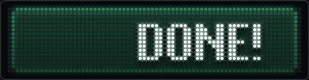 |  |
| ✅ Finished and marked done | 📝 Stopped: time logged, task still open |

### 📁 Tasks

Your cached projects and their tasks, refreshed from the provider. Create local
ad-hoc tasks here for work that has no ticket, or a project of your own: the
next sync leaves it alone, and time on its tasks stays on this machine like
ad-hoc time.

> [!NOTE]
> **Ad-hoc time stays on this machine.** It is in History like any other
> time, but it is never sent to your provider, which has no ticket to put it
> on. Finishing an ad-hoc task as done marks it done here only. The key the window shows is the one set in **Settings, Account**
> (`MISC-1` by default); the bar shows the task's name alone.

  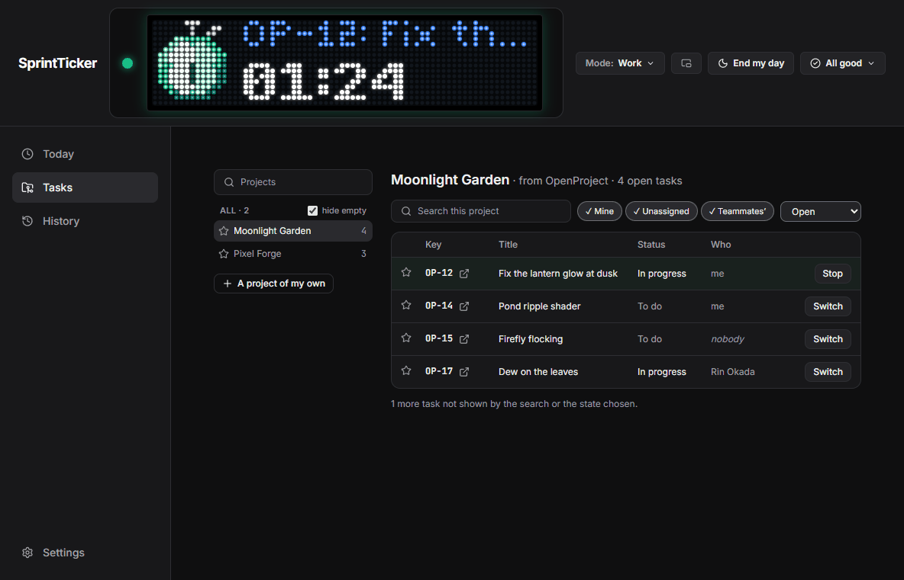

Each task has **Start**, or **Switch** while something runs -- the same as
picking it in the picker, so during an interruption it switches from the
interruption. The task being timed has **Stop**, one click as on Today:
the time is logged, the task stays open, and Undo takes it back for ten
seconds. Done and Discard are on Today's session card.

A task from Jira or OpenProject shows the start of its description under its
title, on one line. The task picker searches it too, so you can find a task by
what it is about.

🔎 **Only projects with tasks** -- the switch above the project list, on by
default -- hides every project with no open task. A provider lists every
project you can see, while the tasks it fetches are yours and the team's free
or ongoing work, so most projects held nothing to pick. A project is listed again as soon as it
has a task to do or in progress. The switch says how many projects it hides,
and turning it off lists them all. The bar's own picker follows it; the
window's task picker always lists only the projects with a task. The project you have
selected stays listed even when it is empty, so one you have just created does
not vanish before its first task. If no project has a task for you -- before
the first sync, or on a day nothing is assigned to you -- every project is
listed, and the switch says so: *none has a task: showing all*. Ad-hoc work
does not count for this, since an ad-hoc task stays in progress until you
finish it as done.

👥 **Unassigned and Teammates'** -- two switches above each task list --
decide whose tasks it shows besides yours, which are always there.
**Unassigned**, on by default, lists the open tasks nobody is assigned: work
free to take. **Teammates'**, off by default, lists a teammate's task while it
is in progress. A task that is not yours carries *Unassigned* or the
assignee's name beside its key, and the switches say how many tasks they hide.
They are one setting: the task picker, Tasks and the
bar's picker all follow it, and **Only projects with tasks** counts what they
show -- a project holding only unassigned work is listed while unassigned work
is. The task you are tracking stays listed whoever's it is. Every list keeps
one order: yours in progress, yours to do, unassigned to do, unassigned in
progress, teammates' in progress, then finished work -- yours, then
unassigned.

↗️ **Open a task on its provider** -- the small arrow beside a task's key in
Today, Tasks and History opens it in
your browser, on Jira or OpenProject, to comment, attach a picture or read
the thread. Ad-hoc work and projects made in SprintTicker have no page there,
so no arrow.

⏱️ **A glance moves nothing.** Starting a task moves it to In Progress, and
takes it if nobody has it, only once you have timed it for two minutes --
paused time does not count. Started to look at it and stopped or switched
within those two minutes, it stays where it was on Jira or OpenProject. The
wait, or none, is in **Settings, Account** › *When I start a task*, and so is
turning it off: then starting a task never moves or takes it.

🙋 **Starting an unassigned task assigns it to you**, without asking, two
minutes in, and then moves it to In Progress as for your own. If someone took it in the meantime,
it stays theirs -- SprintTicker never takes a task away from anyone -- but
your session runs and its time is logged: a Windows toast says *TEAM-2 is
taken*, the bar shows **TAKEN** and their name, and the panel and the mini
timer say **Assigned to** them. Marking it done then asks first, as for any
task that is not yours. If the assignment fails, a toast says the task *was
not assigned to you*; it is not retried, so assign it on the provider if it
should be yours. Starting a teammate's task in progress assigns nothing and
moves nothing.

The cache is what the app and the bar read. If it looks stale, **Sync now** in
**Settings, Account** refetches it, and **Try now** in the header's status
panel does too.

### 📊 History

One day at a time: ‹ and › step through the days, a click on the date picks
one, and **Today** comes back. At the top, what the day adds up to -- *7h 30m
· 6 tasks · 9 entries* -- and where its sends stand (*all sent but 1
correction*); under it each task's share, the most time first. Then every
entry in the order you worked it: its task, the note your provider shows,
its time, when it started, and where it stands there. ⋯ on a row corrects,
moves or deletes it. The arrow beside a task opens it on Jira or
OpenProject, as on Today and in Tasks. Interruptions still to place, of any
day, are listed above the day.

📅 **The week** (**Week**, beside **Day**): a timesheet of the week the day
falls in. Each project with its total, the largest open and the others a
click away; under it each task's time on each day. Then the **Day** row,
and **In Jira** (or OpenProject) -- *what your manager sees*: only what your
provider holds, so an entry held by an overlap, still sending or refused is
not in it, and a correction not answered yet still counts its old value.
A day that differs is amber and says why: *20m held*, *18m to place*,
*correction waiting*. The line under the sheet names each exception. Click
a day's total, or a task's time, to open that day. Weekends show when they
have time.

**Export CSV** saves the week as a spreadsheet where you choose: one row per
entry with its date, start and end in your local time, its length (also in
decimal hours), project, task, note, and whether it was sent.

✔️ **Check my week…** (beside Export CSV) lists everything in the week worth
a look, each with its fix:

- an interruption still to place -- **Place…** opens Place interruptions;
- a correction your provider has not answered, or an entry it refused --
  **Send now** sends again what was refused;
- a working day with untracked time in its working hours, or nothing logged
  at all -- **Open** that day, where a gap opens Add time;
- two entries that overlap -- **Fix…** opens their day; the later one is
  not sent until the overlap is fixed;
- in a week already closed, any entry added, corrected or deleted since it
  closed: what your manager saw has moved. With none, it says so.

There is no daily target to be "under": untracked time is what it shows
instead.

▨ **The day as a timeline.** Under the day's figures, a strip shows your
working hours -- from the stand-up to the wrap-up, as set in **Settings, My
workday** -- with each entry a block named by its task, ⚡ for time that began
as an interruption, and lunch. What no entry covers is hatched, and the strip
says how much: *6h 50m logged · 40m untracked in working hours*. A click on a
hatched stretch opens Add time at its start and length; a click on a block
corrects that entry. Nothing is guessed or logged from a gap -- it is only
shown. Stretches under five minutes are not, on today the rest of the day is
not missing yet, and a day off has no working hours, only its entries.

➕ **Add time you didn't time** with **+ Add time**, on any day here and on
Today: pick the task, say how long and when it started, and add a note --
it is what your provider shows. It opens on half an hour, ending now on
today and from 09:00 on another day. It is sent like any entry, after the
same ten seconds of Undo. Before you add it, it says when it would overlap
an entry -- *Overlaps PF-31, which starts at 08:45* -- and offers the one
change that clears it; added anyway, the later of the two waits. It says so
too for a week already closed. An entry ends on the day it starts: add the
time after midnight as another.

  

**A worklog never spans midnight.** Jira and OpenProject file a worklog under
the day it began, so a session from 23:00 to 01:00 is logged as two: an hour
on each day, each sent on its own. A session paused overnight and resumed in
the morning puts the morning on the morning's day. The finish dialog, and the
question about a session left running, say how the time will be filed before
it is. The timer still shows the whole session.

**A long pause starts a new worklog too**: 15 minutes or more by default,
set under **Working Days** in **Settings, My workday** (0 keeps one worklog per day). A
shorter pause is a gap inside one worklog. A piece too short for your
provider -- 30 seconds after midnight, on Jira -- is added to its neighbour
rather than lost.

**A worklog is written locally whether or not the remote accepted it.** If Jira
refused a 40-second session, the time is still in your history — it just is not
in Jira. Each entry says where it stands: **Sent**, **Sending**, **Not sent**,
**Local only** (ad-hoc work, or too short for your provider), or a correction
on its way.

  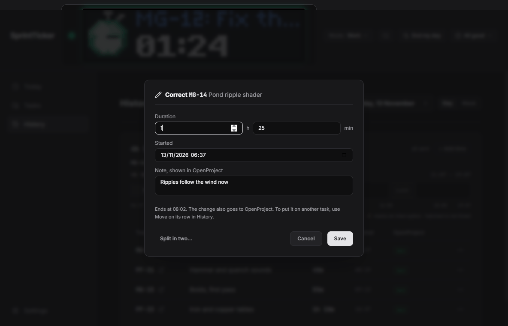

↩️ **Undo, for ten seconds.** Nothing you stop, discard, correct, move or
delete goes to Jira or OpenProject at once: for ten seconds a bar at the foot
of the window says what you did -- *Stopped MG-12 · 1h 05m* -- with **Undo**,
and the mini timer shows it too. Undo puts things back as they were: a
stopped session runs on with its time and pauses, a discarded one comes
back, a corrected, moved or deleted entry is as it was. A task you marked
done is not moved on the provider until the ten seconds are over. Starting
another task, or another action, makes the last one final. Quitting within
the ten seconds sends it at the next start.

⏸️ **Two entries that overlap are not both sent.** The same hour twice is
the error a timesheet reviewer finds first, so the later of two overlapping
entries says **Waiting · overlaps PF-31** and is not sent until you correct
one of them; then it goes. A correction that would make two entries overlap
says so before you save it. Entries already sent stay as they are.

✏️ **Correct or delete a worklog** with **Correct…** and **Delete…** in ⋯ on its row. A
correction changes the duration, the start or the comment. It applies here at once and
reaches Jira or OpenProject through the sync queue, so it survives a lost
connection or a restart; a worklog not sent yet is simply sent with the new
values. A deletion asks first, and deletes the entry at the provider too.
Worklogs sent by an earlier version are found at the provider by the
`[#xxxxxxxx]` tag at the end of their comment, so keep that tag if you edit the
comment in Jira.

✂️ **Split an entry in two** with **Split in two…** in Correct, for the time
you forgot to switch: slide to the moment you switched, by the minute, and
pick the task the rest goes to -- nothing is chosen for you. The first part
stays on its task and the rest becomes a new entry with the same note. Jira
or OpenProject gets the first entry shortened, then the second as a new one,
in that order, so it never holds the same minutes twice; a shortening it
refuses keeps the second from being sent. Undo is there for ten seconds, and
time in a closed week is warned about first. An entry under two minutes has
nothing to split.

⇄ **Move a worklog to another task** with **↳ Move…** in ⋯ on its row: pick the
task, and the time is on it at once here. At Jira or OpenProject the entry is
deleted where it was, then created on the new task -- in that order, so the
time is never on both, and for a moment may be on neither while the move goes
through. A worklog not sent yet simply goes to the new task. Neither task's
status changes. An interruption waiting in **Interruptions to place** is
placed rather than moved: see [Interrupt](#-interrupt-a-timer-at-once).

Each entry is named by its task's key and title. **Deleting a task or a project
does not delete the time logged against it**: the task leaves your lists and
stays in your history. The same happens when your provider stops listing a task
you worked on — reassigned, closed or moved — and if it lists it again, it
comes back.

An entry whose comment starts **"Recovered:"** is a session an earlier version
left running behind another one. Its end is where the next session began, the
latest it can have run, so check it before copying it to a timesheet; it is not
sent to your provider.

### 🔌 Settings: Account

Credentials, the completion transitions, and which tasks to fetch — assigned to
me, everything open, or your own query (JQL for Jira, a v3 filter array for
OpenProject). **When I start a task** says how long a task is timed before it
moves to In Progress and becomes yours -- right away, after one, two (the
default) or five minutes -- or turns that off; it is hidden for a provider
that can do neither. **When I mark a task done** is the completion
transition for all projects, and under it a list of your projects where any
one can go elsewhere: a Jira state or transition name, typed, or an
OpenProject status, chosen. A project left empty follows the choice for all.
A state its workflow lacks moves nothing, and the time is sent all the same.

  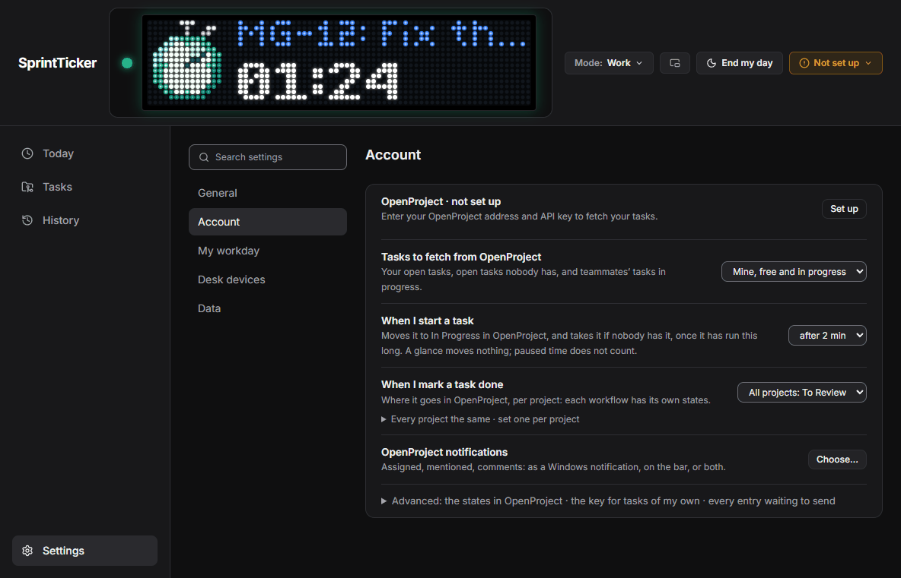

**Notifications from OpenProject** turns what happens on your work packages
into Windows notifications: assigned to you, a mention, a comment, a status
change, a date alert. Tick the ones you want. Clicking a notification opens the
work package in your browser. With a bar, they can go there too, as a banner
that competes for the display like any *Notification — Default*. The app
checks every minute by default (30 seconds to an hour); more than three at
once arrive as one summary. Only unread notifications that arrive after you
turn this on are shown -- what was already waiting in OpenProject is not
replayed -- and one you have read in OpenProject before the next check is not
shown either. **Send a test notification** shows what one looks like, and
says where it went.

**Notifications from Jira** does the same for Jira issues: assigned to you, a
status change, a comment, a mention in a comment. Clicking one opens the issue,
or the comment. Jira Cloud has no notification feed for apps to read, so
SprintTicker looks at the issues you are assigned, reported or watch at each
check, and works out what changed. That has edges worth knowing:

- 🙈 **Your own changes never notify you**, including the status changes
  SprintTicker makes for you when you start or finish a task.
- 👀 **A mention on an issue you do not follow is not seen**, and neither is a
  mention in a description rather than a comment.
- 📅 **Jira has no date alerts**, so that box is not offered.

Below the credentials, folded under **Entries waiting to send**, is every worklog that has not reached
the provider, with the server's own message, the attempt count against the
ceiling, and when the next attempt is due. When the provider refuses your saved
credentials, a Windows notification says **Sending time to Jira stopped** (or
OpenProject) -- once, even with provider notifications switched off. Your time
waits in the queue; saving the credentials again sends it.

The project and task lists refresh by themselves after every sync, every five
minutes, so a task added on the provider appears without changing views.

| Button | Does |
| :--- | :--- |
| 🔄 **Sync Now** | Fetches projects and tasks immediately |
| ♻️ **Retry Failed** | Un-parks rows that gave up — use after fixing what broke them |

> [!NOTE]
> **Why a row parks**
>
> A row goes `FAILED` when the failure is permanent: a deleted issue, a revoked
> key, a session too short for the provider to record. Retrying those on a timer
> would send byte-identical requests forever, so the app stops and tells you
> why. **Retry Failed** is for after you have fixed the cause.

### 📅 Settings: My workday

Working hours, and the three scheduled events:

  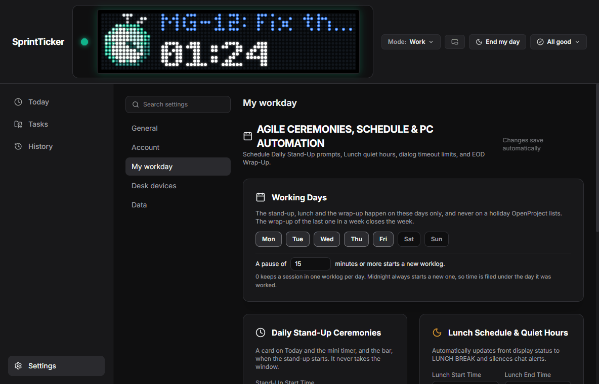

| | Default | Does |
| :--- | :--- | :--- |
| 🗣️ **Stand-up prompt** | 09:30 | A card on Today; **Join** switches your timer to Daily Standup |
| 🥪 **Lunch** | 12:30–13:30 | Switches to Lunch mode |
| 🌙 **End-of-day wrap-up** | 17:30 | Prompts to wrap up; can save open editors and schedule a shutdown |

Both prompts can be confirmed or dismissed **from the bar itself** — see the
hardware controls below.

🔕 **No prompt takes the window.** SprintTicker never comes up over what you
are typing. A question waits as a card at the top of **Today** and in the
mini timer's row until you answer it, and, while the window is hidden in the
tray or minimised, a Windows notification says so; clicking it opens the
window. The stand-up's card offers **Join**, **Skip today** and **Remind me in
10 min**, and stays until you choose. The end-of-day wrap-up opens in the
window without bringing it forward.

🔔 **Reminders ask once.** Between your stand-up time and your end of day, on
a working day and in Work mode, SprintTicker asks -- once each time, on Today,
in the mini timer, and by notification while the window is hidden:

| When | It asks | Answers |
| :--- | :--- | :--- |
| Nothing timing for 10 min | *Did you mean to stop?* | **Not now** · **▶ Start a task…** |
| A pause of 30 min | *Still paused?* | **Still paused** · **▶ Resume** |
| An interruption of 20 min | *Still on it?* | **Still on it** · **↩ Back to MG-12** (or **■ Stop**) |
| The stand-up at 25 min | *Still in it?* | **Still in it** · **End stand-up** |

The quiet answer is final for that time: the same pause is not asked about
again, the next one is. Resuming, going back or starting a task answers it
too. **Back to MG-12?** left unanswered for 10 minutes gets one more
notification. The delays are `prompt_delays` in the settings; Settings
will show them.

During Lunch the bar shows a sandwich building itself beside **LUNCH**, on
teal. In Away mode it shows a steaming coffee beside **AWAY**, on purple. At the
stand-up prompt it shows three people round a table taking turns to speak,
beside **MEETING**, on blue. Each loops
for as long as the mode lasts, and the bar plays it itself, so it keeps moving
when the computer is busy.

| | |
| :---: | :---: |
|  |  |
| 🥪 Lunch | ☕ Away |
| 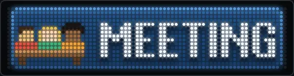 |  |
| 🗣️ Stand-up | 🌙 End of day |

🗣️ **Joining the stand-up switches your timer to it.** Press **Join** on
Today's card or in the mini timer, or OK on the bar's prompt: the task you are tracking stops, its time
logged, and a **Daily Standup** task starts -- one ad-hoc task, reused every
day, kept on this computer and never sent. Joined late? Pick **joined 2, 5,
10 or 15 min ago** beside Join: the stand-up starts then, and those minutes
come off the task before it. To have the stand-up sent to your provider,
choose its task in **Settings, My workday** -- *Timed on* › **Choose a
task…**; **Keep it here** goes back to Daily Standup. A chosen task that is
no longer in your lists falls back to Daily Standup. The bar then shows its timer, with three people at a table in place of
the stopwatch, taking turns to speak, so you can see the prompt has gone and
the meeting is being timed. Stop the stand-up (STOP, FINISH or DROP) and the task you were on starts
again, by the same rules as after lunch: once, that day, and only if you have
not started something else meanwhile, and never when the end-of-day wrap-up
is what stopped it. A task that left your list during the
meeting is asked about first: **Resume after the stand-up?** in the window,
**NOT YOURS / RESUME IT?** on the bar. **Leave it**, BACK, or leaving the
question alone keeps your task running.

🥪 **Lunch and Away pause the task you are tracking.** Neither is timed,
and nothing is sent at the start of the break: when you stop the task, its
time goes in as two worklogs either side of a break of 15 minutes or more
(*A pause of … minutes or more starts a new worklog*, in **My workday**), to the second. When
the break ends -- lunch's hour is over, or you unlock Windows -- Today and
the mini timer ask **Back at your desk?**, naming the task, and the bar shows
its key with **BACK? OK=YES**:

- **Resume KEY** starts timing again.
- **I worked through it** takes the break back as though you had never
  paused: the time counts as work, in one worklog.
- **Not now** leaves the task paused.

During the break, Today has a **Lunch until 13:30** or **Away** card saying
the task is paused and nothing is sent, with **Resume KEY** -- resuming
during lunch is working through it -- or, for Away, **Back: resume KEY**,
which also leaves Away.

The paused session is kept in the database: closing the app over lunch, or
leaving Windows locked until after it ends, does not lose it -- the question
comes when you are back, that day. Lunch never undoes what you do:

- **Working through lunch.** Start a task, resume a paused one or switch tasks
  during lunch -- in the window, the mini timer or on the bar -- and Lunch ends
  there and then. Nothing restarts when it would have ended, even if you stop
  your task before that, and Lunch does not start again that day.
- **The bar's picker works during lunch.** START or a click with nothing
  running opens it over the sandwich; BACK brings the sandwich back. Opened
  while Windows is locked, it waits under Away and shows as soon as you
  unlock, ahead of any notification that came in meanwhile.
- **A task that left your list over the break** -- reassigned, closed or
  moved -- is not restarted without asking. The window asks **Resume after
  lunch?**, and the bar shows **NOT YOURS / RESUME IT?**: OK resumes it, BACK
  leaves it. Starting another task answers no. Resuming it tracks your time
  and nothing else: the task stays out of your lists, is not moved to In
  Progress on the provider, and marking it done still asks first.
- **Locked when lunch begins.** The bar stays on Away; your task, paused
  when you locked, stays paused for lunch. Unlock during lunch and the bar
  goes straight to Lunch; unlock after it and **Back at your desk?** asks
  about your task.

Lunch must start and end on the same day, start first: **My workday**
says so and saves nothing until it does. A window across midnight never began.

📆 **The ceremonies happen on working days only.** **Working Days**, at the
top of **My workday**, picks them -- Monday to Friday until you change
it, and at least one. On any other day nothing is prompted and Lunch does not
start; your timer works as on any day, and what you track is logged as usual.
With OpenProject connected, the holidays your instance lists (its
*Non-working days*, under Administration) are days off too. They are read
once a day; if the instance cannot be reached, the weekdays you picked decide
alone, and a holiday already read stays one.

🗓️ **The wrap-up of the week's last working day closes the week.** Usually
that is Friday's; with Friday a holiday, or a four-day week, it is Thursday's.
A notice in the corner of the window then shows the week and the time logged
in it, a reminder to check it is all in before your timesheet is due. **Check
my week** opens that week in History with its check (above); either button
dismisses the notice, which
otherwise stays -- across a restart too -- until you do. Missed the wrap-up
(a day off you had not entered, the laptop shut)? The next working day closes
the week at its first check instead, and a week closes once, whatever happens.
A week you did not work at all closes without a notice.

**Time in a closed week asks first.** Closing a week locks nothing, but its
timesheet may be in by then, or approved. So moving a worklog of a closed week
asks before the task picker opens, and correcting or deleting one says so in
the dialog before you save -- a correction that moves the start into a closed
week too. A locked timesheet may refuse the change at Jira or OpenProject; the
sync queue then shows why.

### 🔔 Settings: Desk devices, Windows notifications

Which applications may reach the bar -- folded under **Desk devices**, with a
bar. **Nothing is mirrored until you allow it.**

  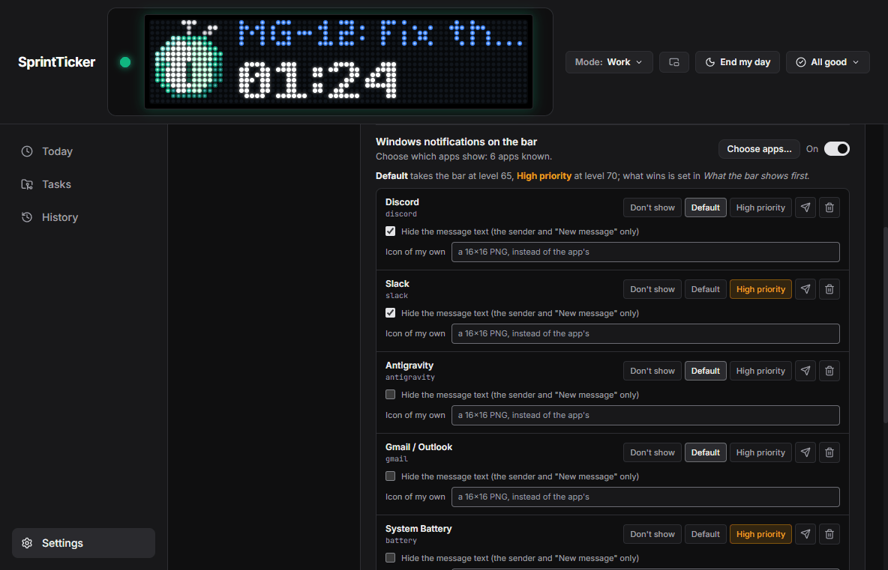
  

Per app, choose one of three:

| Setting | Effect |
| :--- | :--- |
| 🚫 **Don't Show** | Ignored entirely |
| 💬 **Default** | Claims the display at whatever *Notification — Default* scores |
| 🔔 **High Priority** | Claims it at whatever *Notification — High Priority* scores |

Note what that means: an app is assigned to a **class**, and **What the bar shows
first** decides what that class is worth and how it behaves during Lunch and Away.
Nothing here hardcodes which app wins. In the shipped defaults those two classes
score 65 and 70, and a few common apps arrive pre-classified — Slack and the
battery warning as High Priority, Discord, Gmail and Windows as Default — but
all of it is yours to change.

Each app's real icon is resolved from its MSIX manifest or Start Menu shortcut
and downscaled to 15×15. Windows itself says which shortcut belongs to which
app, so a shortcut named differently from its app — `PowerToys (Preview)`,
`Visual Studio Code` — still finds the right icon. An app with no shortcut is
matched by name, which is not perfect: if it shows the wrong icon, set an icon
override on that app. The first notification from an app after SprintTicker
starts shows the built-in icon while the real one is looked up; later ones
show the app's own.

**Sender only** mode shows that a message arrived without showing what it said.

Notification text is redacted from logs and the diagnostics export. Launch with
`--debug-notifications` to see it while troubleshooting.

### ⚡ Settings: Desk devices, What the bar shows first

What the display shows when several things want it -- folded under **Desk
devices**, with a bar. Every claim has a score;
the highest holds the bar. The arrows beside a claim move its level by 10 and
the list sorts itself again; type a level from 1 to 100 to place it exactly.

  

| Claim | Default |
| :--- | ---: |
| 🧳 Away mode | 100 |
| 🎛️ Bar task picker | 97 |
| 🥪 Lunch mode | 95 |
| 🌙 End-of-day wrap-up | 80 |
| 🥪 Resume after lunch question | 76 |
| 🗣️ Stand-up prompt | 75 |
| 🔔 Notification — High Priority | 70 |
| 💬 Notification — Default | 65 |
| ⏱️ Active task tracker | 45 |

Every row is editable, including what each does in each mode — **Display**,
**Suppress** or **Queue** for Work, Lunch and Away.

With the shipped ordering, notifications do not interrupt Lunch or Away. That is
the table working as configured, not a bug. Move the rows if you disagree.

### 🩺 Settings: Desk devices and General

**Desk devices** shows the bar's connection, battery and firmware as the bar
reports it. The animation debugger -- marquee speeds, particle effects, LED
colours and icon rasterisation, live, drawn through the real renderer -- and
**Display Health** are under **Developer**.

  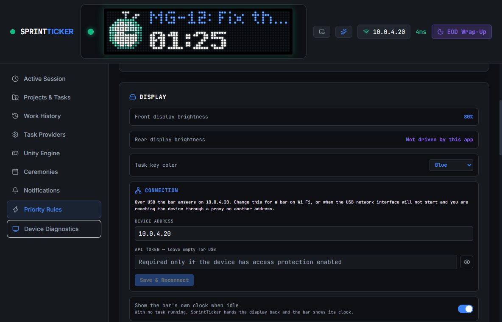

It also holds **Connection**, where you set the address the app dials and, if
your device needs one, an API token:

- 🌐 **Device address.** Defaults to `10.0.4.20`, which is where the bar answers
  over USB. Change it for a bar on Wi-Fi, or when you are reaching the device
  through a proxy on another address. An IPv4 address or a hostname — no
  `http://`, no port, no path.
- 🔑 **API token.** Leave empty for USB, where the bar accepts unauthenticated
  requests. Fill it in once the device has access protection enabled, which is
  the normal state over Wi-Fi; without it every request comes back 401 or 403.

**Save & Reconnect** applies both immediately — the app re-dials without a
restart. Watch the connection status at the top of the window to see whether the
new address answered; saving means the setting was stored, not that the bar
replied. **Reset to USB default** puts the address back to `10.0.4.20`.

🎨 **Task key color** sets the color of the task key on the bar's front
display -- blue, pink, amber or pale cyan -- and is kept across restarts.

🚀 **Start with Windows** starts SprintTicker when you sign in, in the tray,
with no window over whatever you open first. The tray icon, the bar and the
mini timer work as usual; open the window from the tray, or by starting
SprintTicker again. The same switch is in the tray menu, and Windows lists
the entry under *Settings → Apps → Startup*: turned off there, it reads off
here too. The portable build registers the file you ran, so move it and
switch it on again from the new place. A build run from source
(`pnpm dev`) shows the switch greyed out.

⌨️ **Interrupt shortcut** starts an
[interruption](#-interrupt-a-timer-at-once) from any app, with the window
closed. It is off until you tick **Use the shortcut**. The suggested chord
is **Ctrl+Alt+Shift+I**; **Change** records another -- press it, then the
keys, or Escape to keep the old one. A chord needs Ctrl, Alt or Win: Shift
alone only types capitals. Avoid Ctrl+Alt without Shift on AZERTY and
other layouts where it is AltGr, or the shortcut takes a character you type
-- the card says so.
- **"Not active: another app holds it"** means Windows gave that chord to
  another app first. Choose another; SprintTicker tries yours again at its
  next start.
- **Nothing happens in an app run as administrator.** Windows does not pass
  a shortcut to SprintTicker while such a window has the focus.
- **With the window hidden, no bar and no mini timer**, a Windows
  notification says the interruption started and which task waits paused
  -- otherwise nothing would show that the timer changed. Pressed during
  an interruption, the shortcut is **Another**.

---

## 💡 The bar itself

### 🖼️ What it shows

A 72×16 RGB matrix: a 16px icon on the left, then two rows of text, both in
proportional fonts drawn for SprintTicker. Row 0 holds roughly twelve characters
of mixed case in its 55px field. Row 1 uses a narrower face and holds about
fourteen.
Text that does not fit ends in `…`. Accented letters are shown without their
accents, since the display draws plain ASCII only.

The small screen on the back belongs to the bar itself: it shows a copy of the
front at twice the size, and its own clock and date when the front is empty.
SprintTicker draws nothing there.

Every screen, as the bar shows it:

| Screen | What it means |
| :---: | :--- |
| 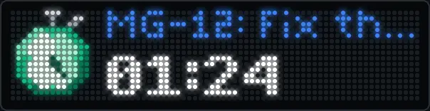 | ⏱️ **Tracking.** The task on row 0, its time in large digits on row 1. The stopwatch's hand ticks round. |
|  | ⏸️ **Paused.** The key and its time; turn the wheel to **INTERRUPT**, **STOP**, **FINISH** or **DROP**, click to confirm. DROP asks first. |
| 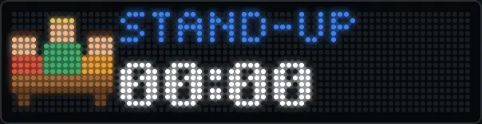 | 🗣️ **Stand-up.** Joined from its prompt: the stand-up's own timer, with three people at a table taking turns to speak in place of the stopwatch. An ad-hoc task shows its name alone, never its shared key. |
| 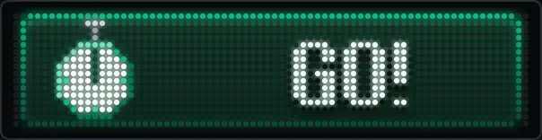 | 🏃 **GO!** A task picked on the bar itself, for two seconds. |
|  | 📝 **LOGGED.** Stopped: the time is kept, the task stays open. |
|  | ✅ **DONE!** Finished and marked done. |
|  | 🔔 **Notification**, from an app you allowed, with its own icon. |

The session screen's icon is a stopwatch whose colour says where you are: green
while a task runs, its hand ticking round once a second; amber with blinking
pause bars while it is paused; dim grey when nothing runs (the screen then
reads **Ready / No task running**). While a task runs, row 0 shows the task and
row 1 its time, in large digits. While paused, row 0 shows the task key and its time, and row
1 offers **INTERRUPT**, **STOP**, **FINISH** and **DROP**; the wheel moves
one choice per notch and stops at either end, and a click confirms. The menu
opens on FINISH. Row 1 has room for two of them, so it shows STOP and FINISH
with a small arrow each side, FINISH and DROP once you turn right, and
INTERRUPT alone once you turn left past STOP. INTERRUPT starts an
[interruption](#-interrupt-a-timer-at-once). DROP discards the session, so it asks first:
**DISCARD?** in red, **OK=YES BACK=NO**. A click throws the session away --
no worklog, nothing sent, no scene -- and BACK, short or long, brings the menu
back; the other buttons wait for the answer. Picking
a task from the bar's own picker shows **GO!** for two seconds, the stopwatch
setting off, before the tracking screen. STOP logs the time and leaves the task open, and the bar shows
**LOGGED** for three seconds, the stopwatch's hand sweeping back to twelve;
FINISH also marks it done, and shows **DONE!**.

> [!NOTE]
> **Why the timer shows HH:MM**
>
> Every frame is an asset upload plus a draw — two HTTP requests. A per-second
> redraw would mean an upload a second for a digit nobody reads, so the tracker
> deliberately shows minutes. The stopwatch's ticking hand is the bar's own
> animation: it shows that the clock is running, and is not the seconds of your
> session.

### 🎞️ Animated icons

The icons move. A notification without an app logo rings its bell, the
end-of-day prompt's alarm clock rings, and the lunch prompt's burger hops. An
OpenProject notification passes a shine across the OpenProject logo; other
apps' logos stay still. The bar animates them itself. If one ever shows still,
the log's `[IconAnimator]` lines say why, and the screen is otherwise
unaffected.

| | |
| :---: | :---: |
| 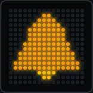 | 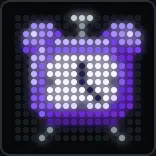 |
| notification | end of day |

### 🎛️ Controls

| Control | Does |
| :--- | :--- |
| ▶️ **START** press | Start or pause. With nothing running, opens the task picker |
| 🔄 **Wheel** turn | Scroll |
| 🖱️ **Wheel** click | Open the task picker |
| ↩️ **BACK** short press | Dismiss the current notification |
| ⏹️ **BACK** long press | Complete the active task and log the time |

All of these are rebindable.

🗂️ **The task picker** is two stages: turn to choose a project, click to descend
into it, turn to choose a task, click to start. **BACK** leaves at any point.
A blue folder means you are choosing a project, a checklist a task. The
checklist also gives the task's status: grey for to do, amber for in progress,
green for done, and a done task's name is dimmed. Tasks come in the window's
order -- yours in progress, yours to do, unassigned work, teammates' work in
progress, finished work last -- and within each the most urgent first, by the
priority set in Jira or OpenProject. Projects and tasks follow the **Only
projects with tasks**, **Unassigned** and **Teammates'** switches of
Tasks. The second row shows the task key, then whose the task
is when it is not yours -- `free` for nobody's, `@Alice` for a teammate's --
followed by as much of its description as fits, and on
its right where you are in the list -- `3/12` --
with a thin line along the bottom whose bright segment slides from left to
right as you scroll: at the far left there is nothing before, at the far right
nothing after.

🗣️ **During a ceremony prompt**, START confirms and BACK dismisses. The end-of-day
wrap-up asks twice — the first START is "yes", the second confirms — because it
can shut your machine down. Once it is done, the bar says **SEE YOU!** for five
seconds, a moon rising and the stars coming out, and then goes idle.

The bar's buttons answer the wrap-up only while the bar shows its prompt. The
**End my day** button in the header puts the prompt on the bar too. If
something ranked above the wrap-up holds the bar -- Lunch, in the shipped
ordering -- the buttons keep doing what that screen says, and the wrap-up is
confirmed in the window.

---

## 🎹 A Stream Deck

SprintTicker has a plugin for Elgato's Stream Deck app (7.1 or later). It
works beside the bar or without one, and leaves the rest of your deck alone.
Releases carry it beside the installer, from 1.3.0 on, as
`SprintTicker-StreamDeck-<version>.streamDeckPlugin`: double-click it. Its
version is its own, not the app's. Before that release, build it from the
source with `pnpm deck:pack` and double-click the `.streamDeckPlugin` file
that lands in `packages/streamdeck-plugin/dist/`. It has been tried on Stream
Deck Mobile, not yet on a physical deck.

Its five actions are listed under **SprintTicker** in the Stream Deck app --
one key to spare on a Stream Deck Mini. Drag each onto any key, as many times
as you like:

| Action | The key shows | A press |
| :--- | :--- | :--- |
| **Session** | the task, its time and the bar's icon, moving as it does on the bar -- a notification's own icon while its banner holds the bar -- under a band: green while tracking, amber while paused | pauses or resumes; with nothing running, opens the task picker. **Held** half a second, it opens the task picker whatever runs |
| **Interrupt** | INTERRUPT | starts a timer at once, whatever runs -- see [Interrupt](#-interrupt-a-timer-at-once) |
| **Answer A** | DONE -- or the yes to a question waiting: JOIN, WRAP UP, RESUME | ends the session and marks the task done; or says yes |
| **Answer B** | NOT DONE -- or the no: SKIP, NOT NOW, LEAVE IT | ends the session and logs its time, the task left open; or says no |
| **Answer C** | DISCARD, always | throws the session away, nothing logged |

- **A and B follow the question.** When SprintTicker asks something -- the
  stand-up, the wrap-up, back to your task? -- A and B turn into its yes and
  no, filled green and red, and go back to DONE and NOT DONE once it is
  answered. A press in the moment they change only flashes the key, so a
  question arriving as you press DONE is not answered by mistake. C never
  changes: the one key that throws work away stays where it is.
- **Laid out your deck before 0.5.0?** The keys you placed -- Not done,
  Done, Discard, Yes, No -- keep working; they are only gone from the list.

- **A key's colour says what it does.** A coloured glyph can be pressed; a
  grey key has nothing to do; a key filled with colour is waiting on you --
  a question, or a second press.
- **Discard asks first, on the same key.** It fills red, **DISCARD?**; press
  it again within four seconds to go ahead. Done does the same, filled amber,
  **NOT YOURS**, when the task is no longer yours. Waiting, or another task
  starting, takes the question back.
- **Keys move a little when something happens.** Done's check draws itself,
  Discard's bin lifts its lid, Not done's square presses in and Interrupt's
  bolt strikes when you press them; the yes and the no draw their mark when
  a question arrives. Half a second, then they rest.
- **Yes and no are two keys**, and neither changes meaning with how long you
  hold it. Session is the one key with a long press: held, it opens the task
  picker in its own small window, in front of the app you are in -- to
  switch tasks without ending the one running. The wrap-up asks
  twice, as on the bar: yes, then **CONFIRM**.
- **offline under every key** means the plugin cannot reach SprintTicker:
  start it, and the keys come back by themselves within ten seconds. **update
  app** means SprintTicker and the plugin are of different versions -- update
  whichever is older.

---

## 🩺 Troubleshooting

Click a problem to unfold its answer.

📭 <b>The task list is empty</b>

 Check **Settings, Account** for a saved domain and key.
Press **Sync Now**; if it stays empty, the credentials are probably wrong — the
app deliberately does not invent tasks. A provider error is shown rather than
swallowed.

🔑 <b>Jira says <code>Checking the Jira credentials failed: HTTP 401</code></b>

 Jira no longer
accepts the API token. Atlassian tokens carry an expiry date chosen when they
are created, so a token that worked last month can simply have run out. Create
a new one at id.atlassian.com › Security › API tokens and paste it into Task
Providers. Your projects and tasks stay as they were in the meantime, and the
next sync brings them up to date.

🔀 <b>The task I am tracking says "No longer assigned to you", "Assigned to …" or "Closed on the provider"</b>

 Since you started it, the task
left what your provider lists for you: reassigned to someone else, closed, or
moved to a project you are not in. Nothing is lost: the session keeps running
and its time is logged when you stop. The task stays in your lists until then.
Marking it done asks first, because your completion transition would move a
task that is no longer yours. If the provider refuses the time -- some Jira
setups forbid logging on someone else's issue -- the row appears under **Entries
waiting to send** with Jira's own message.

📤 <b>A worklog never reached Jira or OpenProject</b>

 Open **Entries waiting to send** in **Settings, Account**. The
row carries the server's own message. Common causes:

- *`404` — the issue no longer exists.* Nothing to do; the local worklog stands.
- *`400` — under a minute.* Jira records time to the minute; anything shorter
  rounds to zero and is refused. The time is in your local history.
- *`401`/`403` — the key was revoked.* Enter a new one; saving credentials
  automatically un-parks rows the old key stranded.

✏️ <b>A correction never reached Jira or OpenProject</b>

 The worklog says **Correction failed**,
and **Entries waiting to send** lists a *Correction* row with the reason.

- *Not found in Jira (or OpenProject).* The entry was deleted there, or its
  comment lost the `[#xxxxxxxx]` tag that identifies it. Correct it there by
  hand; the worklog here already has the new values.
- *Under a minute.* Jira records time to the minute, so a correction to a
  shorter duration is refused before it is sent.
- *`401`/`403`.* As for any worklog: enter a new key, and the row is retried.

A **Correction pending** that stays put is waiting for the worklog's own send
to arrive first: a correction never overtakes it.

🔕 <b>Notifications never appear on the bar</b>

 Three things to check, in order: the
app is set to something other than *Don't Show*; the notification listener is
running (**Settings, Developer** reports its status — **its failures are otherwise
silent**); and nothing higher-priority holds the display, Lunch and Away being
the usual culprits.

🔌 <b>The bar never connects</b>

 The header shows *Disconnected* and Device
Diagnostics reports no firmware or battery. The bar reaches the app as a **USB
network device on `10.0.4.20`**, so the question is whether that device exists
at all:

1. Open <http://10.0.4.20> in a browser. If the bar's own web UI loads, the link
   is fine and the problem is in the app — export the logs from Device
   Diagnostics and read the `[BusyBarDriver]` lines.
2. If the browser times out, run `ipconfig` (Windows) and look for an adapter
   holding a `10.0.4.x` address. **No such adapter means the bar is not
   enumerating**, and nothing in software can reach it.
3. Reseat the cable, and make sure it is a **data** cable rather than
   charge-only — a charge-only cable powers the bar, so its lights come on and
   it looks healthy while presenting no network device at all. Try a port
   directly on the machine rather than through a hub, and confirm the bar is
   awake.
4. On Windows, open Device Manager and look under **Network adapters** for
   *Flipper FZCO Network Interface*. A yellow warning triangle with **Code 10 —
   "This device cannot start"** means the bar is enumerating correctly and
   Windows' own USB network driver is refusing to bring the interface up. See
   the note below; this is not something the app can fix.

> [!WARNING]
> **Code 10 on the Flipper network interface is a Windows driver fault, not a
> bar fault or an app fault.**
> It has been reproduced on Windows 11 25H2 with an Intel 700-series USB
> controller, where the composite device enumerates cleanly, every descriptor
> reads back, and the network child still fails to start. The same bar works on
> another computer. Reinstalling the driver, switching to the alternate inbox
> NCM driver, `DISM`/`sfc`, clearing the USB descriptor cache and disabling
> selective suspend all change nothing.
>
> An **in-place repair upgrade** of Windows is the obvious next move, and on
> this machine it did not help: the upgrade completed, the driver store was
> rebuilt, Windows selected the same `usbncm.inf`, and the interface still came
> up with Code 10. Try it if you like, but do not count on it.
>
> **What does work is not using the Windows driver at all** — pass the USB
> device through to another network stack. WSL2 with `usbipd-win` brings the
> adapter up without complaint under its own `cdc_ncm` driver; proxy the bar
> back to a local address from there.
>
> Then **put that address in Settings › Device → Connection**. That is what the
> setting is for: the bar is reachable at, say, `10.0.4.21`, and the app needs
> to be told.
>
> One thing to watch if you go this route: a `usbipd` binding, and any watcher
> script that re-attaches the device on plug-in, will claim the bar before
> Windows can try. If you ever want to re-test the native driver, disable the
> watcher and `usbipd unbind` the device first, or you are only testing the
> passthrough.

> [!NOTE]
> **Export the logs; they now say what went wrong.** The driver records the
> reason it could not reach the device — `timed out after 2000ms`,
> `ECONNREFUSED`, and so on — and logs the moment a connection is lost or comes
> back. Earlier builds failed silently, so a diagnostics export sent in to ask
> "why won't it connect" contained no evidence of the failure anywhere.

🎞️ <b>An animation plays in the app but not on the bar</b>

 Fixed as of this
release, and worth knowing why, because the symptom is confusing: the preview
and the bar are fed by two different paths. The on-screen emulator draws every
frame locally, while the bar is handed the whole animation file and plays it
itself, so the preview kept animating while the bar showed nothing. Two causes,
both addressed — a refused upload that went unreported, and the app drawing its
own blank frame on top of the animation it had just started. If you still see
it, export the logs from **Settings, Data** and look for `[AnimationPlayer]`
lines naming the file and its size.

⬆️ <b>Updating the bar's firmware</b>

 Firmware 1.3 changed how the bar
stores animations, and reads only its own files: a bar on 1.3 shown a file made
for 1.2 draws a small error icon where the animation should be, without
reporting anything wrong. SprintTicker 1.4.0 and later carry every animation
in both forms and read the bar's version to pick one, so update the app first,
then the bar.

After the update the bar restarts. SprintTicker notices the new version when
the bar answers again and sends its animations once more in the new form. If
the bar ever reports a version the app cannot read, the app sends no animation
files at all: scenes play from the app frame by frame, and icons stay still.
**Settings, Desk devices** shows the version the bar reported.

SprintTicker 1.3.0 or older, on a bar updated to 1.3, shows that error icon in place
of every animated icon and scene. Updating the app fixes it.

🧊 <b>The bar freezes and stops answering</b>

 The panel stops changing, the app
reports the bar disconnected, and sometimes the bar restarts on its own about
45 seconds later. On firmware 1.2.4 this is what happens when the display is
cleared a few times while a picture and an animation are both on it. Earlier
builds did exactly that each time Lunch, Away or a meeting began from a screen
with an animated icon. 1.2.0 switched scenes without clearing; it still hung
the bar during long Unity sessions, because the end of a compile cleared the
display two or three times at once. 1.2.1 fixed that. (Unity support itself
was removed later.)

Firmware 1.2.4 also freezes, now and then, when an animation is removed from
the panel while it plays -- an animated icon as its screen ends, for
instance. The panel then stays on that icon, still moving, and the bar stops
answering. Nothing warns of this one. 1.2.1 never removes a playing
animation: it replaces it with an empty one, and returns to the clock by
taking the picture down first, which is the half second of black you may see
before the clock.

If the bar does freeze, unplug and replug it, then
export the logs from **Settings, Data**: the lines just before the freeze say
what the app was drawing. For the first kind of freeze, uploads taking several
hundred milliseconds, rather than about fifty, are the warning sign, and
**Settings, Developer** shows them under **Display Health**: the median upload
time, turning red with a warning when it reaches that level, and how many
times the screen closed in the last hour. If you see the warning, export the
logs before restarting the bar; the bundle then holds the run-up to the
freeze. Once the bar is back, the app redraws the current screen by itself.

🕰️ <b>The bar shows something stale</b>

 Something is holding the display lock at a
higher priority. Check **What the bar shows first** and the mode in the header. After the bar
restarts or its connection drops, the app redraws the current screen within a
few seconds of the bar answering again; before 1.2.1 it could put back the
screen from before the outage.

🛡️ <b>Windows warns on first launch</b>

 The build is unsigned. *More info → Run
anyway*. There is no way around it short of a code-signing certificate.

🔤 <b>Accented characters</b>

 These are transliterated to ASCII (`é` → `e`), because
the device accepts printable ASCII only. Emoji do not render.

### 📭 No notification from OpenProject or Jira

- **Is it switched on, for that kind?** **Settings, Account** › Notifications from
  OpenProject (or Jira). **Send a test notification**: if it says it was sent and nothing
  appeared, the cause is on the Windows side.
- **Windows may be holding it.** Do Not Disturb, Focus, or SprintTicker turned
  off in Windows Settings › System › Notifications all hide toasts without
  telling the app. They still land in the notification centre.
- **It may have been read already.** Only unread OpenProject notifications are
  shown; one read in OpenProject between two checks is not news.
- **On Jira, is it an issue you follow?** Only issues you are assigned,
  reported or watch are read, and nothing you changed yourself is reported.
- **The log says why a check failed** -- `[ProviderEvents] OpenProject events
  unavailable: ...`, or `Jira events` -- and a refused toast as
  `[Toasts] Windows did not show a notification`.

---

## 🔐 Your data

One SQLite file: `%APPDATA%\SprintTicker\sprintticker.db`. Installing over a
previous version does not touch it.

Provider credentials are encrypted at rest with Windows' own keystore. If it is
unavailable, the app says so rather than failing silently; if the file is read
by a different Windows account, the key reads back as "not configured" and you
are asked to re-enter rather than shown a crash.

> [!NOTE]
> **No telemetry, no account, no server**
>
> The one outbound request is a daily update check against GitHub, which sends
> nothing about you and can be turned off in **Settings, General** — turning it off
> stops the request being made, rather than hiding its result.
